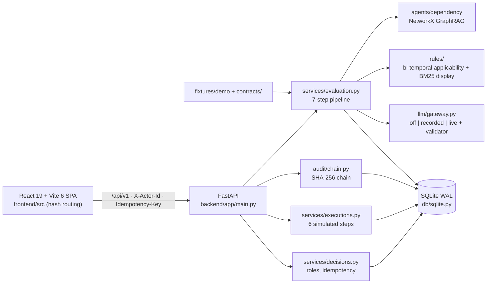

# AegisShield AI — Handoff / Current Status

| | |
|---|---|
| **Snapshot date** | 2026-11-02 (= **D8**, M5 rehearsal day) |
| **Branch / HEAD** | Baseline `main` @ `9778612`. Phase A fixes are on branch **`fix/handoff-p1`** (PR to `main` pending your merge) |
| **Next hard gates** | **G1 Demo Freeze: Tue 03 Nov 2026 18:00** (`docs/00-source-of-truth.md:630`) · Finale 04 Nov (`docs/decisions/OD-05-06-research.md:102`) |
| **One-line verdict** | Phase A (2026-11-02) closes the unauthenticated-reset, Vercel, pyproject, F-31, F-15, F-09/F-10-contract, `.env.example` and doc-drift findings on `fix/handoff-p1`, with the full gate green (§5). Most remaining work is **human-gated demo readiness**: rehearsals, the offline drill on the demo laptop, the backup video, and OD-04/06/07. Code P1s F-06 and F-13a are deferred to Phase B. |

Evidence convention: `path:line` means verified in the current tree. `[INFERENCE]` means not directly observed.

---

## 1. Project summary

AegisShield AI is a supply-chain recovery **preflight** engine built for **SAP Hackfest Bengaluru 2026** (`README.md:1-6`, `docs/00-source-of-truth.md:38-42`). When a disruption delays components, ordinary optimizers propose alternate suppliers or routes on cost and lead time alone. AegisShield runs deterministic checks on each candidate plan before a human acts on it:

- **GraphRAG supplier dependency:** checks whether an "alternate" supplier secretly depends on the same disrupted fab further upstream (tier 2 or 3).
- **Trade compliance / LC preflight:** checks whether a reroute breaks LC clauses (UCP 600 43T transhipment, 47A) or FTA direct-consignment rules, using a bi-temporal rule engine.
- It also covers **inventory rebalancing** (ATP), **honest financials** (recovery cost vs residual loss vs contingent exposure), **human-in-the-loop approvals**, **simulated SAP execution**, and a **SHA-256 hash-chained audit trail** with a verify endpoint.

**Demo scenario** `SCN-DEMO-001` (all data synthetic, `README.md:5-6`):
- A fire at Zenith Wafer Fab delays PO-7001, putting ₹11,60,000 of baseline penalty loss at risk across SO-1001, SO-1002 and SO-1003.
- Plan **P1** (naive cost/time) looks best on paper at ₹8,26,000 but is **BLOCKED**: SUP-B depends on Zenith (`Chonburi ← Kedah ← Zenith`), and the Singapore transhipment violates LC-SYN-0117 clauses 43T/47A.
- Plan **P2** (AegisShield-verified: SUP-C direct from HCMC to Chennai, plus Bengaluru stock) **PASSES** with ₹6,18,000 net avoided loss.
- Priya approves P2, six simulated execution steps run, and the audit chain verifies.

Demo actors in code and contract: `USR-PRIYA` (supply planner, approves/executes), `USR-ARJUN` (trade compliance, LC amendments), `USR-VIEW` (guest viewer, read-only) (`fixtures/demo/policies.json:43-45`, `contracts/openapi.yaml:493`). The only actor ID hardcoded in the frontend is the default, `USR-PRIYA` (`frontend/src/App.tsx:116`). A "VP Supply Chain" escalation persona appears only in the narrative docs (`docs/01-research-and-deck.md` §6) and has no actor ID.

## 2. Architecture & stack



**Backend** (`backend/app/`):
- FastAPI + Uvicorn, Pydantic v2, NetworkX, jsonschema, PyYAML, httpx.
- SQLite in WAL mode with 10 tables, including `audit_events`, `idempotency` and `lc_versions` (`backend/app/db/sqlite.py`).
- Lifespan startup seeds LC v1 and a genesis audit event (`main.py:57-102`).
- Errors are RFC 7807 problem responses (`api/problems.py`).
- Serves `frontend/dist` at `/` when present (`main.py:701-704`), so deploys can be single-origin.

Key components:
- **GraphRAG** (`agents/dependency/{graph,linearize,check,view,explain}.py`): DiGraph traversal that is cycle-safe (F-01, fixed in `9364573`), focused graph views, and citation-grounded explanations.
- **Temporal rules** (`rules/applicability.py`): evaluates transaction time (`applicable_on`) and knowledge time (`known_as_of`). Authority precedence is gazette > circular > internal > secondary. BM25 ranking (`rules/passages.py`) is for display only and never affects selection.
- **LLM** (`llm/gateway.py`): three modes.
  - `off` (default): templates only.
  - `recorded`: hash-addressed cassettes in `fixtures/llm/recorded/`.
  - `live`: OpenAI-compatible API, 8 s timeout, 1 retry, degrades to templates on failure.
  - `llm/validate.py` rejects unknown citations, outcome contradictions, numbers not in context, and over-length output. There are 4 prompts in `llm/prompts/`.

**Frontend** (`frontend/`):
- React 19.1, Vite 6.4, TypeScript 5.8, Lucide icons; tests use Playwright + axe.
- Hash routing (`src/app/navigation.ts`). Six screens in `src/components/screens/`: CommandCenter, EvaluationProgress, Evaluations, Execution, SupplyGraph, AuditTrail. State is local only.
- The API client (`src/api/client.ts`) has two modes, set via `VITE_API_MODE` / `VITE_API_BASE_URL`: `stub` (default, reads `/stubs/*.json`) and `live`.
- The frontend uses SAP Fiori design with UI5 Web Components (PR #22). The component wrappers in `frontend/src/components/ui/` (`NeuButton`, `NeuInput`, `NeuChip`, etc.) wrap official UI5 elements.

**Contracts** (`contracts/`): OpenAPI 3.1 (`openapi.yaml`, 17 operations) plus JSON Schemas at v1.1.1. `tools/check_contracts.py` and `tools/aegis_oracle.py` (an independent oracle) gate the fixtures and goldens.

**Deploy targets**

| Target | Config | Status |
|---|---|---|
| SAP BTP Cloud Foundry | `ops/btp/manifest.yml`, `ops/btp/README.md` | Live-verified 2026-10-23 (`docs/decisions/decision-sheet.md:15`). Uses the Python buildpack only, so **`frontend/dist` must be built before `cf push`** (`.cfignore:5`). SQLite lives in `/tmp` and is lost on restart. |
| Docker | `Dockerfile` (node:20-slim → python:3.12-slim) | Builds the UI with `VITE_API_MODE=live VITE_API_BASE_URL=/` via `npx vite build`, which skips `tsc -b` (`Dockerfile:8`). Serves UI and API on `${PORT:-8000}`. Smoke-tested by the CI `container` job. |
| Render | `render.yaml` (docker runtime, free plan) | Documented in `ops/render-free-runbook.md` (UptimeRobot keep-alive). See F-31 in §7. |
| Vercel | `vercel.json`, `pyproject.toml` `[tool.vercel]` | **Not working and not documented.** See §7 P1. |

## 3. Repository map

| Path | Purpose |
|---|---|
| `backend/` | FastAPI app (`app/`), unit/eval tests (`tests/`, 74 tests), `pytest.ini`, `requirements.txt` |
| `frontend/` | React/Vite SPA. `tests/`: stub Playwright, 10 tests. `tests-live/`: full-stack Playwright. Also `scripts/gen_graph_stubs.py` and `public/stubs/` |
| `contracts/` | OpenAPI 3.1 + JSON Schemas, CHANGELOG (v1.0.0) |
| `tools/` | `check_contracts.py` (contract/golden gate), `aegis_oracle.py` (independent reference implementation) |
| `tests/` | Repo-root suites: `conformance/` (live API vs OpenAPI) and `e2e/` (golden flow, failure/determinism, endpoints) |
| `fixtures/` | `demo/` scenario data, `expected/` goldens, `validation/cases.json` (39 automated + 3 manual cases), `llm/recorded/` cassettes |
| `docs/` | `00-source-of-truth.md` (canonical spec); 01 research/deck; 02 UI/UX; 03 backend; 04 GraphRAG; 05 temporal RAG; `M5-dispatch.md` (OD register, D-042..44), `M5-open-questions.md`, `M5-part-c-blocked.md`, `M5-review-sop.md`; `decisions/`; `reviews/` |
| `ops/` | `runbook.md` (clean clone → deploy), `render-free-runbook.md`, `btp/`, `timing.py` + `timing-log.md` |
| `pitch/` | Acceptance dry-run (DA-01..15), offline drill, rehearsal log, backup-video shot list, authoring plan |
| `security/` | `STRIX.md`: policy for the optional dev-time scanner |
| `.github/workflows/` | `ci.yml` (backend, frontend, container jobs), `strix.yml` (manual dispatch) |
| root files | `Dockerfile`, `render.yaml`, `vercel.json`, `pyproject.toml`, `runtime.txt` (3.12), `requirements.txt` (identical to the backend copy), `.env.example`, `aegisshield-docs-package.zip` (stale 19-Oct seed) |

**Git state:**
- **No tags exist** (`git tag -l` is empty).
- Three remote branches are not merged into `main`, one commit each: `origin/bolt-dependency-graph-memo-…`, `origin/feat/m2-frontend`, `origin/m4/graphrag` (`git branch -r --no-merged main`). Triage them before G1.

## 4. Milestone status

Sources: `docs/00-source-of-truth.md` §13.2 (lines 624-630), `docs/M5-review-sop.md:17-20`, `pitch/rehearsal-log.md`.

| Gate | Target | State | Evidence |
|---|---|---|---|
| Phase 0 | 19–21 Oct | Elapsed; default in effect | `docs/decisions/decision-sheet.md:19`: OD-05 is still "NEEDS DECISION", with the default Phase 0 frame applied |
| G0 Contracts freeze | 25 Oct | **Met in substance; the tag is missing** | `check_contracts.py` passes today (§5). The exit criterion "Contracts v1.0.0 tagged" (`docs/00:624`) is unmet because the repo has no git tags. |
| M1 Skeleton | 26 Oct | **Done** | All 17 operations are implemented (§5) |
| M2 Module goldens | 28 Oct | **Done** | 5/5 goldens match the oracle today |
| M3 Live evaluation | 30 Oct | **Done** | Conformance + e2e golden flow pass today |
| M4 Feature freeze | 01 Nov | **Features landed; no formal sign-off recorded** | UI refactor in PR #12/#13, reset-confirm in PR #15 |
| **M5 Rehearsals & locked deck** | **02 Nov (today)** | **In progress, blocked on humans** | `pitch/rehearsal-log.md`: R1–R4 all `(pending)`. Demo-laptop timing run missing (`ops/timing-log.md:4`). Physical offline drill pending (`pitch/offline-drill.md:52-58`). |
| G1 Demo freeze | 03 Nov 18:00 | Pending | No `demo-freeze` tag yet |
| R1–R4 review checkpoints | 27 Oct / 29 Oct / 01 Nov / 02 Nov 12:00 | **No checkpoint records exist** | `docs/M5-review-sop.md:17-20` is only the schedule. The only R-artifacts are pre-reads: `docs/reviews/M5-code-review-draft.md` and `docs/reviews/R1-evidence/`. |

**Blocked items** (`docs/M5-part-c-blocked.md`):
1. **OD-04, LLM credentials:** a human must supply `AEGIS_LLM_BASE_URL/MODEL/API_KEY`. The documented fallback is `recorded` (plan hashes are identical across modes). The 2026-10-23 review recommends locking the demo to `off` (`docs/reviews/demo-readiness-2026-10-23.md:506`).
2. **OD-05/06, Sir MVIT event logistics:** NOT FOUND online. A human must confirm from the organiser's notice.
3. **OD-07, sign-off** on the claims in `docs/decisions/OD-07-claim-check.md`: needs a human call.
4. **Registration date:** sources conflict (15 vs 21 Oct). Keep it out of the deck.
5. **OD-08, Stretch S-1:** deferred.
6. **BV-P1/P2/P3:** the backup-video operator and the Priya stand-in are unassigned; the S6/S7 spec citation is unresolved; the storage location and naming are undecided.

**Open questions** (`docs/M5-open-questions.md`):

| Question | State |
|---|---|
| Q1 LLM credentials | Unanswered; fallback in effect |
| Q2 Venue/timing | NOT FOUND |
| Q3 OD-07 scope | Pending the sign-off call |
| Q4 S-1 | Deferred |
| Q5 Registration date | Provisionally 21 Oct |
| Q6 Camera operator | Unanswered |
| Q7 S6/S7 extraction | Unanswered |
| Q8 Video storage | Unanswered |

`M5-open-questions.md` lists OD-01 (BTP live), OD-02 (plain greedy, no LangGraph) and OD-03 (plain CSS, no Tailwind) as resolved. However, `docs/decisions/decision-sheet.md:16-17` still shows OD-02 as "DEFAULT PENDING" and OD-03 as "NEEDS DECISION", so the decision sheet was never updated.

## 5. Verification results (run 2026-11-02 on this HEAD; independently re-run by QA)

Environment: Python 3.14.9 (venv `/tmp/aegis-venv` built from `backend/requirements.txt`), Node 24.21 / npm 11.19. CI uses Python 3.12 / Node 20.

| Check | Command | Result |
|---|---|---|
| Backend unit/eval | `cd backend && pytest -q` | **74 passed**, 0 failed, 1 warning (Starlette httpx deprecation) |
| Contract gate | `python tools/check_contracts.py` | **PASSED**: 10/10 hand calcs, 2/2 referential, 5/5 goldens, 19/19 schemas, 39/39 oracle cases, 2/2 OpenAPI (56 examples) |
| Root suites (conformance + e2e) | `AEGIS_DB_PATH=<tmp> PYTHONPATH=. pytest -q tests` | **7 passed**, 0 failed |
| Live boot | `uvicorn backend.app.main:app` + `GET /api/v1/health` | 200, `input_snapshot_id sha256:d52c7ecc…d6c0` |
| Contract ↔ code routes | openapi.yaml vs registered routes | **17/17 matched**, 0 missing. Only FastAPI's `/docs`, `/redoc`, `/openapi.json` and the static `/` mount are undocumented. |
| Frontend install | `npm ci` | OK, 187 packages (eslint deprecation warning) |
| Typecheck | `npx tsc -b` | 0 errors |
| Lint | `npm run lint` | 0 errors, 0 warnings |
| Build | `npm run build` (`tsc -b && vite build`) | OK. JS 345.43 kB (96.71 kB gzipped), CSS 48.08 kB |
| UI tests (stub) | `npm test` | **10 passed** |
| npm audit | `npm audit --omit=dev` / full | 0 production vulnerabilities / 12 moderate in dev dependencies (typescript-eslint/minimatch) |

**Not run in this review:**
- `npm run test:live`: needs the backend on :8010 and Vite on :4174. CI runs it.
- The Docker build/smoke test: CI's `container` job covers it.
- Anything against BTP or Render.

Requirements for live Playwright are in `frontend/playwright.live.config.ts`.

### Phase A re-verification (branch `fix/handoff-p1` merged with `main@9927738`, 2026-11-02)

| Check | Result |
|---|---|
| Backend `pytest -q` | **107 passed** (including 7 reset-auth tests) |
| `tools/check_contracts.py` | **PASSED** (66 OpenAPI examples, 45/45 oracle cases, 22 schemas, 7 goldens) |
| Root `pytest -q tests` (conformance + e2e golden flow) | **10 passed**; golden plan hashes unchanged |
| Frontend `tsc -b` / lint / `npm test` / `npm run test:live` | OK / OK / **12 passed** / **1 passed** |
| `ops/smoke.py` vs local uvicorn, no token | 8/8 PASS, exit 0 |
| `ops/smoke.py` vs uvicorn with `AEGIS_RESET_TOKEN` set | no token → `FAIL reset 403 RESET_TOKEN_INVALID`, exit 1; correct token → exit 0; non-ASCII header → 403 (not 500) |
| Container (`podman build` of `Dockerfile`, run, health, `<div id="root">`, smoke) | health OK, `<div id="root">` OK, smoke 8/8 PASS exit 0 |
## 6. CI/CD and deploy-config consistency

`.github/workflows/ci.yml` runs on pushes to `main` and on all PRs:
- **backend job:** `pip install -r backend/requirements.txt` → `check_contracts.py` → `pytest` in `backend/` → `pytest tests` at repo root → `rules_eval.run_eval` + `git diff --exit-code app/rules/EVAL.md`. The generated `backend/app/agents/dependency/EVAL.md` (from `backend/tests/graph_eval/run_eval.py`) is **not** freshness-checked.
- **frontend job:** `pip install` → `npm ci` → lint → build (includes `tsc -b`) → `playwright install` → Playwright stub tests → `npm run test:live` (recorded LLM mode) → regenerate graph stubs + `git diff --exit-code frontend/public/stubs`.
- **container job:** `docker build` → run → health loop → assert `<div id="root">` on `/`. The health loop (`ci.yml:58`) never fails on its own when it times out (F-35); the `curl | grep` that follows still fails the job.

`.github/workflows/strix.yml` runs on `workflow_dispatch` only and needs the `STRIX_LLM` and `LLM_API_KEY` secrets.

Local results match every CI step that was run. GitHub-side CI status was not checked. PR #14 (`9778612`) is a **no-op merge**: `git diff 9778612^1 9778612` is empty, because its CI fix (`2f1ffb6`) was superseded by PR #15 in `46029c2`.

Consistency:
- Python 3.12 is used everywhere: `runtime.txt`, `Dockerfile:11`, `ci.yml:12,35`, and `pyproject.toml:5` (`>=3.12`).
- `requirements.txt` and `backend/requirements.txt` are byte-identical (`diff` is empty). That is duplication, but there is no drift.
- `pyproject.toml` **disagrees** with the requirements files. It adds `sqlalchemy`, `alembic`, `pydantic-settings` and `python-multipart`, which nothing uses. It **omits** `networkx`, `jsonschema` and `openapi-spec-validator`. It does declare `python-dotenv` (`:15`).
- `.dockerignore` and `.cfignore` both exclude `.env*` except `.env.example` (F-14, fixed in `d470532`). `.cfignore` deliberately keeps `frontend/dist`.

## 7. Open issues, risks, tech debt

### Human-gated demo readiness (biggest schedule risk: G1 is tomorrow)
- R1–R4 rehearsals are unrecorded (`pitch/rehearsal-log.md`).
- The demo-laptop timing run is missing (`ops/timing-log.md:4`: `python ops/timing.py --label "demo laptop"`).
- The physical offline drill (Wi-Fi off) is pending (`pitch/offline-drill.md:52-58`). `frontend/src/styles/tokens.css:2` loads Google Fonts, so with no network the UI falls back to system fonts.
- The backup video `pitch/finale/demo-backup.mp4` is missing (F-18), and no operator is assigned (Q6).
- The OD-04, OD-06 and OD-07 decisions are outstanding (§4).

### Engineering findings

Severity follows the 2026-10-23 review where one exists. Its addendum lists F-06, F-13a and F-20 as the remaining P1s (`docs/reviews/demo-readiness-2026-10-23.md:529`).

| Pri | Issue | Evidence |
|---|---|---|
| ~~P1~~ **Mitigated on `fix/handoff-p1`** | **Destructive reset.** The viewer `USR-VIEW` now gets 403 `ROLE_FORBIDDEN`. When `AEGIS_RESET_TOKEN` is set, `X-Reset-Token` is required (byte-safe `hmac.compare_digest`), otherwise 403 `RESET_TOKEN_INVALID`. With the token unset, PRIYA/ARJUN behave as before. **Residual:** with the token set, the UI Reset button returns 403; reset via `ops/smoke.py` / curl (`ops/DEPLOY-CHECKLIST.md` §6). | `backend/app/main.py` `reset_demo`; `backend/tests/test_demo_reset_auth.py` |
| **P1** | F-06: the execution step generator hardcodes PO-7001, 900, SUP-C, PM-750, 6600, LC-SYN-0117, VNSGN/INMAA and LOC-KAV-BLR as fallbacks. It is correct for the demo scenario only. | `backend/app/services/executions.py:20-21,57-62,92-94,120-123` |
| **P1** | F-13a: the UI disables Approve on blocked plans, so the server's `PLAN_BLOCKED` refusal (and its audit event) is never shown live. | `frontend/src/components/screens/CommandCenter.tsx:293`; `frontend/src/App.tsx:267-270` |
| ~~P1~~ **Fixed on `fix/handoff-p1`** | Vercel config and `pyproject.toml` removed (Vercel was a non-functional, undocumented target; `pyproject.toml` existed only for it). The runbook notes the removal. | commit `1794744` |
| ~~P2~~ **Fixed on `fix/handoff-p1`** | F-31: `render.yaml` now has `value: "off"`. F-15: `python-dotenv>=1.0,<2` is declared in both requirements files (still identical). | commits `647f793`, `0afc2af` |
| P2 | F-24: evaluation steps 1–6 are fabricated as `succeeded` with `duration_ms: 0`; only step 7 is actually measured. | `backend/app/services/evaluation.py:593-617` |
| P2 | F-28: `worst([])` returns `"passed"`, and a missing MFN rate raises `TypeError`. F-29: an FTA finding can carry `evidence_ids=[]`, which violates the schema's `minItems: 1`. | `evaluation.py:36-40,421-424,208-213`; `contracts/schemas/common.schema.json:383-385` |
| P2 (server side open) | F-09/F-10: the **contract** now documents the server's actual 403/409 responses and the `AMENDMENT_ALREADY_ACCEPTED`, `LC_VERSION_STALE`, `RESET_TOKEN_INVALID` codes (additive only, `CONTRACT_VERSION` unchanged). The inconsistent 403-vs-400 server behaviour remains for Phase B. | commit `656fab7`; `contracts/CHANGELOG.md` Unreleased |
| P2 | F-19: `getPolicies()` always reads `/stubs/policies.json`, even in live mode. | `frontend/src/api/client.ts:166-168` |
| P2 | These open review findings were not re-verified in this pass: F-08 (9 cases are oracle-only), F-11 (not every refusal is audited), F-12 (plans are superseded before generation succeeds), F-13 (sync evaluation inside the SQLite write lock), F-26 (health always reports "ok"), F-34 (acknowledging actor taken from the request body). | `docs/reviews/demo-readiness-2026-10-23.md` |
| ~~P2~~ **Fixed on `fix/handoff-p1`** | `.env.example` documents every variable; only the LLM lines are active, so copying it doesn't override path defaults. README no longer claims a neomorphic UI. The review doc has a superseding status banner. `decision-sheet.md` marks OD-02/OD-03 resolved. The runbook has the BTP pre-build note and `AEGIS_RESET_TOKEN`. Still stale: `docs/02` §19 and `docs/reviews/R1-evidence/evidence-index.md:120`. | commits `4528ccc`, `40e302a` |
| P3 | F-20 accessibility (focus escape, drawer Escape): Escape and Shift+Tab focus traps are now in `frontend/src/components/ui/Modal.tsx:23-48` and `Drawer.tsx:22-47`. A live axe pass is still needed to close it formally. | as cited |
| P3 | `aegisshield-docs-package.zip` (172 KB, 50 files, 19 Oct) is a stale seed. It has older `docs/02` and `docs/05` and none of the M5, decisions or reviews docs. | `unzip -l` |
| P3 | `react-router-dom` is unused, and `@types/react-router-dom@5` sits in runtime dependencies. | `frontend/package.json:15,19` |
| P3 | `client.ts` falls back to `http://localhost:8000` when `VITE_API_BASE_URL` is unset. | `frontend/src/api/client.ts:39` |
| P3 | F-35 (CI health loop); F-32 (vacuous hash assertion); F-33 (e2e uses the default DB unless `AEGIS_DB_PATH` is set); F-27 (dead code, which the backend auditor did not reproduce). | `ci.yml:58`; `tests/e2e/test_endpoints.py:10,152` |
| P3 | Smaller items: silent `except Exception: ext = None` in sensing; Starlette TestClient deprecation; a single 345 kB JS chunk; moderate npm audit findings in dev dependencies only. | `backend/app/agents/sensing/assess.py:56-57` |

**Security posture:**
- Git history was verified clean of secrets (`docs/reviews/demo-readiness-2026-10-23.md:283`).
- The API key field is `repr=False` (`gateway.py:50`), and no hardcoded secrets were found.
- Rotate any LLM key used during the hackfest afterwards (`demo-readiness-2026-10-23.md:507`).
- Strix is dev-time only: manual dispatch, never against third-party hosts (`security/STRIX.md`).

## 8. Recent change log (newest first)

main advanced to 9927738 (PRs #16–#22: Fiori migration, contracts 1.1.1, BTP redeploy D-045, early warnings, offline fonts); Phase A merged onto it on 2026-11-02.

| Commit | Summary |
|---|---|
| `9778612` PR #14 | Merge of the CI-fix branch. **No net change** (its fix was superseded by PR #15) |
| `46029c2` | Merge main into the CI-fix branch, keeping main's reset-confirm |
| `829c18e` PR #15 / `98700f9` | Single reset-confirm dialog; live E2E now confirms the reset |
| `2f1ffb6` | Live demo test handles the reset confirmation |
| `b84f285` | Copilot agent "Initial plan" (empty commit) |
| `cd9904c` PR #13 / `2f46e1b` | Light-theme redesign; `App.tsx` split into screen modules; Lucide icons; hooks |
| `2e7987d` | Added `pyproject.toml` + `vercel.json` (see §7 P1) |
| `b7c9a5e` PR #12 / `c4a38e8` | UI/UX audit fixes: typography tokens, agent-step strip, allocation table, "Why?" drawer, WCAG AA contrast; added `docs/02` §19 |
| `0e49ef2` PR #11 | Demo-readiness fixes merged |
| `c96c5c6` | Demo-readiness audit 2026-10-23 + addendum (NO-GO → GO WITH RISKS) |
| `d470532` | `.env` excluded from images; added `ops/runbook.md`; doc corrections (F-14/16/17/23) |
| `727f047` | Disruption and plan financials now rendered from the API (F-02..05, DA-13) |
| `9364573` | Fixed dependency false-pass behind cycles and the missing ₹8,000 LC amendment fee (F-01, F-07) |

## 9. How to run locally

Environment variable **names**:
- In `.env.example`: `AEGIS_LLM_MODE` (`off` | `recorded` | `live`, default `off`), `AEGIS_LLM_BASE_URL`, `AEGIS_LLM_MODEL`, `AEGIS_LLM_API_KEY`.
- Also read by the backend: `AEGIS_DB_PATH`, `AEGIS_DEMO_MODE`, `AEGIS_CORS_ORIGINS`, `AEGIS_FRONTEND_DIST`, `AEGIS_LLM_TIMEOUT_S`, `AEGIS_SIMULATE_FAIL_AT_STEP`.
- Frontend: `VITE_API_MODE`, `VITE_API_BASE_URL`.

Run every block from the repo root.

```bash
# Backend: setup + run (verified)
python3 -m venv .venv && source .venv/bin/activate
pip install -r backend/requirements.txt
AEGIS_LLM_MODE=off python -m uvicorn backend.app.main:app --host 127.0.0.1 --port 8000
curl -s http://127.0.0.1:8000/api/v1/health      # in another shell
```

```bash
# Backend checks (verified; venv active)
(cd backend && python -m pytest -q)                                    # 74 passed
python tools/check_contracts.py                                        # RESULT: PASSED
AEGIS_DB_PATH=/tmp/aegis-e2e.sqlite3 PYTHONPATH=. python -m pytest -q tests   # 7 passed
```

```bash
# Frontend (verified, except test:live)
(cd frontend && npm ci && npx tsc -b && npm run lint && npm run build)
(cd frontend && npx playwright install chromium && npm test)          # 10 passed, stub mode
(cd frontend && npm run dev)                                           # stub data, no backend
(cd frontend && VITE_API_MODE=live VITE_API_BASE_URL=http://localhost:8000 npm run dev)
(source .venv/bin/activate && cd frontend && npm run test:live)        # starts its own :8010 + :4174; needs `python` with backend deps on PATH
```

```bash
# Same-origin build (Docker/BTP style): FastAPI serves the UI at /
(cd frontend && VITE_API_MODE=live VITE_API_BASE_URL=/ npm run build)
docker build -t aegis-demo . && docker run -p 8000:8000 aegis-demo    # not run in this review; CI covers it
```

The full clean-clone → BTP procedure is in `ops/runbook.md` and `ops/btp/README.md`. Reset demo state before any presentation; SQLite on BTP lives in `/tmp`.

## 10. Recommended next steps (in order)

1. **You, today:** review and merge PR `fix/handoff-p1` → `main`.
2. **You, on the deploying device:** follow `ops/DEPLOY-CHECKLIST.md`.
   - Build the frontend (`VITE_API_MODE=live`, `VITE_API_BASE_URL=/`).
   - Run `cf push -f ops/btp/manifest.yml`.
   - Run `cf set-env <APP> AEGIS_LLM_MODE off`. Optionally set `AEGIS_RESET_TOKEN`; it is recommended if the URL is public, but the UI Reset button is then disabled in effect.
   - Run `cf restage <APP>`, then `python ops/smoke.py https://<APP-ROUTE> [--reset-token …]`, then reset again before the pitch.
3. **Team, D8/D9:**
   - Decide OD-04: lock the demo to `off`.
   - Run the R4 rehearsal and log it in `pitch/rehearsal-log.md`.
   - Run `python ops/timing.py --label "demo laptop"` and the physical offline drill.
   - Record `pitch/finale/demo-backup.mp4`.
4. Triage the 3 unmerged remote branches (§3). Optionally create the `v1.0.0` contracts tag.
5. Tag `demo-freeze` at G1 (03 Nov 18:00).
6. **Phase B (after the finale, branch `refactor/post-finale`):**
   - Code: F-06, F-13a, F-24, F-28, F-29, F-09/F-10 server alignment, F-19, F-11/F-12/F-13/F-26.
   - CI: F-35, plus a freshness check for `agents/dependency/EVAL.md`.
   - Cleanup: remove `react-router-dom`, self-host fonts, finish the `docs/02` §19 / R1 evidence index refresh, rotate any LLM keys used.
   - Ask before deleting `aegisshield-docs-package.zip`.

---
*Baseline review of `main@9778612`, fact-checked (49 claims, 9 corrected). Phase A update 2026-11-02: fixes on `fix/handoff-p1`, re-verified per §5. Verification artifacts are outside the repo (`/tmp/aegis-venv`) or gitignored.*
