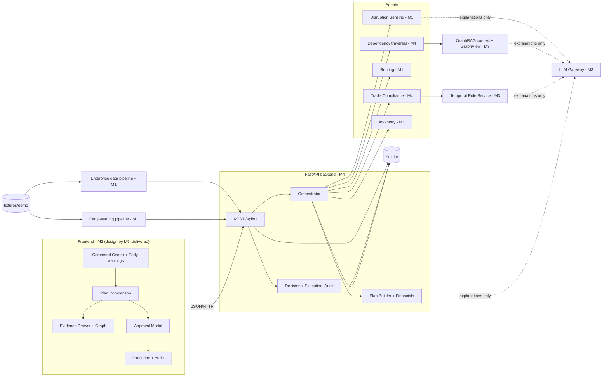
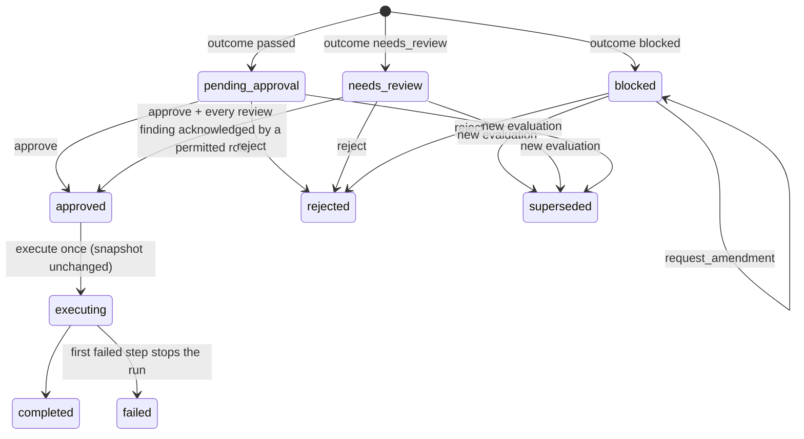

# AegisShield AI — Shared Source of Truth (v2)

| | |
|---|---|
| Document | `docs/00-source-of-truth.md`: canonical for every shared decision, owner, formula, date and demo number |
| Version | 2.1.0 — Fri 30 Oct 2026, 20:30 (2.0.0 the same day; replaces 1.0.0 of 19 Oct) |
| Team | ChainGang, Sir M. Visvesvaraya Institute of Technology, Bengaluru |
| Final decision authority | Member 3, after consulting the owner of the affected module (§15.4) |
| Maintainer | Member 3 (whole document); Member 4 keeps §9–§11 and Appendix A in sync with `contracts/` |
| Machine-readable truth | `contracts/` 1.1.1 and `fixtures/`. If this document and a contract file disagree, the contract file wins and this document is corrected in the same pull request. |
| Verification | Every figure in §10, §12 and Appendix F is recomputed by `python3 tools/check_contracts.py`. Last run: PASSED on 30 Oct 2026, with 45/45 automated validation cases. |

**People vs software.** *Member 1–5* always means a person on the team. *Agent* always means one of the software components in §8.

---

## Read me first: what changed in v2

1. **Team split.** Member numbers now follow the team context file. Member 5 stops all UI/UX work and only prepares the final pitch, presentation and scripts. UI/UX and the frontend move to **Member 2**. **Member 3** becomes the final decision-maker. Ownership is in §7.
   - **v2.1 (30 Oct, 20:30):** the enterprise data pipeline (MOD-22: fixture ingestion, validation, input snapshot, `/scenario` and `/disruptions`) moves from Member 2 to **Member 1**, so Member 2 works only on UI/UX and the frontend (D-031).
2. **v1 role documents are retired.** `docs/01…05` used a different numbering (in v1, "Member 3 — Backend" is the person who is now Member 4). Delete them or move them to `docs/archive/v1/`. Their technical content is folded into the appendices of this document (§19), and the per-person plans now live in `prompts/`.
3. **Contracts 1.1.0 (additive).** They add the early-warning feature for Member 1 (`signals.schema.json`, `external_signals.json`, `GET /api/v1/early-warnings`, VC-EWS-01…06) and remap owner metadata. All 12 existing demo fixtures are byte-identical, so `input_snapshot_id` and both plan hashes are unchanged. The one code change needed elsewhere is the step → owner map in the orchestrator (`contracts/CHANGELOG.md`). **1.1.1** (v2.1) changes owner metadata only, for the data-pipeline move.
4. **Corrections to the team context file.** The context file proposed a "Disruption Probability Score", a net-profitability formula and per-member "SAP integrations". Each is reconciled in §2.3–§2.4. The most important rule: never call the early-warning index a probability.
5. **Schedule.** The plan covers the 4½ days left: feature freeze **Sun 1 Nov 20:00**, finale **Wed 4 Nov**. Because both halves of the app are partly built, every module starts with a handover and an inventory (§7.5).

---

## Contents
1. Product in one page
2. Evidence labels and reconciliation
3. Event facts and calendar
4. Scope, cut list, success criteria
5. Requirements
6. Technology stack
7. Team, architecture, modules, ownership, handover
8. Agents and orchestration
9. Contracts overview
10. Deterministic behaviour
11. Human approval, simulated execution, audit
12. Demo scenario and demo script
13. Integration plan, critical path, daily plan, contingencies
14. Tests, demo acceptance, risks, assumptions, open decisions
15. Repository conventions, versioning, change control, decision authority
16. Traceability
17. Glossary
18. Sources
19. Module specifications (Appendices A–F)
20. Decision log

---

## 1. Product in one page

**What it is.** AegisShield AI is a preflight layer for supply-chain recovery decisions. It was designed for SAP BTP; hosting status is tracked in §2.4. It watches external signals around supplier sites. When a disruption lands, it proposes recovery plans and checks each plan before anyone acts:

0. **Early warning (advisory):** are there signals (grid, weather, news, port congestion) around a supplier site that feeds our orders?
1. **Disruption sensing:** what broke, which shipments slip, which customer orders are late, and what penalties apply if we do nothing?
2. **Supplier dependency (GraphRAG):** does the "alternate" supplier secretly depend on the same broken upstream factory?
3. **Routing:** which sailings can each candidate supplier actually use?
4. **Inventory rebalancing:** how much usable stock above protected levels can cover the gap?
5. **Trade compliance:** do the route and documents fit the letter of credit and the FTA direct-consignment rule that applies on the import date?

Then it compares the plans with honest money, waits for a recorded human decision, simulates execution and writes a hash-chained audit trail.

**Principle: code decides, AI explains.** Deterministic code produces every `passed` / `needs_review` / `blocked` outcome, quantity, date and rupee amount. The LLM only extracts fields into a fixed schema (checked against the record) and writes explanations that may cite only proven evidence. Missing or unverified data becomes `needs_review`, never `passed`. Nothing executes without a human decision.

**Target segment (hypothesis):** mid-size Indian manufacturers importing critical electronic components from ASEAN under FTAs and documentary credits.
**Revenue model (hypothesis):** B2B SaaS per plant or legal entity, with an optional per-evaluation tier.

**Users in the demo (simulated identities):** Priya R., supply planner, and Arjun M., trade compliance officer, both synthetic. The personas and empathy maps from Member 5's UX research are canonical for the pitch.

**End-to-end example (all SYNTHETIC; numbers from `fixtures/expected/`):**
- **Early warning.** On 23 Oct at 21:00, three signals (a grid-operator bulletin, a weather warning and a local news report) push the Zenith wafer fab in Kulim to early-warning index **97/100 (warning)**. AegisShield links that fab to PO-7001, to three customer orders, and to the Thai candidate supplier.
- **Disruption.** The Penang supplier's delay notice arrives 59 h 40 min later (26 Oct, 08:40). Shipment slips 7 days, so the three orders will be 6, 4 and 2 days late: **₹11,60,000** of penalties if we do nothing.
- **Plan P1, the obvious fix.** A cost-and-time optimiser proposes plant and Pune stock, 400 modules from Thailand via Colombo, and 200 from Vietnam via Singapore. On paper it avoids **₹8,26,000**. AegisShield **blocks** it:
  - the Thai supplier's dies come from the same Kulim fab, through a Kedah die processor;
  - the Singapore transhipment breaks this letter of credit, because 43T says "not allowed" and 47A excludes the UCP 600 20(c) container exception;
  - the Colombo transit leaves the AIFTA preference **needing review**, with **₹3,87,600** of duty at risk at the 15% rate in force on arrival.
- **Plan P2, the verified fix.** 150 units of Bengaluru stock, 150 from Pune, and 600 from Vietnam on a direct sailing. All checks pass; net avoided loss is **₹6,18,000**; 100 units arrive 2 days late (₹50,000 residual).
- **Decision.** Priya approves P2. Execution is simulated, and the audit chain verifies.

---

## 2. Evidence labels and reconciliation

### 2.1 Labels used across docs and prompts
| Label | Meaning |
|---|---|
| **[REQ]** | Requirement given directly by the team (prompts of 19 Oct and 30 Oct 2026). |
| **[CTX]** | Statement from the team context file (30 Oct). Planning material; reconciled in §2.3. |
| **[PDF p.N]** | Statement from the original planning conversation (22 pages). Historical. |
| **[VERIFIED: source]** | Checked against an external source (§18). "official" = SAP or ICC page; "secondary" = reproduction or commentary. |
| **[ASSUMPTION A-nn]** | Our reversible decision where information is missing (§14.4). |
| **[OPEN OD-nn]** | Unresolved; has an owner and a deadline (§14.5). |
| **SYNTHETIC** | Fictional demo data. Never present it as real. |

### 2.2 v1 corrections still in force (from the planning PDF)
| # | Rule | Why |
|---|---|---|
| C3 | In MT700, **43T = transhipment, 43P = partial shipments**. | The PDF had "43P (transshipment prohibited)" [VERIFIED secondary: MT700 field list; ICC eUCP briefing]. |
| C4 | LC transhipment is **blocked only if** 43T is "not allowed" **and** 20(c) is excluded (or the container / single-B/L exception does not apply). Non-party transit under AIFTA → **needs_review**, never automatic loss. | UCP 600 Art. 20(c) [VERIFIED secondary]; AIFTA Rule 8 direct consignment [VERIFIED secondary]. |
| C5 | 44C is a **shipment** date. Arrival is never an LC input. | Field definition. |
| C6 | One synthetic fixture for all numbers. | PDF amounts were irreconcilable. |
| C7 | No novelty, "never", "<100 ms" or score-out-of-10 claims. | Unverifiable; other 2026 teams built similar systems [VERIFIED: public repos]. |
| C9 | SAP products are "proposed mapping" unless built (§2.4). | No access was verified. |

### 2.3 Reconciliation of the team context file [CTX]
| # | Context file says | Problem | Canonical decision |
|---|---|---|---|
| F1 | "Disruption Probability Score… before an official outage is declared" | We have no historical outage data, so any probability would be invented. | Call it the **early-warning index (0–100)**. It is a deterministic heuristic with synthetic, team-chosen weights (§10.9). Allowed: "raised a warning 59 h 40 min before the supplier's notice in our synthetic scenario". Banned: "probability", "predicts outages", any accuracy percentage. |
| F2 | "External feeds vectorized into a temporal database… compared against historical patterns" | There is no pattern model, and similarity would decide nothing. | Signals are filtered by time window and area, with no look-ahead. Vector similarity is not used to score. Optional text search is for display only. |
| F3 | `Net Profitability = Base Revenue − (Recovery/Shipping + Potential Late Penalty Risk + Compliance/Tariff Penalties − FTA Tax Savings)` | It mixes certain costs with uncertain risks, and counts "FTA savings" as a gain even though the baseline already assumes the preference. Base revenue (₹1,89,00,000 of orders) is the same in every plan, so it carries no information. | Use the canonical definitions (§10.7). The term-by-term mapping is in §10.10. Risk appears as **worst-case exposure**, shown separately. Without calibrated probabilities we never net "expected" penalties into cost. |
| F4 | "Singapore transhipment route violates LC terms" | True only because of this LC's wording. | Say: "this LC sets 43T NOT ALLOWED and its 47A clause excludes the UCP 600 20(c) container exception". |
| F5 | "Colombo route lacks required trade compliance documentation" | The route is not blocked. | Say "**needs review**": the AIFTA preference depends on evidence that the direct-consignment conditions are met; ₹3,87,600 of duty is at risk at 15%. |
| F6 | "P2 uses Pune stock plus a direct Vietnamese supplier" | Incomplete. | P2 = 150 Bengaluru plant stock + 150 Pune stock + 600 from Vietnam direct (RT-C-DIR). |
| F7 | "P2 routes the exception for explicit human approval" | Approval is not an exception path. | Every plan needs human approval. P2 passes all checks and shows the 100 late units as ₹50,000 residual loss. |
| F8 | "Hosted on SAP BTP"; per-member SAP IBP / Ariba / S/4HANA / TM / GTS / Integration Suite / Event Mesh / Fiori | Unbuilt integrations stated as fact. | Status table §2.4. Only items marked **Built** may be called integrations. |
| F9 | "Power outage starting 24 Oct" | The fixture notice says "unplanned shutdown on 24 Oct". | "Power-related shutdown" is consistent with signals SIG-0001 and SIG-0006. Do not edit the notice text: that would change every plan hash. |
| F10 | "Monitors weather, power grids, geopolitics, port congestion" | No live feeds exist. | The demo uses six synthetic signals in four categories. Stretch S-5 may display one real public feed but never score it. |
| F11 | M5 owns "UI/UX, dashboard & presentation" | Superseded [REQ 30 Oct]. | M5 owns the pitch, deck, scripts and Q&A only. M2 owns UI/UX and the frontend. |
| F12 | M1 "anchors research and pitch narrative" | Conflicts with M5 owning the pitch. | M1 keeps the domain evidence register and fact-checks claims (MOD-24). M5 owns the narrative and slides. |
| F13 | "Identical inputs always yield identical outputs" | Fine, but it is a claim. | Present it as a **tested** property: two runs after reset give identical plan hashes (DA-15). |

### 2.4 SAP mapping status (owners confirm by Sat 31 Oct 12:00; see OD-01)
| SAP offering | Proposed fit in AegisShield | Owner | Demo status | Allowed wording |
|---|---|---|---|---|
| SAP BTP, Cloud Foundry runtime | Hosts the backend (Python buildpack documented by SAP [VERIFIED official]) | M4 | **In progress (OD-01)** | Built: "runs on SAP BTP". Otherwise: "designed for SAP BTP". |
| SAP Integration Suite | ERP → AegisShield data integration | M4 | Proposed | "would connect through" |
| SAP Event Mesh | Asynchronous disruption and signal events | M4 | Proposed | "would publish to" |
| SAP S/4HANA (OData APIs) | Purchase orders, inventory, master data | M1 | Proposed. The demo reads synthetic fixtures; an OData-shaped mock adapter is stretch S-9. | "shaped for S/4HANA-style APIs (mock)" |
| SAP IBP | Supply plans, inventory context | M1 | Proposed | "would read from" |
| SAP TM | Freight orders, sailings | M1 | Proposed | "would book through" |
| SAP Ariba | Supplier and sub-tier documents | M3 | Proposed | "would source declarations from" |
| SAP GTS | Customs, FTA and LC data | M3 | Proposed | "would align with" |
| SAP Fiori design / UI5 | Planner UI patterns | M2 | Fiori-inspired design language. Say "UI5" only if UI5 Web Components are actually in the frontend. | "Fiori-inspired" unless built |
| SAP Generative AI Hub | Live LLM for explanations | M3 | Optional (OD-04) | Only if live mode used it |

---

## 3. Event facts and calendar

| Fact | Status | Source |
|---|---|---|
| Finale and winners: **Wed 4 Nov 2026** at New Horizon College of Engineering (NHCE), Bengaluru. Finalists travel at their own cost. | VERIFIED (official, 19 Oct). A re-check on 30 Oct was inconclusive because the official page blocks automated reading. → **OD-09** confirms time and format with the coordinator. | SAP Hackfest Bengaluru page |
| Shortlist of top 5 teams per regional college round: 25 Oct 2026. | VERIFIED (official) | same |
| The finale requires a working prototype that uses SAP technologies. | VERIFIED on the North and South-East pages; Bengaluru wording not visible → **OD-01** | regional pages |
| The theme suggests five agent roles (disruption sensing, scenario planning, rerouting & logistics, inventory rebalancing, compliance & audit) plus human approval for high-stakes decisions. | VERIFIED (official) | Hackfest 2026 page |
| SAP frames problems through Domain, Tech and Business lenses. | VERIFIED (SAP Community) | SAP Community |
| Team ChainGang is preparing for the finale. | [REQ] (statement 30 Oct) → A-16 | — |
| Finale pitch length, demo slot, Q&A length, projector/HDMI, internet | UNVERIFIED → **OD-09** | — |

**Calendar (IST).**

| Date | Build day | Focus | Gate |
|---|---|---|---|
| Fri 30 Oct (from 17:00) | D5 evening | Re-plan call, handovers, contracts 1.1.1 merged | **H0** handovers done 21:00 |
| Sat 31 Oct | D6 | Integration: live evaluation equals golden; UI on live API | **G2** 18:00 golden evaluation via API |
| Sun 1 Nov | D7 | Approval → execution → audit live; acceptance run #1 | **FREEZE 20:00** |
| Mon 2 Nov | D8 | Fixes only, offline drill, rehearsals, backup video | **G3** 20:00 numbers and deck locked |
| Tue 3 Nov | D9 | Fixes until 14:00, acceptance run #2, go/no-go 18:00 | **G4** go/no-go; `demo-freeze` tag |
| Wed 4 Nov | Finale | Present at NHCE | — |

---

## 4. Scope, cut list, success criteria

### 4.1 MVP (P0 unless marked)
- One synthetic scenario (`SCN-DEMO-001`), loaded from `fixtures/demo/` and resettable in one call.
- Five logical agents (§8) behind one deterministic orchestrator.
- Two plans per evaluation: **P1** `cost_time_only` and **P2** `constraint_verified`.
- Findings with ≥1 evidence item each; an evidence drawer; the graph path highlighted; a rule table showing applied, superseded, draft and lower-authority rules.
- Plan comparison with baseline, recovery, residual and net avoided loss, plus exposures shown separately.
- Approve, reject, request LC amendment (P1); role-specific acknowledgements.
- Simulated execution (6 step types); hash-chained audit log with verification.
- LLM modes `live` / `recorded` / `off` with identical outcomes and hashes.
- **P1:** early-warning endpoint and Command Center panel with an "as of 23 Oct 21:00 / now" toggle; active warnings listed in the approval modal (advisory only).

### 4.2 Excluded
- Real SAP or ERP integration, except what OD-01 adds.
- Real data or live feeds.
- Disruption probability modelling.
- Legal advice.
- FX; origin-qualification maths (RVC/CTSH); surcharges and IGST; LC amendment timing.
- Authentication; multi-tenancy; mobile layouts.

### 4.3 Stretch (only after the freeze is green, in this order; Member 3 decides)
- S-1 Simulated LC amendment acceptance plus re-evaluation (VC-AMEND-01)
- S-2 Live LLM extraction of the supplier notice
- S-3 Rule timeline graphic
- S-4 SAP HANA Cloud for rule passages
- S-5 One real public feed displayed, not scored
- S-6 Ownership edges in the graph
- S-7 P3 plan with acknowledged review items
- S-8 LLM explanation of early warnings
- S-9 OData-shaped mock adapter for enterprise data

### 4.4 Cut list (Member 3 applies it in this order if behind)
1. Live LLM mode
2. S-goals
3. Rule passage ranking display
4. Evaluation progress animation
5. Audit filters
6. Early-warning as-of toggle (keep the pre-notice view only)
7. Early-warning panel (fall back to one slide built from the golden)
8. Explanations other than templates

**Never cut:**
- the golden evaluation;
- server-side approval enforcement;
- the evidence drawer for FND-DEP-SUP-B, FND-LC-TRANSHIPMENT-RT-C-SIN and FND-FTA-DIRECT_CONSIGNMENT-RT-B-CMB;
- synthetic labels; reset; offline mode.

### 4.5 Success criteria
| ID | Criterion | Measured by | Due |
|---|---|---|---|
| SC-1 | Live API evaluation equals `fixtures/expected/evaluation_EVAL-0001.json` (volatile fields ignored) | e2e (M3) | **Sat 31 Oct 18:00** |
| SC-2 | Every oracle case has an automated test in its owner's module, all green; manual cases recorded | CI + test log | Sun 1 Nov 15:00 |
| SC-3 | No execution without approval; stale, duplicate and blocked approvals refused (VC-APR-01…08) | e2e | Sun 1 Nov 15:00 |
| SC-4 | Every finding opens an evidence item within 2 clicks | DA-05…07 | Sun 1 Nov 17:00 |
| SC-5 | Same plan hashes in `off`/`recorded`/`live`; demo runs with the network unplugged | VC-LLM-01, offline drill | Mon 2 Nov 12:00 |
| SC-6 | Reset → audit verify in ≤ 3 min across 3 consecutive rehearsals, no manual data edits | rehearsal log (M5) | Mon 2 Nov 20:00 |
| SC-7 | Keyboard-only approval flow; status never by colour alone; WCAG 2.2 AA text contrast | a11y checklist (M2) | Sun 1 Nov 15:00 |
| SC-8 | Every number in the deck equals a golden value or an Appendix F derived value | DA-14 (M5) | Mon 2 Nov 20:00 |
| SC-9 | Evaluation ≤ 5 s on the demo laptop in `recorded` mode (**target, not yet measured**) | timing log (M4) | Mon 2 Nov |
| SC-10 | Early-warning endpoint equals both EWS goldens; VC-EWS-01…06 green | tests (M1) | Sat 31 Oct 18:00 |

---

## 5. Requirements

P0 = finale blocker, P1 = should, P2 = stretch. Owner = the one accountable person. Tests refer to `fixtures/validation/cases.json` (VC-*), the golden flow `fixtures/expected/approval_flow.json` (G-FLOW n), and demo acceptance items (DA-*, §14.2).

| ID | Requirement | Pri | Owner | Acceptance criteria |
|---|---|---|---|---|
| FR-01 | Load and validate fixtures; expose scenario and disruptions | P0 | M1 | `/scenario` and `/disruptions` validate against schemas; `/health.input_snapshot_id` equals the golden |
| FR-02 | Command Center shows disruption, affected orders, days late, baseline | P0 | M2 | DA-02 |
| FR-03 | Disruption Sensing Agent | P0 | M1 | Equals `expected/disruption_assessment.json`; VC-SENSE-01 |
| FR-04 | Routing Agent | P0 | M1 | 4 supplier options (quote × route) equal golden `options` |
| FR-05 | Dependency traversal ≤ 3 hops with evidence paths | P0 | M4 | VC-DEP-01, 02; `results` in `expected/dependency_results.json` |
| FR-06 | Missing, unverified or truncated dependency data never passes | P0 | M4 | VC-DEP-03, 04, 06 |
| FR-07 | Cycle-safe traversal | P1 | M4 | VC-DEP-05 |
| FR-08 | Temporal rule applicability | P0 | M3 | VC-RULE-01…07; `expected/rule_applicability.json` |
| FR-09 | Unresolved equal-authority conflict → needs_review | P0 | M3 | VC-RULE-03 |
| FR-10 | LC preflight (43T/20(c), 44C, 44E, 44F, 48+31D, amount, 43P, extraction consistency) | P0 | M4 | VC-LC-01…07 |
| FR-11 | FTA preflight (direct consignment, certificate of origin) and duty at risk | P0 | M4 | VC-FTA-01…03; VC-FIN-02 |
| FR-12 | Inventory ATP and allocation feasibility | P0 | M1 | VC-INV-01…03 |
| FR-13 | Plan builder P1 and P2 | P0 | M4 | Lines and `plan_hash` equal golden; VC-LC-05 |
| FR-14 | Financials per §10.7, exposures separate | P0 | M4 | VC-FIN-01, 03 |
| FR-15 | Plan comparison screen with recommendation rule | P0 | M2 | DA-04 |
| FR-16 | Evidence drawer for every finding; graph path highlight | P0 | M2 | DA-05…07 |
| FR-17 | Decisions with version + hash, roles, acknowledgements, idempotency | P0 | M4 | VC-APR-01…08; G-FLOW 5–10 |
| FR-18 | Approval UI with actor switcher, acknowledgement checklist, blocked state | P0 | M2 | DA-08, DA-09 |
| FR-19 | Simulated execution: once, after approval, input snapshot unchanged | P0 | M4 | G-FLOW 11–13; VC-APR-04, 05; VC-EXE-01 |
| FR-20 | Hash-chained append-only audit API + verify | P0 | M4 | G-FLOW 15–16 |
| FR-21 | Agent progress timeline | P1 | M2 | DA-03 |
| FR-22 | LLM gateway `live`/`recorded`/`off` | P0 | M3 | VC-LLM-01; DA-12 |
| FR-23 | Grounded explanations with citation validator and template fallback | P1 | M3 | VC-LLM-02 |
| FR-24 | LC raw-text extraction compared with gold; mismatch → needs_review | P1 | M3 | VC-LC-07 end to end |
| FR-25 | Synthetic labelling in the UI | P0 | M2 | DA-01 |
| FR-26 | Request LC amendment records an AmendmentRequest; plan stays blocked | P1 | M4 | VC-APR-08 |
| FR-27 | Simulated amendment acceptance + re-evaluation | P2 | M4 | VC-AMEND-01 |
| FR-28 | At least one SAP technology actually used (per OD-01) | P0 decide / P1 build | M4 | OD-01 record + working demo of the chosen piece |
| FR-29 | Early-warning index endpoint | P1 | M1 | Equals both `expected/early_warnings_*.json`; VC-EWS-01…05 |
| FR-30 | Early-warning panel with as-of toggle; active warnings shown in the approval modal (advisory) | P1 | M2 | DA-16 |
| FR-31 | Early warnings never change plans, money, hashes or the input snapshot | P0 | M1 | VC-EWS-06; boundary test (§7.4 rule 6) |
| FR-32 | Demo reset and id counters | P0 | M4 | G-FLOW 1–3 |
| FR-33 | Audit viewer with "Verify chain" | P0 | M2 | DA-11 |
| FR-34 | Pitch numbers and claims match Appendix F; synthetic labelled | P0 | M5 | DA-14 |
| FR-35 | GraphRAG context (linearisation) and GraphView payload | P0 | M3 | `linearized_contexts` equal golden; `graph_view_SUP-B.json` |
| FR-36 | Golden-flow e2e and response-conformance tests | P0 | M3 | G-FLOW 1–16 automated and green |
| NFR-01 | Determinism: same inputs → same outcomes, amounts, ids and plan hashes | P0 | M4 | DA-15; VC-LLM-01 |
| NFR-02 | Offline demo | P0 | M4 | DA-12 offline drill |
| NFR-03 | Every API response validates against OpenAPI (in tests) | P0 | M4 | Conformance tests (FR-36) |
| NFR-04 | Accessibility basics | P0 | M2 | SC-7 |
| NFR-05 | No secrets in the repo; `.env` ignored | P0 | M4 | Repo scan |
| NFR-06 | Performance measured and reported, never claimed in advance | P1 | M4 | Timing log |
| NFR-07 | Early-warning index labelled "heuristic, not a probability" in API, UI and pitch | P0 | M1 | `score_note` present; DA-16; Appendix F |

---

## 6. Technology stack
These choices are unchanged from v1. **No stack changes after D5: keep what exists.**
- **Backend:** Python 3.12, FastAPI, Pydantic v2, SQLite (SQLAlchemy 2.0).
- **Graph:** NetworkX in-process.
- **Rules:** deterministic metadata filter decides; BM25 only orders passages for display.
- **LLM:** provider-agnostic gateway with `live` / `recorded` / `off`.
- **Orchestration:** plain Python pipeline.
- **Frontend:** React 18 + TypeScript + Vite, Tailwind/shadcn (or the kit already in use), Cytoscape.js, TanStack Query, types generated with `openapi-typescript`.
- **Tests:** pytest, jsonschema, Vitest, Playwright smoke.
- **Contract gate:** `tools/check_contracts.py`.
- **Deployment:** local laptop (primary, offline-capable); SAP BTP Cloud Foundry trial if OD-01 succeeds.

---

## 7. Team, architecture, modules, ownership, handover

### 7.1 The five people
| Member | Role | Accountable for | Reviews | Explicitly not doing |
|---|---|---|---|---|
| **M1** | Predictive sensing pipeline, **enterprise data pipeline** & domain strategy | MOD-22 data pipeline, MOD-04 sensing, MOD-06 routing, MOD-09 inventory, MOD-21 early warning, MOD-24 domain evidence register | MOD-12, MOD-18 | Pitch narrative (M5), UI (M2) |
| **M2** | **UI/UX and frontend** (implements M5's delivered design) | MOD-13 frontend app, MOD-14 graph & evidence components, MOD-20 UI tests & a11y | MOD-02, MOD-15 | Data pipeline (M1); backend logic; money or outcome calculations |
| **M3** | Main RAG system, contracts & **final decisions** | MOD-01 contracts & tooling, MOD-07 temporal rules, MOD-12 LLM gateway & explanations, MOD-17 decision log, MOD-18 demo acceptance, MOD-19 golden-flow e2e, MOD-23 GraphRAG context & GraphView | MOD-03, 05, 08, 10, 11, 13, 14, 16, 20, 21, 24 (bounded, §15.4) | Implementing other owners' modules |
| **M4** | Major backend & deterministic check engine | MOD-02 API & persistence, MOD-03 orchestrator, MOD-05 dependency traversal, MOD-08 compliance, MOD-10 plans & financials, MOD-11 decisions/execution/audit, MOD-15 deployment | MOD-01, 04, 06, 07, 09, 17, 19, 22, 23 | UI |
| **M5** | Final pitch, presentation & scripts | MOD-16 pitch: deck, scripts, demo narration, Q&A bank, backup video, rehearsal log | Executes DA checklist during rehearsals (MOD-18) | **Any UI/UX or code work** [REQ] |

### 7.2 Component view



### 7.3 Modules: one accountable owner, one reviewer
**Existing code paths win.** Do not move or rename files during the reshuffle; ownership changes, paths don't. The paths below are defaults for new code only.

| Module | Scope | Accountable | Reviewer | Default location |
|---|---|---|---|---|
| MOD-01 Contracts & tooling | `contracts/`, goldens, checker, CI job, CHANGELOG | M3 | M4 | `contracts/`, `tools/` |
| MOD-02 API & persistence | FastAPI app, SQLite, problem+json, idempotency store, id counters, **reset** | M4 | M2 | `backend/app/api`, `backend/app/db` |
| MOD-03 Orchestrator | Evaluation job, steps, timeouts, supersession, failure propagation | M4 | M3 | `backend/app/orchestrator` |
| MOD-04 Disruption Sensing Agent | Notice extraction (gold/recorded/live), alias resolution, impact, baseline, severity | M1 | M4 | `backend/app/agents/sensing` |
| MOD-05 Dependency traversal | Graph load and validation, traversal, coverage, outcomes, evidence paths | M4 | M3 | `backend/app/agents/dependency` |
| MOD-06 Routing Agent | Route eligibility per quote | M1 | M4 | `backend/app/agents/routing` |
| MOD-07 Temporal Rule Service | Rule store, applicability, conflicts, BM25 display ranking | M3 | M4 | `backend/app/rules` |
| MOD-08 Trade-Compliance Preflight | LC checks, FTA checks, duty at risk | M4 | M3 | `backend/app/agents/compliance` |
| MOD-09 Inventory Rebalancing Agent | ATP options, allocation-feasibility findings (called by MOD-10) | M1 | M4 | `backend/app/agents/inventory` |
| MOD-10 Plan Builder & Financials | Strategies, plan-level checks, financials, comparison, plan hash | M4 | M3 | `backend/app/plans` |
| MOD-11 Decisions, Execution, Audit | State machine, idempotency, amendment requests, simulated execution, hash chain | M4 | M3 | `backend/app/decisions`, `backend/app/audit` |
| MOD-12 LLM Gateway & explanations | Modes, recorded store, prompt registry, validator, LC extraction, explanation composer | M3 | M1 | `backend/app/llm` |
| MOD-13 Frontend application | Screens, state, API client, formatting | M2 | M3 | `frontend/src` |
| MOD-14 Graph & evidence components | Cytoscape view, evidence drawer, rule and LC panels | M2 | M3 | `frontend/src/features/evidence` |
| MOD-15 Deployment & demo environment | Local runbook, one-origin serving, offline bundle, optional BTP | M4 | M2 | `ops/` |
| MOD-16 Pitch | Deck, speaker scripts, demo narration, Q&A, backup video, rehearsal log | M5 | M3 | `pitch/` |
| MOD-17 Decision log & scope | §20, cut list, change control | M3 | M4 | `docs/00` §20 |
| MOD-18 Demo acceptance | DA-01…17: M5 executes in rehearsals, M2 drives, M3 signs | M3 | M1 | `pitch/rehearsal-log.md` |
| MOD-19 Golden-flow e2e & conformance | `approval_flow.json` 1–16 automated; response validation | M3 | M4 | `backend/tests/e2e`, `backend/tests/conformance` |
| MOD-20 UI tests & accessibility | Vitest, Playwright smoke, a11y checklist | M2 | M3 | `frontend/tests` |
| MOD-21 Early-warning pipeline | Signal loading, window filter, scoring, exposure, endpoint | M1 | M3 | `backend/app/agents/early_warning` |
| MOD-22 Enterprise data pipeline | Fixture/ERP-shaped ingestion, validation, input snapshot, scenario and disruption read endpoints | M1 | M4 | `backend/app/data` (or the existing loader file) |
| MOD-23 GraphRAG context & GraphView | `linearize`, `build_graph_view`, dependency explanations | M3 | M4 | `backend/app/agents/dependency/{linearize,view}.py` |
| MOD-24 Domain evidence register | Claim → source → status table for the pitch | M1 | M3 | `pitch/evidence-register.md` |

### 7.4 Boundary rules
1. Only MOD-02 writes the database. MOD-22 provides validated, in-memory fixture models; agents are pure functions over typed inputs.
2. Only MOD-12 calls an LLM provider.
3. Only MOD-08 decides LC/FTA outcomes; MOD-07 only says which rules apply.
4. Only MOD-10 computes plan money. The UI formats numbers and never recomputes them.
5. Only MOD-11 changes plan status after evaluation.
6. MOD-21 is advisory: the orchestrator, plan builder and decision code **must not import it**. A test asserts this, and VC-EWS-06 proves plans are unchanged.
7. Production code never imports `tools/aegis_oracle.py`. No stub or golden-serving routes are active in demo mode.

### 7.5 Handover protocol (both halves are partly built)
1. **By Fri 30 Oct 21:00**, whoever wrote code for a module that now has a different owner pushes it to a branch `handover/<MOD-id>`. They add `HANDOVER.md` with five lines: what works, how to run it, tests passing/failing, known gaps, open questions.
2. The new owner runs it and confirms at the **Sat 09:30 stand-up**. The previous author answers questions until **Sat 13:00**.
3. Merge through pull requests only. Never force-push or rewrite another person's branch; never delete a branch you didn't create.
4. Member 5 hands Member 2 the location of the delivered design files (OD-10). This is a hand-off of existing files, not new UI work.

---

## 8. Agents and orchestration

| Agent | Purpose | Owner | Inputs → outputs | Deterministic responsibilities | Bounded LLM use | Failure handling |
|---|---|---|---|---|---|---|
| Disruption Sensing (DSA) | Notice → graph nodes, delayed shipments, affected orders, baseline loss, severity | M1 | `DisruptionEvent` → `DisruptionAssessment` | Alias resolution, revised dates, penalties, severity | Extract `GoldExtraction` fields (recorded/live); a mismatch with gold → needs_review | Unresolved alias → needs_review with empty `disrupted_node_ids`, which forces every dependency check to needs_review |
| Supplier Dependency (SDA) | Prove or refute each candidate's independence | M4 (traversal); M3 (context, view, explanations) | `DependencyQuery` → `DependencyResult`, `LinearizedContext`, `GraphView` | Traversal, coverage, cycles, outcome rules (§10.1) | Explain paths citing only allowed ids | Exception → needs_review with `check_unavailable`; never passed |
| Routing (RTA) | Eligible sailings per quote | M1 | quotes, routes → eligible routes | Same origin port, ETD ≥ ready date | none | Missing data → option omitted and logged |
| Trade-Compliance (TCA) | LC and FTA checks per option and plan | M4 | option, LC, rule results → findings, duty at risk | §10.3, §10.4 | none (LC extraction is MOD-12's, validated) | Rule service failure → `FTA.RULE_APPLICABILITY` needs_review |
| Inventory Rebalancing (IRA) | ATP and allocation feasibility | M1 | positions, plan lines → options, `INV.*` findings | ATP formula, availability date, allocation ≤ ATP | none | Invalid stock → blocked finding |

**Early-warning pipeline (MOD-21, M1).** It runs before and outside evaluations and has its own endpoint (§10.9). It feeds the human, not the plans.

**Orchestration (MOD-03, M4)** runs these steps in a fixed order, each with a timeout and an `AgentStep` record. The `owner` written into each step record must match this table (contracts 1.1.0):

| Seq | Step | Owner in step record | Timeout |
|---|---|---|---|
| 1 | disruption_sensing | member_1 | 10 s |
| 2 | supplier_dependency | member_4 | 5 s |
| 3 | routing | member_1 | 5 s |
| 4 | inventory_rebalancing | member_1 | 5 s |
| 5 | trade_compliance | member_4 | 5 s |
| 6 | plan_assembly | member_4 | 5 s |
| 7 | explanation | member_3 | 10 s |

Rules:
- Deterministic steps get 0 retries. LLM calls get 1 retry, then fall back to a template and the step is marked `degraded`.
- A failure in step 1 or 6 fails the evaluation. A failure in steps 2–5 turns the affected findings into needs_review.
- The total budget is 30 s (target). A new evaluation supersedes undecided plans.
- **Human checkpoint:** every evaluation ends with plans in `blocked`, `needs_review` or `pending_approval`. Nothing executes without a recorded decision (§11).

**Mapping to the event's agent vocabulary** [VERIFIED official]:

| Event term | Our components |
|---|---|
| Disruption Sensing | MOD-21 early warning + DSA |
| Scenario Planning | SDA + Plan Builder |
| Rerouting & Logistics | RTA |
| Inventory Rebalancing | IRA |
| Compliance & Audit | TCA + MOD-11 audit log |

---

## 9. Contracts overview
Canonical files: `contracts/schemas/*.schema.json` (JSON Schema 2020-12, relative `$ref`s) and `contracts/openapi.yaml` (OpenAPI 3.1). The registry with owners is `contracts/README.md`.

### 9.1 Conventions
- **IDs:** counters `EVAL-0001`, `PLN-0001`, `DEC-0001`, `EXE-0001`, `AMD-0001`, `AUD-000001` restart on reset.
- **Fixture ids** (`SUP-B`, `FAC-FABZ`, `E-005`, `RT-C-SIN`, `TR-0003`, `SIG-0001`, `AREA-MY-KULIM`) and **content-derived ids** (`FND-…`, `EVD-…`, `PATH-…`, `EXP-…`, `EWS-…`) are stable.
- **Money:** integer whole rupees (`*_inr`). Rates in basis points. Rounding is half-up to the rupee per line, then summed. The UI formats with Indian grouping (₹11,60,000).
- **Dates:** `YYYY-MM-DD`. Timestamps are RFC 3339 with offset. `effective_to` is inclusive.
- **Nullability:** nullable fields are always present; empty lists are `[]`.
- **Versions:** every payload carries `schema_version`.
- **Synthetic flags:** fixtures carry `synthetic: true`, and the API exposes `data_mode: "synthetic"`.

### 9.2 Entities
| Entity group | Schema | Producer |
|---|---|---|
| Master data: Scenario, Location, Agreement, Part, Customer, Supplier, CustomerOrder, PurchaseOrder, Shipment, SupplierQuote, RouteOption, InventoryPosition, LetterOfCredit, Source, Policies | `master-data.schema.json` | `fixtures/demo` via MOD-22 |
| DisruptionEvent, GoldExtraction, DisruptionAssessment | `disruption.schema.json` | MOD-04 |
| SupplyGraph, DependencyQuery/Result/Path, LinearizedContext, GraphView | `graph.schema.json` | MOD-05, MOD-23 |
| TradeRule, RuleQuery, RuleApplicabilityResult | `trade-rules.schema.json` | MOD-07 |
| Evidence, Finding, Problem, Actor, Subject | `common.schema.json` | all |
| SourceOption, PlanLine, Exposure, PlanFinancials, RecoveryPlan, PlanComparison, AgentStep, Explanation, Evaluation | `plan.schema.json` | MOD-03, MOD-10, MOD-12 |
| DecisionRequest, Decision, Acknowledgement, AmendmentRequest, Execution, ExecutionStep, AuditEvent, AuditVerifyResult | `decision.schema.json` | MOD-11 |
| Health, DemoResetResponse, ScenarioResponse, DisruptionList | `api.schema.json` | MOD-02, MOD-22 |
| ExternalSignal, Area, ScoringPolicy, EarlyWarning, EarlyWarningResult | `signals.schema.json` | MOD-21 |

### 9.3 HTTP API (`/api/v1`; details in `openapi.yaml`)
| Method & path | Purpose | Owner | Success | Main errors |
|---|---|---|---|---|
| GET `/health` | status, LLM mode, snapshot | M4 | 200 | — |
| POST `/demo/reset` | restore fixtures, clear state | M4 | 200 | 403 |
| GET `/scenario` | orders, POs, shipments, suppliers, inventory, LCs, actors | M1 | 200 | — |
| GET `/disruptions`, `/disruptions/{id}` | events | M1 | 200 | 404 |
| GET `/early-warnings?as_of=` | early-warning result | M1 | 200 | 400 |
| POST `/evaluations` | start evaluation (async) | M4 | 202 | 400, 404, 409, 422 |
| GET `/evaluations/{id}` | progress and results | M4 | 200 | 404 |
| GET `/evaluations/{id}/graph?focus_supplier_id=` | GraphView | M3 (payload) / M4 (route) | 200 | 404, 409 |
| GET `/plans/{id}` | current plan | M4 | 200 | 404 |
| POST `/plans/{id}/decisions` | approve / reject / request_amendment | M4 | 201 (200 replay) | 400, 403, 404, 409, 422 |
| POST `/plans/{id}/executions` | simulated execution | M4 | 202 | 409 |
| GET `/executions/{id}` | execution steps | M4 | 200 | 404 |
| GET `/amendment-requests/{id}`; POST `/demo/amendment-requests/{id}/simulate-acceptance` | amendment (stretch) | M4 | 200 | 403, 404 |
| GET `/audit-events`, `/audit-events/verify` | log, chain check | M4 | 200 | — |
| POST `/rules/applicability` | rule panel and tests | M3 | 200 | 422 |

Mutating calls carry the headers `X-Actor-Id` and `Idempotency-Key`. Errors are `application/problem+json` with a stable `code`.

### 9.4 Internal interfaces (typed Pydantic models)
```python
# M1
def load_fixtures(dir) -> ScenarioContext                                  # MOD-22: validated; computes input_snapshot_id
def assess_disruption(event, ctx, mode) -> DisruptionAssessment
def eligible_routes(quote, routes) -> list[RouteOption]
def inventory_options(positions, as_of) -> list[SourceOption]
def allocation_findings(plan_id, lines, options) -> list[Finding]          # called by MOD-10
def early_warnings(ctx, signals, as_of) -> EarlyWarningResult              # never called by MOD-03/10/11
# M4
def check_dependency(q, graph, parts, policy) -> DependencyResult
def lc_route_findings(lc, route, locations) -> tuple[list[Finding], list[Evidence]]
def fta_findings(quote, route, rules, agreements) -> tuple[list[Finding], list[Evidence]]
def duty_at_risk(quote, route, qty, rules) -> int | None
def build_plan(strategy, assessment, options, findings, ...) -> RecoveryPlan
# M3
def rule_applicability(q, rules, agreements) -> RuleApplicabilityResult
def rank_passages(q, result, k=3) -> list[PassageHit]                      # display only
def linearize(result, graph) -> LinearizedContext
def build_graph_view(results, graph, focus_supplier_id, evaluation_id) -> GraphView
def explain(subject_id, context, prompt_id) -> Explanation                 # never raises; template fallback
def extract_lc_fields(raw_text) -> dict                                    # validated against gold
```
`tools/aegis_oracle.py` is a **reference** implementation of every function above. Owners may port it, but they must test against the goldens and validation cases.

---

## 10. Deterministic behaviour

### 10.1 Supplier dependency (MOD-05)
- Start at the candidate's `supplying_facility_id`. Relevant parts = the BOM closure (PM-750 → IGBT die, DBC substrate).
- Depth-first search upstream over incoming `SUPPLIES` edges with a relevant part, sorted by `edge_id`, up to `max_depth` (3).
- A node already on the current path is skipped and sets `cycle_detected`.
- A path ends where there is no relevant incoming edge. If that node is not an origin for the part it supplies, record gap `upstream_unknown`. Stopping at max depth with more edges remaining sets `truncated`. A critical BOM child with no source at the start node is gap `missing_critical_input`.
- Outcome, first match wins:
  1. No disrupted node known → `needs_review`.
  2. A path reaches a disrupted node → `blocked` if every edge on those paths is verified, else `needs_review`.
  3. Any gap → `needs_review`.
  4. Truncated → `needs_review`.
  5. Otherwise `passed`.
- Shared but undisrupted upstream nodes are reported as notes. **Missing data is never evidence of independence.**

### 10.2 Temporal rule applicability (MOD-07)
Query fields: `applicable_on` (MVP: ETA at the Indian port, A-05) and `known_as_of` (the scenario date).
1. Exclude a rule on any of: jurisdiction, HS scope, origin scope, `published_date > known_as_of`, draft or withdrawn status, `applicable_on < effective_from`.
2. Exclude superseded rules (explicit `supersedes`); then expired ones (`applicable_on > effective_to`).
3. Per rule type, keep the highest authority level. Equal authority with different values → **unresolved conflict → needs_review**. Lower authority → excluded; if its value differs, record a conflict resolved by authority precedence.
4. A requested type with nothing applicable → `missing_rule_types` → needs_review.
5. BM25 only orders passages. **Similarity never decides applicability.**

### 10.3 Letter-of-credit checks (MOD-08)

| Check | Rule | If it fails |
|---|---|---|
| LC.TRANSHIPMENT | No transhipment → pass. 43T allowed or silent → pass. 43T not allowed and 47A excludes 20(c) → **blocked**. 43T not allowed, 20(c) not excluded, containerised, single B/L → pass with note. Otherwise blocked. | blocked + remedy `request_lc_amendment` |
| LC.LATEST_SHIPMENT_DATE | ETD ≤ 44C. **Arrival never checked.** | blocked |
| LC.PORT_OF_LOADING / DISCHARGE | 44E / 44F match | blocked |
| LC.PRESENTATION_PERIOD | ETD + 48 ≤ 31D | blocked |
| LC.AMOUNT (plan) | Drawing ≤ available balance | blocked |
| LC.PARTIAL_SHIPMENTS (plan) | 43P allowed or full drawing | blocked |
| LC.EXTRACTION_CONSISTENCY | LLM extraction equals the verified record | needs_review |

These are simplified encodings for a demo (A-13).

### 10.4 FTA checks (MOD-08)
- `FTA.DIRECT_CONSIGNMENT`: all transit countries are parties → pass. Non-party transit with evidence → pass. Otherwise **needs_review**.
- `FTA.CERTIFICATE_OF_ORIGIN`: available → pass; pending or unavailable → needs_review.
- Unresolved rules → `FTA.RULE_APPLICABILITY` needs_review.
- **Duty at risk** (needs_review lines only) = qty × (price + freight) × (MFN bps − preferential bps) / 10,000, rounded half-up. Basic customs duty only (A-06).

### 10.5 Inventory (MOD-09)
- ATP = max(0, on_hand − reserved − protected_floor), available on scenario date + transfer days.
- A plan never allocates more than ATP from a source.

### 10.6 Plans (MOD-10)
- **Options** = inventory sources plus each quote × eligible route. Capacity is shared per quote.
- **Greedy allocation**, orders by need-by date: cheapest on-time option first; otherwise the earliest option that still beats the delayed primary; otherwise the units stay on the delayed PO (`BASELINE-PO`).
- **P1** uses all options. **P2** uses only `passed` options and caps LC-funded quantities at ⌊balance / unit price⌋.
- **Plan outcome** = worst finding. Status: passed → `pending_approval`, needs_review → `needs_review`, blocked → `blocked`.
- **Recommendation rule:** exclude blocked plans; prefer passed over needs_review; then highest net avoided loss; then lowest worst-case exposure.

### 10.7 Financial definitions
| Term | Definition |
|---|---|
| Baseline loss | Penalties if nothing is done (affected units × rate × min(days late, cap)) |
| Recovery cost | Incremental cash: supplier price premium + freight + transfer + LC amendment fee + certain incremental duty |
| Residual loss | Penalties still incurred under the plan |
| Net avoided loss | Baseline − recovery − residual |
| Exposure | A possible loss if a non-passed finding materialises. Reported separately and **never** added to cost. Mutually exclusive futures are not summed. |
| Worst-case exposure | Sum over independent groups of the largest per-scenario total in each group |

### 10.8 Worked figures (INR; recomputed by the checker)
| | Do nothing | P1 cost & time only | P2 verified |
|---|---|---|---|
| SO-1001 (400 u, need 3 Nov) | 400 × 250 × 6 = 6,00,000 | on time | 100 u × 250 × 2 = 50,000 residual |
| SO-1002 (300 u, need 5 Nov) | 300 × 300 × 4 = 3,60,000 | on time | on time |
| SO-1003 (200 u, need 7 Nov) | 200 × 500 × 2 = 2,00,000 | on time | on time |
| **Baseline loss** | **11,60,000** | 11,60,000 | 11,60,000 |
| Price premium | — | B 400 × 300 + C 200 × 600 = 2,40,000 | C 600 × 600 = 3,60,000 |
| Freight | — | 400 × 160 + 200 × 120 = 88,000 | 600 × 210 = 1,26,000 |
| Stock transfer | — | 150 × 40 = 6,000 | 6,000 |
| **Recovery cost** | 0 | **3,34,000** | **4,92,000** |
| **Residual loss** | 11,60,000 | **0** | **50,000** |
| **Net avoided loss** | 0 | **8,26,000 (on paper)** | **6,18,000** |
| Outcome | — | **BLOCKED** (15 passed, 1 needs review, 2 blocked) | **PASSED** (15 passed) |
| Exposures | — | B fails like A: 5,10,000; or B arrives but the preference is denied: 3,87,600 (same group, not added); LC risk unquantified. **Worst case 5,10,000.** | none |

P1 looks **₹2,08,000** better on paper and cannot be executed. Using the repealed 10% rate would understate duty at risk at ₹2,58,400 (VC-FIN-02).

### 10.9 Early-warning index (MOD-21)
- **Inputs:** `external_signals.json` (scoring policy, areas, signals) plus the graph, orders and locations.
- **Inclusion:** a signal counts at `as_of` when `observed_at ≤ as_of` (**no look-ahead**) and `as_of − observed_at ≤ 72 h`, and all its areas are known. Unknown areas give `unmapped_area`, which is reported, never silently dropped.
- **Contribution** = round_half_up(severity points × source confidence % / 100). Severity points: low 10, medium 25, high 45, critical 70. Confidence: official 100, operator 80, news 60, social 30. Each signal counts once per subject.
- **Score** = min(100, Σ contributions). Level: ≥ 60 **warning**, ≥ 30 **watch**, otherwise none. Subjects with 0 points are omitted.
- **Exposure:** for a facility, everything downstream over SUPPLIES edges (≤ 4 hops, cycle-safe) → suppliers → POs → pegged orders and shipments, plus alternate/candidate suppliers reached. For a port, shipments and route options that use it. **No money is computed.**
- **Golden results:**

| as_of | Subject | Signals | Raw | Score | Level | Linked |
|---|---|---|---|---|---|---|
| 23 Oct 21:00 | Zenith Kulim fab (FAC-FABZ) | SIG-0001 45 + SIG-0002 25 + SIG-0003 27 | 97 | **97** | **warning** | PO-7001 → SO-1001/1002/1003; also feeds candidate **SUP-B** |
| 23 Oct 21:00 | Penang assembly | SIG-0002 | 25 | 25 | none | PO-7001 |
| 23 Oct 21:00 | Port Klang | SIG-0004 (10 × 80%) | 8 | 8 | none | SHP-A-0901 |
| 23 Oct 21:00 | Binh Duong assembly | SIG-0005 (25 × 30% = 7.5 → 8) | 8 | 8 | none | candidate SUP-C |
| 26 Oct 09:00 (scenario) | Zenith Kulim fab | SIG-0002 + SIG-0003 + SIG-0006 70 | 122 | **100** | warning | as above; SIG-0001, SIG-0004 outside window |

- **Isolation:** `external_signals.json` is excluded from `input_snapshot_id`. A warning on any supplier (even the recommended one, VC-EWS-06) is shown to humans but never changes plans or hashes.

### 10.10 How the context file's profitability formula maps to the canonical model
| Context-file term | Canonical treatment | Demo value |
|---|---|---|
| Base Revenue | Identical in every plan (orders are delivered either way), so it is not used to compare plans | ₹1,89,00,000 of orders (84 L + 63 L + 42 L) |
| Recovery/Shipping Costs | Recovery cost | P1 3,34,000 · P2 4,92,000 |
| Potential Late Penalty Risk | Certain lateness → residual loss; uncertain → exposure (separate) | P1 residual 0, exposure up to 5,10,000 · P2 residual 50,000, exposure 0 |
| Compliance/Tariff Penalties | Certain → `duty_incremental` in recovery cost; uncertain → duty-at-risk exposure | P1 duty at risk 3,87,600 (mutually exclusive with the 5,10,000) |
| FTA Tax Savings | Not a gain: the baseline already assumes the preference; losing it is an exposure | — |
| "Net Profitability" | **Net avoided loss**, shown next to worst-case exposure and outcome | P1 8,26,000 on paper but blocked · P2 6,18,000 passed |

---

## 11. Human approval, simulated execution and audit

### 11.1 Plan states



### 11.2 Roles (`policies.json`)
| Action | Roles | Rules |
|---|---|---|
| Approve | supply_planner, trade_compliance_officer | Never for blocked plans. Each needs_review finding needs acknowledgement by the right role: compliance → trade_compliance_officer; dependency, routing, inventory, sensing → supply_planner. |
| Reject | both | Justification ≥ 10 characters |
| Request LC amendment | trade_compliance_officer | Plan must have a blocked `LC.*` finding; the plan stays blocked |
| Execute | any approver | Approved, matching decision id, snapshot unchanged |
| Viewer | — | Read only |

### 11.3 Server-side enforcement
| Situation | Response |
|---|---|
| Execute before approval | 409 NOT_APPROVED |
| Execute a second time | 409 ALREADY_EXECUTED (the same key replays 202) |
| Same decision, same key | 200 + `Idempotent-Replay: true` |
| New decision on an already-decided plan | 409 DECISION_EXISTS |
| Same key, different body | 409 IDEMPOTENCY_KEY_REUSED |
| Stale version or hash | 409 PLAN_VERSION_STALE (with `current`) |
| Superseded plan | 409 PLAN_SUPERSEDED |
| Inputs changed since approval | Execution refused with 409 PLAN_VERSION_STALE |

Refusals are audited. Every state change is one transaction.

### 11.4 Simulated execution
Steps, in order:
1. REDUCE_PO
2. CREATE_PO (per quote)
3. BOOK_FREIGHT (per route)
4. CREATE_STOCK_TRANSFER
5. RESERVE_STOCK
6. NOTIFY_CUSTOMER (draft, not sent)

Every step carries `simulated: true` and a `proposed_sap_mapping` string. The first failure stops the run; there is no retry and no compensation (VC-EXE-01). The P2 golden is `approval_flow.json` step 12.

### 11.5 Audit
- Append-only. `event_hash = sha256(canonical JSON without event_hash)`; `prev_hash` chains events (genesis = 64 zeros).
- `GET /audit-events/verify` recomputes the chain. Reset starts a new chain at `AUD-000001`.
- After the golden flow there are exactly **26** events.

---

## 12. Demo scenario and demo script

### 12.1 Scenario `SCN-DEMO-001` (all SYNTHETIC; scenario clock 26 Oct 2026 09:00 IST)
| Item | Value |
|---|---|
| Buyer | Kaveri Motion Systems, Bengaluru plant; imports PM-750 IGBT power modules (HS label `HS-SYN-8504.90`, illustrative) |
| Primary supplier | SUP-A Penang PowerTech (MY): PO-7001, 900 units at ₹6,000, Port Klang → Chennai, planned plant arrival 2 Nov |
| Early signals | SIG-0001 grid instability (22 Oct 16:00), SIG-0002 storm warning (23 Oct 10:30), SIG-0003 local report of voltage dips (23 Oct 19:45), SIG-0006 confirmed curtailment 24–27 Oct (25 Oct 10:00), plus three minor signals |
| Disruption | DIS-2026-0042: Zenith Wafer Fab (Kulim) unplanned shutdown on 24 Oct; notice received 26 Oct 08:40; departure slips 26 Oct → 2 Nov; plant arrival 9 Nov |
| Orders | SO-1001 Nilgiri Rail: 400 u, need 3 Nov, ₹250/u/day · SO-1002 Deccan Water Utilities: 300 u, 5 Nov, ₹300 · SO-1003 Konkan Cold Chain: 200 u, 7 Nov, ₹500 · 10-day cap · order values ₹84 L / 63 L / 42 L |
| Inventory | Bengaluru ATP 150 (available now, ₹0) · Pune ATP 150 (available 29 Oct, ₹40/u) |
| Quotes | SUP-B Thailand ₹6,300, 400 u, ready 27 Oct · SUP-C Vietnam ₹6,600, 600 u, ready 28 Oct, under LC-SYN-0117 |
| Routes | RT-B-CMB via Colombo (plant 3 Nov) · RT-B-DIR (8 Nov) · RT-C-SIN via Singapore (4 Nov) · RT-C-DIR direct (5 Nov) |
| Graph | B: Chonburi ← Kedah die services ← **Zenith Kulim fab**. C: Binh Duong ← Vina Die ← Kumgang Gumi fab. A and C share Selangor substrates (not disrupted). |
| LC-SYN-0117 | 43P allowed; 43T not allowed; 47A excludes 20(c); 44C 5 Nov; 31D 26 Nov; 48: 21 days; ₹60 L; available ₹45 L |
| Rules | TR-0002 MFN 10% to 31 Oct (superseded) · TR-0003 MFN 15% from 1 Nov · TR-0004 draft 20% · TR-0005 AIFTA 0% · TR-0006 newsletter (secondary) · TR-0001 direct consignment |

### 12.2 Demo script (3 minutes; M5 narrates, M2 drives)
| Beat | Time | Screen | What the audience sees | Golden |
|---|---|---|---|---|
| 0 Early warning | 0:00–0:20 | Command Center, "as of 23 Oct 21:00" | Kulim fab **WARNING 97/100** from 3 signals; linked to PO-7001 and 3 orders, and to Thai candidate SUP-B. "Heuristic index, not a probability." | `early_warnings_pre_notice.json` |
| 1 Disruption | 0:20–0:40 | Command Center, "now" | Supplier notice arrives 59 h 40 min later; 3 orders late 6/4/2 days; ₹11.6 L baseline | `disruption_assessment.json` |
| 2 Attractive plan | 0:40–1:00 | Comparison | P1: ₹8.26 L avoided on paper, the cheapest | comparison PLN-0001 |
| 3 Hidden dependency | 1:00–1:25 | Evidence → Graph | B's dies trace to the same Kulim fab via Kedah | `graph_view_SUP-B.json` |
| 4 Documentary constraint | 1:25–1:50 | Evidence → LC & rules | 43T + 47A → blocked; Colombo → needs review, ₹3.88 L at 15% (TR-0003; the 10% rule is superseded) | FND-LC-TRANSHIPMENT-RT-C-SIN, FND-FTA-DIRECT_CONSIGNMENT-RT-B-CMB |
| 5 Verified plan | 1:50–2:10 | Comparison | P2: plant + Pune stock + Vietnam direct; all checks passed; 100 units 2 days late | PLN-0002 |
| 6 Money | 2:10–2:25 | Comparison | P1 ₹8.26 L on paper, blocked, exposure up to ₹5.1 L; P2 ₹6.18 L, no exposure | comparison |
| 7 Decision | 2:25–3:00 | Approval, Execution, Audit | Approving P1 is refused; Priya approves P2; 6 simulated steps; audit chain valid | `approval_flow.json` |

**Fallback:** press Reset and rerun (≈ 10 s). If the backend is down, switch to the backup video (M5 holds it on two devices).

---

## 13. Integration plan, critical path, daily plan, contingencies

### 13.1 Sequence
1. **Handover and inventory (Fri evening):** every owner records what exists.
2. **Contracts 1.1.1 merged** (Fri 21:00, M3): everyone pulls and runs the checker.
3. **Golden evaluation via the live API (Sat 18:00):** M4 wires M1's, M3's and M4's modules; the UI switches from stub to live.
4. **Decisions → execution → audit (Sun 15:00).**
5. **Freeze (Sun 20:00).**
6. Rehearse and fix only (Mon–Tue).

### 13.2 Critical path
- **Backend:** MOD-03/05/08/10 golden equality (M4, Sat 18:00) → MOD-11 decisions, execution, audit (M4, Sun 15:00).
- **Frontend:** approval modal and execution/audit screens (M2, Sun 15:00).
- **Then:** acceptance run #1 (Sun 17:00) → freeze.

### 13.3 Daily plan
| Day | M1 Data, sensing & domain | M2 UI/UX & frontend | M3 RAG, contracts, decisions | M4 Backend & engine | M5 Pitch |
|---|---|---|---|---|---|
| **Fri 30 Oct** (from 17:00) | Re-plan call 18:30; inventory MOD-22/04/06/09/21 incl. the existing loader (handover from M2 if M2 wrote it); start MOD-22 | Re-plan call; receive design files (OD-10); inventory frontend; hand any loader code to M1; stub mode on goldens | **Chair re-plan 18:30**; merge contracts 1.1.1 by 21:00; log D-021…D-031 | Inventory backend; update step → owner map; list gaps vs goldens | Re-plan call; OD-09 email to coordinator; story outline from Appendix F |
| **Sat 31 Oct** | **Data endpoints (`/scenario`, `/disruptions`, snapshot) by 12:00**; MOD-04, 06, 09 cases green by 13:00; MOD-21 endpoint + goldens by 18:00 | Command Center, Comparison, Evidence drawer on live API by 18:00 (stub until M1/M4 endpoints land) | VC-RULE green 12:00; GraphView + linearise + templates; e2e skeleton; **UI checkpoint U1 17:00 (30 min)**; OD-01/04/09 decisions by 12:00 | Golden evaluation via API by **18:00 (G2)**; decisions API started | Deck v1 + script v1 by 20:00; evidence check with M1 |
| **Sun 1 Nov** | Early-warning panel support; evidence register final (OD-07) by 18:00 | Approval modal, Execution, Audit, early-warning panel by 15:00; a11y pass | Golden flow e2e green 16:00; **UI checkpoint U2 15:00 (45 min)**; **acceptance run #1 17:00**; **freeze 20:00** | Execution + audit + all VC-APR by 15:00 | Rehearsal #1 18:00; deck v2 with real screenshots by 22:00 |
| **Mon 2 Nov** | Fixes; Q&A drill on sensing and evidence | Fixes; drive rehearsals; record clean run for video 16:00 | Fixes triage; LLM-off/recorded runs (VC-LLM-01) | Offline drill 11:00; BTP final (OD-01) by 12:00; timing log | Rehearsals 11:00 / 15:00 / 19:00; backup video edited by 20:00; **numbers locked (G3)** |
| **Tue 3 Nov** | Fixes only to 14:00 | Fixes only to 14:00; package demo build | **Acceptance run #2 15:00; go/no-go 18:00 (G4)**; approve `demo-freeze` tag | Fixes only to 14:00; tag; laptops packed | Final dress rehearsal 16:30; PDF + video on USB |
| **Wed 4 Nov** | Q&A support | Drives demo | Q&A (rules, RAG) | Q&A (engine, SAP) | Presents |

**Cadence:** stand-up 09:30 (15 min, blockers first); evening sync 21:00 (10 min); merge windows 13:00 and 19:00. M3 runs the checker and e2e after each merge window and posts the results.

### 13.4 Contingencies (decided by M3 at the named time)
| ID | Trigger | Action |
|---|---|---|
| C-1 | Sat 13:00: MOD-11 execution/audit not started | If M1's Sat-13:00 items are green, M1 takes the `execution` and `audit` files (exclusive) and M4 keeps decisions. If they are not, M3 cuts early-warning P1 work (cut-list items 6–7) to free M1 first. |
| C-2 | Sat 18:00: Comparison + Evidence drawer not on live API | M2 drops FR-21 (progress timeline) and the as-of toggle (cut-list items 4 and 6). No reassignment, because M1 already carries the data pipeline. |
| C-3 | Sun 15:00: golden flow not green | Scope frozen to P0; apply the cut list |
| C-4 | Mon 12:00: BTP deploy not working | Local demo; SAP status slide uses "designed for" wording |
| C-5 | Any beat red at go/no-go | Show that beat from the backup video; never fake a live screen with stub data |

---

## 14. Tests, demo acceptance, risks, assumptions, open decisions

### 14.1 Test layers
| Layer | What | Owner | Gate |
|---|---|---|---|
| Contract | `python3 tools/check_contracts.py` | M3 | every PR |
| Module | Owners turn their VC-* cases into unit tests | each owner | PR |
| API conformance | Responses validate against `openapi.yaml` | M3 (tests), M4 (property) | PR |
| Golden e2e | `approval_flow.json` 1–16 | M3 | after merge windows |
| Boundary | MOD-21 not imported by MOD-03/10/11; oracle not imported by production code | M3 | PR |
| Frontend | Vitest + Playwright smoke (reset → early warnings → evaluate → B finding → approve P2 → execute → verify) | M2 | Sun+ |
| Manual | DA-01…17 | M3 (sign) / M5 (execute) / M2 (drive) | Sun 17:00, Tue 15:00 |

### 14.2 Demo acceptance checklist
| ID | Check |
|---|---|
| DA-01 | Reset works; "SYNTHETIC DATA" banner on every screen |
| DA-02 | Command Center: 3 orders, 6/4/2 days late, ₹11,60,000 baseline |
| DA-03 | Evaluation shows 7 steps with status and mode; completes (record seconds) |
| DA-04 | Comparison: P1 ₹3,34,000 / ₹0 / ₹8,26,000 BLOCKED; P2 ₹4,92,000 / ₹50,000 / ₹6,18,000 PASSED; P2 recommended |
| DA-05 | FND-DEP-SUP-B opens the graph with Chonburi ← Kedah ← Zenith highlighted, plus a text version |
| DA-06 | LC finding shows the 43T and 47A lines and the remedy "request amendment" |
| DA-07 | FTA finding (Colombo) shows needs review, ₹3,87,600 at 15% (TR-0003), TR-0002 superseded, TR-0004 draft, TR-0006 lower authority |
| DA-08 | Approving P1 shows the server's PLAN_BLOCKED message; nothing changes |
| DA-09 | Priya approves P2; repeating shows "already decided"; Arjun cannot approve again |
| DA-10 | Execute → 6 simulated steps, all labelled; a second execute is refused |
| DA-11 | Audit shows refusals and decisions; Verify → valid (26 events) |
| DA-12 | Network unplugged + LLM off: same numbers and outcomes; badge "LLM: off (templates)" |
| DA-13 | Whole approval flow by keyboard; focus visible; statuses have icon + text |
| DA-14 | Every number on slides equals the UI or Appendix F |
| DA-15 | A second run after reset gives identical plan hashes |
| DA-16 | Early warnings: "as of 23 Oct 21:00" shows Kulim fab WARNING 97/100 with 3 signals, links to 3 orders and SUP-B; "now" shows 100; the label "heuristic index, not a probability" is visible |
| DA-17 | The approval modal lists active warnings (level ≥ watch) that touch the plan: P1 shows the Kulim fab warning via SUP-B; P2 shows none. No number changes. |

### 14.3 Risks
| ID | Risk | L | I | Mitigation / fallback | Owner |
|---|---|---|---|---|---|
| R-01 | Finale needs SAP tech and we show none | M | H | OD-01 by Sat 12:00; fallback C-4 | M4 / M3 |
| R-02 | LLM or venue network fails | H | M | `recorded` default; `off` mode | M3 |
| R-03 | M4 overloaded (critical path) | H | H | M1 takes small modules; contingency C-1; oracle port | M3 |
| R-04 | M2 overloaded (whole frontend) | M | H | M5's design is ready; stub mode; C-2; cut list | M3 |
| R-13 | M1 overloaded (data pipeline + sensing + early warning + small agents + evidence register) | M | H | Data endpoints first (Sat 12:00); early warning is P1 and on the cut list; C-1 only if M1 is on schedule | M3 |
| R-05 | Handover gaps in partly-built code | M | H | §7.5 protocol; previous author on call until Sat 13:00 | M3 |
| R-06 | Early-warning index presented as prediction | M | H | NFR-07; Appendix F wording; DA-16 | M1 / M5 |
| R-07 | Judges challenge LC/FTA accuracy | M | H | Precise wording C3–C5; "simplified encoding" | M5 / M3 |
| R-08 | "Where does tier-2 data come from?" | H | M | Provenance per edge; missing → needs_review | M3 |
| R-09 | Numbers drift between deck and app | M | H | Deck uses Appendix F; DA-14; G3 lock | M5 |
| R-10 | Scope creep | H | M | Freeze Sun 20:00; M3 says no | M3 |
| R-11 | Demo state corrupted mid-demo | M | M | Idempotent APIs; reset; backup video | M2 |
| R-12 | Finale format unknown | M | M | OD-09; 10-min and 5-min versions | M5 |

### 14.4 Assumptions
| ID | Assumption |
|---|---|
| A-01 | Build continues to Tue 3 Nov; finale Wed 4 Nov |
| A-02 | All five members are available ~8 h/day including the weekend |
| A-03 | Demo runs on our laptop with a projector; venue internet not guaranteed |
| A-04 | INR only; FX ignored |
| A-05 | Applicable tariff date = ETA at the Indian port (simplification; India ties the rate to bill-of-entry timing; unverified) |
| A-06 | Duty = basic customs duty on (price + freight) |
| A-07 | The delayed PO may be reduced without charge (synthetic force-majeure clause) |
| A-08 | Borrowed stock is replenished by the delayed delivery |
| A-09 | Penalties are linear per unit-day with a 10-day cap |
| A-10 | Identity is simulated (`X-Actor-Id`) |
| A-11 | LC amendment lead time is not modelled; fee ₹8,000 |
| A-12 | Route schedules are static |
| A-13 | LC and FTA rules are simplified encodings, not legal advice |
| A-14 | Greedy planning is a heuristic; the fixture is built so it matches the optimal choice |
| A-15 | One evaluation at a time per disruption |
| A-16 | Team ChainGang is a finalist |
| A-17 | M5's delivered design covers the screens in Appendix E; M2 fills any gaps in the same design language |
| A-18 | Early-warning weights are team choices for the demo, not calibrated |

### 14.5 Open decisions
| ID | Question | Research | Decides | Deadline | Default |
|---|---|---|---|---|---|
| OD-01 | Which SAP technology do we actually use? (BTP CF hosting; HANA Cloud; Generative AI Hub; UI5) | M4 | M3 | **Sat 31 Oct 12:00** | BTP CF hosting attempt; otherwise "designed for SAP BTP" |
| OD-04 | Live LLM provider/model | M3 | M3 | Sat 31 Oct 12:00 | `recorded` + `off` only |
| OD-07 | Primary-source upgrade for pitch claims (UCP 600 Art. 20, ISBP, AIFTA Rule 8, party list) | M1 | M3 | Sun 1 Nov 18:00 | Cautious wording in Appendix F |
| OD-08 | Build stretch S-1? | M4 | M3 | Sat 31 Oct 21:00 | No |
| OD-09 | Finale format: pitch length, live demo allowed, Q&A length, projector/HDMI, internet, reporting time | M5 | M3 | **Sat 31 Oct 12:00** | Prepare 10-min and 5-min versions with a 3-min demo |
| OD-10 | Where M5's design files live and which screens they cover | M2 (with M5, 15-min hand-off) | M3 | Fri 30 Oct 21:00 | `design/` folder in the repo |
| OD-11 | Keep the UI kit already in use (Tailwind/shadcn vs UI5)? | M2 | M3 | Fri 30 Oct 21:00 | Keep what exists |

v1 decisions OD-02 (LangGraph wrapper → no), OD-03 (UI kit → see OD-11), OD-05 and OD-06 (Round 1 rules and date) are closed or past.

---

## 15. Repository conventions, versioning, change control, decision authority

### 15.1 Repository
```
aegisshield/
  README.md
  docs/00-source-of-truth.md           (v1 docs/01-05 retired)
  prompts/                             per-member plan prompts + team audit prompt
  contracts/ fixtures/ tools/
  backend/ frontend/ design/ pitch/ ops/
```
- Branches: `m<member>/<topic>`; protected `main`; squash-merge after reviewer approval and green CI.
- Never force-push, rewrite shared history or delete others' branches. No secrets in the repo.
- Commit messages: `<MOD-id>: <imperative summary>`.

### 15.2 Contract versioning
SemVer `schema_version`: patch = text/example fix; minor = additive; major = breaking (none before the finale). **1.1.1 since 30 Oct 20:30** (1.1.0 plus owner metadata). From Sat 31 Oct only patch changes; after the freeze only fixes M3 approves.

### 15.3 Change control
1. One PR changes schema + examples + fixtures + CHANGELOG.
2. M3 regenerates goldens if behaviour changed; the reviewer diffs line by line.
3. Checker green; consumers tagged; decision-log entry (§20).

### 15.4 Decision authority
- **M3** makes final calls on scope, design and implementation trade-offs **after consulting the accountable owner**.
- **M5** has the final say on pitch wording, within the claims allowed by Appendix F.
- **M2** decides visual details within M5's delivered design.
- Decisions are logged the same day. Turnaround target is 2 working hours; with no answer, the owner's written proposal stands as "default".
- M3's reviews are bounded to UI checkpoints U1 and U2, PR reviews in the merge windows, and acceptance runs.

---

## 16. Traceability

| Requirement | Module | Owner | Contract | Tests |
|---|---|---|---|---|
| FR-01 | MOD-22 | M1 | `api#ScenarioResponse`, `#DisruptionList` | conformance; health snapshot |
| FR-02, 15, 16, 18, 21, 25, 30, 33 | MOD-13/14 | M2 | `plan#Evaluation`, `graph#GraphView`, `signals#EarlyWarningResult` | DA-01…13, 16, 17; Playwright |
| FR-03 | MOD-04 | M1 | `disruption.schema.json` | `expected/disruption_assessment.json`, VC-SENSE-01 |
| FR-04 | MOD-06 | M1 | `master-data#RouteOption`, `plan#SourceOption` | golden `options` |
| FR-05/06/07 | MOD-05 | M4 | `graph#DependencyResult` | VC-DEP-01…06 |
| FR-08/09 | MOD-07 | M3 | `trade-rules.schema.json` | VC-RULE-01…07 |
| FR-10/11 | MOD-08 | M4 | `common#Finding`, `plan#Exposure` | VC-LC-01…07, VC-FTA-01…03, VC-FIN-02 |
| FR-12 | MOD-09 | M1 | `master-data#InventoryPosition` | VC-INV-01…03 |
| FR-13/14 | MOD-10 | M4 | `plan#RecoveryPlan`, `#PlanFinancials` | VC-FIN-01/03, VC-LC-05 |
| FR-17/26/27 | MOD-11 | M4 | `decision.schema.json` | VC-APR-01…08, VC-AMEND-01, G-FLOW 5–10 |
| FR-19/20/32 | MOD-11 / MOD-02 | M4 | `decision#Execution`, `#AuditEvent`, `api#DemoResetResponse` | G-FLOW 1–3, 11–16; VC-EXE-01 |
| FR-22/23/24 | MOD-12 | M3 | `plan#Explanation`, `LetterOfCredit.extracted` | VC-LLM-01/02, VC-LC-07 |
| FR-28 | MOD-15 | M4 | OD-01 | D8 demo |
| FR-29/31 | MOD-21 | M1 | `signals.schema.json` | VC-EWS-01…06; EWS goldens |
| FR-34 | MOD-16 | M5 | Appendix F | DA-14 |
| FR-35 | MOD-23 | M3 | `graph#LinearizedContext`, `#GraphView` | goldens |
| FR-36 | MOD-19 | M3 | `openapi.yaml`, `approval_flow.json` | G-FLOW 1–16 |
| NFR-01…06 | MOD-02/10/15 | M4 | `RecoveryPlan.plan_hash` | DA-12, DA-15, timing log |
| NFR-07 | MOD-21 | M1 | `ScoringPolicy.score_note` | DA-16 |

---

## 17. Glossary
- **AIFTA:** ASEAN–India Trade in Goods Agreement.
- **ATP:** available to promise = on hand − reserved − protected floor.
- **as_of:** the moment an early-warning query is evaluated at; nothing observed later is used.
- **BOM:** bill of materials. **B/L:** bill of lading. **CoO:** certificate of origin.
- **Direct consignment:** FTA condition on how goods travel; non-party transit is allowed only under conditions.
- **Early-warning index:** 0–100 heuristic from signal severity and source confidence; not a probability.
- **Exposure:** possible loss if a risk materialises; never a cost.
- **GraphRAG:** retrieving facts as graph paths and giving the LLM only a linearised version to explain.
- **HITL:** a human decides before anything executes.
- **LC / UCP 600 / ISBP / MT700:** documentary credit, its ICC rules, ICC's examination practice, and the SWIFT message that issues it (tags 43T, 44C…).
- **Look-ahead:** using information that was not yet known at the decision time; forbidden.
- **Signal:** a dated external observation (grid, weather, news, port).
- **Temporal RAG:** filter rules by validity date, jurisdiction and authority first, then rank text.
- **Tier-1/2/3:** supplier, its supplier, the next level. Tiers are relative to a path: Zenith fab is tier-2 via SUP-A and tier-3 via SUP-B.
- **Transhipment:** moving cargo to another vessel at an intermediate port.

## 18. Sources
- [SAP Hackfest Bengaluru 2026](https://events.sap.com/in-hackfest-bangalore-2026/en_us/home.html) and its [FAQ](https://events.sap.com/in-hackfest-bangalore-2026/en_us/FAQ.html) (blocks automated reading; facts from indexed text, 19 Oct)
- [SAP Hackfest 2026: themes and agents](https://events.sap.com/in-hackfest-2026/en_us/home.html) · [South & East Region 2026](https://events.sap.com/in-hackathon-south-east-india-2026/en_us/home.html) · [SAP Community: North Region 2026](https://community.sap.com/t5/sap-university-alliances-program-events/hackfest-hackathon-north-region-2026/ev-p/14456114)
- [MT700 field list](https://www.iotafinance.com/SWIFT-ISO15022-Type-de-message-MT700.html) · [ICC eUCP MT700 briefing](https://library.iccwbo.org/content/tfb/DIGITAL_COM_BRIEFINGS/20240402_Commercialisation_Briefing_eUCP_MT700_templates_n_3.pdf) · [ICC Forum on UCP 600 Art. 20(c)](https://library.iccwbo.org/iccForum/viewtopic.php?p=5627) · [ISBP 821 revision draft](https://www.icc.se/wp-content/uploads/2025/01/ISBP-821-Revision-Draft-2.doc) · [AIFTA origin rules, Rule 8 (secondary)](https://www.taxmanagementindia.com/visitor/detail_act.asp?ID=11611)
- [SAP BTP: Python on Cloud Foundry](https://developers.sap.com/tutorials/btp-cf-buildpacks-python-create..html) · [SAP HANA Cloud trial](https://developers.sap.com/tutorials/hana-cloud-mission-trial-2..html) · [SAP News, Jun 2026](https://news.sap.com/2026/06/autonomous-supply-chain-why-agentic-ai-is-rewriting-the-operating-model/)
- Similar 2026 team projects: [clutron01/SAP-Hackathon-2026](https://github.com/clutron01/SAP-Hackathon-2026), [ArindamJaiman/SAP-HACKFEST](https://github.com/ArindamJaiman/SAP-HACKFEST)

---

## 19. Module specifications

### Appendix A: Backend and deterministic engine (M4)

**A.1 Persistence (SQLite, one file).**

| Table | Notes |
|---|---|
| `meta` | `input_snapshot_id`; counters EVAL, PLN, DEC, EXE, AMD, AUD |
| `evaluations` | id, disruption, status, llm_mode, snapshot, payload_json |
| `agent_steps` | (evaluation, seq), step, owner, status, attempts, timing, mode, error |
| `plans` | id, evaluation, version, status, outcome, plan_hash, snapshot, payload_json; only `status` mutates |
| `decisions` | partial unique index on (plan_id, plan_version) for approve/reject |
| `amendment_requests` | — |
| `executions` | unique (plan_id, plan_version) |
| `idempotency` | key, endpoint, request_hash, status, response |
| `audit_events` | append-only; no update or delete paths |
| `lc_versions` | — |

Every state change (plan status + decision + audit; execution + audit) runs in one transaction.

**A.2 Orchestrator.** Runs the §8 step table using `asyncio.wait_for(asyncio.to_thread(fn), timeout)`, writing an `agent_steps` row before and after each step plus the matching audit event. At start it supersedes undecided earlier plans. At completion it persists plans (`PLAN_CREATED` × 2) and then `EVALUATION_COMPLETED`. Ids come from counters (P1 = PLN-0001, P2 = PLN-0002). Findings and evidence are sorted by id. Options are ordered inventory first, then quotes × routes in fixture order.

**A.3 Compliance finding ids.**

| Check | Finding id |
|---|---|
| Transhipment | `FND-LC-TRANSHIPMENT-<route>` |
| Latest shipment date | `FND-LC-LATEST_SHIPMENT-<route>` |
| Port of loading | `FND-LC-PORT_OF_LOADING-<route>` |
| Port of discharge | `FND-LC-PORT_OF_DISCHARGE-<route>` |
| Presentation period | `FND-LC-PRESENTATION-<route>` |
| Extraction consistency | `FND-LC-EXTRACTION-<route>` (only when an extraction exists) |
| LC amount | `FND-LC-AMOUNT-<plan>-<lc>` |
| Partial shipments | `FND-LC-PARTIAL-<plan>-<lc>` |
| Direct consignment | `FND-FTA-DIRECT_CONSIGNMENT-<route>` |
| Certificate of origin | `FND-FTA-CERTIFICATE_OF_ORIGIN-<route>` |
| Rule applicability | `FND-FTA-RULES-<route>` |

Evidence ids: `EVD-LCF-<lc>-<tag>`, `EVD-ROUTE-<route>`, `EVD-RULE-<rule>`, `EVD-QT-<quote>`, `EVD-LCB-<lc>`, `EVD-LCRAW-<lc>`. The rule query uses `applicable_on = route.eta_port` and `known_as_of = scenario date`.

**A.4 Plan builder.** Greedy loop per order, sorted by (need_by, order_id):

```
on_time = candidates with eta_plant ≤ need_by → min by (unit_cost, eta, option_id)
else    late candidates with eta_plant < baseline_revised_arrival → min by (eta, unit_cost, option_id)
else    BASELINE-PO
```
- Lines are numbered L01, L02, … in creation order.
- Plan findings = `FND-SENSE-<disruption>` + the findings of options used (first-use order) + plan-level findings (LC amount, partial shipments, inventory allocation from M1's `allocation_findings`).
- `cost_breakdown` always lists all five categories.
- `plan_hash = "sha256:" + sha256(canonical_json(plan_hash_material))`. Canonical JSON is `json.dumps(sort_keys=True, separators=(",", ":"), ensure_ascii=False)`.

**A.5 Decision validation order** (first failure wins):
1. Actor present and not a viewer.
2. Idempotency-Key present.
3. Replay (200) or key reuse (409).
4. Plan exists.
5. Superseded → 409.
6. Version/hash stale → 409 with `current`.
7. Already decided → 409.
8. Action rules (§11.2).
9. Commit in one transaction.

Refusals from step 4 onward write `DECISION_REFUSED`. Request hash = sha256 of canonical `{path, actor_id, body}`.

**A.6 Execution.**
- **Preconditions:** checks in order: actor and key → replay → plan exists → `approved` (else 409 NOT_APPROVED / ALREADY_EXECUTED) → decision id matches → snapshot unchanged (else 409 PLAN_VERSION_STALE) → `EXE-nnnn` queued → 202.
- **Step generation** from the plan lines:
  1. REDUCE_PO {po_id, from_qty, to_qty}
  2. CREATE_PO per quote {supplier_id, quote_id, qty, unit_price_inr, lc_id, lc_drawing_inr}
  3. BOOK_FREIGHT per route {route_option_id, qty}
  4. CREATE_STOCK_TRANSFER per source with transfer days {inventory_source_id, to_location_id, qty}
  5. RESERVE_STOCK per plant source and order
  6. NOTIFY_CUSTOMER per order with late units {order_id, qty_late, days_late}
- **Failure injection:** `AEGIS_SIMULATE_FAIL_AT_STEP=N` fails step N; later steps are skipped and the plan becomes failed. No retry.

**A.7 Audit.**
- One `append_audit()` function holds a lock inside the transaction. Verify recomputes every hash.
- Reset deletes all rows, then writes `DEMO_RESET` as seq 1.

**A.8 Conventions and deployment.**
- **Errors:** problem type `https://aegisshield.local/problems/<kebab-code>`.
- **Serving:** in the demo, FastAPI serves `frontend/dist` (one origin).
- **Config:** `AEGIS_DEMO_MODE=1`, `AEGIS_LLM_MODE=recorded|off`.
- **Offline:** wheels in `ops/wheels`.
- **BTP:** `ops/manifest.yml` (python buildpack, `uvicorn app.main:app --host 0.0.0.0 --port $PORT`). SQLite on CF is ephemeral, which is acceptable for a demo.

### Appendix B: Dependency traversal (M4) and GraphRAG context and GraphView (M3)

**B.1 Graph load (M4).**
- Facilities are `FAC-*` nodes. Edges are `SUPPLIES` (provider → consumer) with `part_id`, `source_ref` and `confidence`.
- Validate on load: unique ids; endpoints exist; part exists; source exists; no self-loops; every supplier facility exists.
- Build a NetworkX `MultiDiGraph` keyed by edge id and iterate sorted.

**B.2 Traversal (M4).** Follows §10.1. Path ids are `PATH-<supplier>-<n>` in discovery order. Every path gets evidence `EVD-PATH-<supplier>-<n>`, so passed results have evidence too. Golden results: SUP-B blocked via E-004, E-005; SUP-C passed, sharing FAC-SUBS with the primary.

**B.3 Linearisation `aegis-path-v1` (M3)** must be byte-identical to the golden:
```
QUERY supplier=<SUP> part=<PRT> max_depth=<n> disrupted=<FAC,...>
RESULT outcome=<outcome> reason=<REASON> coverage_complete=<true|false> truncated=<true|false>
PATH <PATH-ID> [<kind>] (<label> | <org_name> | <country> | <node_id>)[ [DISRUPTED]] <-SUPPLIES[<part short name>; <edge_id>; <source_ref>; <confidence>]- (...)
NOTE <CODE> <node_id>
```
`triples` = one per edge on any path. `allowed_citation_ids` = all path ids + edge ids.

**B.4 GraphView (M3).**
- **Nodes:** buyer, primary facility, each candidate's start and upstream nodes.
- **Status:** disrupted · buyer · affected_primary · blocked / needs_review / candidate_passed (by candidate result) · normal.
- **Edges:** all stored edges between kept nodes, with `highlighted` set on the focus supplier's disrupted paths; plus `CAND-<SUP>` candidate edges.
- `text_alternative` = linearised paths.

**B.5 Explanations (M3).** Prompt `dependency_explain_v1`. The validator rejects:
- unknown citations;
- contradictions with the outcome;
- numbers not in the context;
- text over 600 characters.

Templates:
- *blocked:* "<supplier> is not independent: <part> comes through <labels> from <disrupted>, the disrupted site (<path>: <edges>)."
- *passed:* "No upstream path from <supplier> reaches the disrupted site within <n> hops; all critical inputs have known sources. Shared but undisrupted: <labels>."

**B.6 Graph evaluation metrics** (report in `backend/app/agents/dependency/EVAL.md`):
- disrupted-path recall 1.0
- path precision 1.0
- **false-pass rate 0**
- determinism 100%
- explanation grounding 100% (otherwise template)
- latency target ≤ 50 ms (measure, don't claim)

### Appendix C: Data pipeline, sensing, routing, inventory, early warning (M1)

**C.1 Disruption Sensing.**
- **Modes:** `gold` (demo default), `recorded`, `live`. Output validates as `GoldExtraction`; any mismatch with gold → issue `EXTRACTION_MISMATCH`, needs_review.
- **Consistency issues:** `new_etd` must equal planned + delay (`NEW_ETD_INCONSISTENT_WITH_DELAY`); unknown shipment (`UNKNOWN_SHIPMENT`).
- **Alias resolution:** exact, case-insensitive, exactly one match; otherwise `ROOT_CAUSE_ALIAS_UNRESOLVED` with an empty `disrupted_node_ids`.
- **Impact:** revised plant arrival = planned + delay. Affected orders come from PO pegging with days late > 0. Penalty = qty × rate × min(days, cap). Severity follows `severity_policy`.
- **Golden:** SHP-A-0901 arrives 9 Nov; penalties 6,00,000 + 3,60,000 + 2,00,000 = **11,60,000**; severity high.

**C.2 Routing.** A route is eligible if its origin port equals the quote's and ETD ≥ ready date; sort by route id. QT-B-01 → RT-B-CMB, RT-B-DIR. QT-C-01 → RT-C-SIN, RT-C-DIR.

**C.3 Inventory.**
- Option `OPT-<source>`: ATP per §10.5, `eta_plant` = scenario date + transfer days, unit cost = transfer cost.
- Findings: `FND-INV-ATP-<source>` (passed if ATP > 0, else blocked) and plan-level `FND-INV-ALLOCATION-<plan>-<source>`, exposed as `allocation_findings()` for MOD-10.

**C.4 Early warning.**
- **Function:** implements §10.9 exactly, with the endpoint `GET /api/v1/early-warnings?as_of=`; the default is the scenario clock; an invalid `as_of` returns 400 VALIDATION_ERROR.
- **Output ids:** `EWS-<subject>`; evidence `EVD-<signal_id>` (`source_document`; authority official → `official_circular`, others → `secondary`).
- **Summary template:** "<label>: WARNING (index 97/100) from 3 signal(s): power_grid (official), weather (official), facility_news (news). Linked to 1 purchase order(s) and 3 customer order(s). Also affects candidate supplier(s) SUP-B." Exact strings are in the goldens.
- **Tests:** VC-EWS-01…06, plus the boundary test (§7.4 rule 6).
- **Stretch S-8:** LLM explanation through M3's gateway, citing only `EVD-SIG-*` ids.

**C.5 Enterprise data pipeline (MOD-22).**
- **Load:** the 12 plan-input fixtures in `fixtures/demo/` (all files except `external_signals.json`), each validated against its schema at startup. A validation failure stops startup with the file and the JSON path.
- **Snapshot:** compute `input_snapshot_id` exactly as `tools/aegis_oracle.py::input_snapshot_id`: SHA-256 of canonical JSON (`sort_keys=True`, `separators=(",", ":")`, `ensure_ascii=False`) of `{file_stem: content}` for the 12 files. It must equal the golden `sha256:d52c7ecc…d6c0`. `external_signals.json` is excluded.
- **Provide** validated, typed in-memory models (`ScenarioContext`) to the agents and to MOD-02. Never write to the database (§7.4 rule 1).
- **Endpoints:** `GET /api/v1/scenario` and `GET /api/v1/disruptions[/{id}]` validate against `api.schema.json#ScenarioResponse` / `#DisruptionList`. M4 mounts the routes in the existing router; M1 owns the handlers.
- **Reset:** `POST /demo/reset` (M4) reloads through MOD-22, so the snapshot after reset equals the golden.
- **Stretch S-9:** an OData-shaped mock adapter behind the same `ScenarioContext` interface, labelled "mock".

### Appendix D: Temporal rules and LLM gateway (M3)

**D.1 Rule store.** Rules load from `trade_rules.json` and validate against `TradeRule`. Applicability follows §10.2. Golden results: for all routes, MFN = TR-0003, with TR-0002 superseded, TR-0004 draft and TR-0006 lower authority; preference = TR-0005; consignment = TR-0001. Corpus rule: a real instrument enters only with `verified_primary` status; everything else is a labelled synthetic encoding.

**D.2 Rule evaluation metrics** (in `backend/app/rules/EVAL.md`): applicable-set exactness 100%; exclusion-reason accuracy 100%; superseded/draft leakage **0**; VC-RULE-03 returns needs_review.

**D.3 Gateway.**
- **Modes:**
  - `off`: templates only.
  - `recorded`: `fixtures/llm/recorded/<prompt_id>/<request_hash>.json` (hash of `{prompt_id, prompt_version, input}`); a miss falls back to a template and marks the step `degraded`.
  - `live`: 8 s timeout, 1 retry, then template + degraded.
- **Prompts:** `disruption_extract_v1` (M1), `dependency_explain_v1`, `lc_extract_v1`, `plan_explain_v1`, optional `early_warning_explain_v1`.
- **Validator:** checks schema, citations ⊆ allowed, no contradiction with the outcome, no numbers outside the context, ≤ 600 characters (plans ≤ 900), non-empty. Any failure → template.
- **Plan templates** are exact strings in the golden `explanations[]`.

### Appendix E: UI behaviour spec (M2; visual reference = M5's delivered design)
- **E.1 Global frame.**
  - Persistent banner: "SYNTHETIC DATA — fictional companies and figures".
  - LLM badge: off / recorded / live, amber when degraded.
  - Actor switcher "Simulated identity" (Priya, Arjun, Guest viewer); Reset with confirm.
  - Navigation: Command Center · Evaluation · Execution · Audit.
- **E.2 Command Center.** Early-warnings panel at the top:
  - toggle "As of 23 Oct 21:00 (before the notice)" / "Now";
  - cards sorted by score, each showing level pill + text, score, contributing signals with source kind, linked POs/orders, and "also affects candidate SUP-B";
  - fixed caption "Heuristic early-warning index, not a probability".

  Below the panel: disruption card (raw notice, severity, "Run recovery evaluation"), then the orders table with a **₹11,60,000** total.
- **E.3 Evaluation progress.** A 7-step timeline with status icon + text, mode chip and `aria-live`.
- **E.4 Plan Comparison.**
  - Two cards (P1, P2): outcome pill, four numbers, check counts, allocation table with readable source names, and "Why?" / Approve / Reject.
  - The blocked card says "on paper" and "Cannot be approved: 2 blocking findings".
  - Callout "P1 looks ₹2,08,000 better on paper". Exposures are listed, with "either/or" for mutually exclusive ones.
- **E.5 Evidence drawer.**
  - Tabs by evidence kind:
    - **Graph:** Cytoscape preset layout by role columns; arrows source → target; disrupted = octagon + "Disrupted"; highlighted path thicker; text alternative listed below.
    - **Letter of credit:** monospace MT700 lines with the cited tag highlighted.
    - **Rules:** applied / superseded / draft / lower authority / not yet effective / expired.
    - **Record.**
  - AI explanation labelled with its mode and "Explanation only — decisions come from the checks above".
- **E.6 Approval modal.**
  - Shows version + short hash; acknowledgement rows with role gating; justification; Approve (disabled for blocked plans, with the reason); Reject; Request LC amendment (compliance role only).
  - **Active warnings** section (FR-30, advisory) lists warnings at level ≥ watch where the subject is a plan supplier's facility, `affected_candidate_supplier_ids` includes a plan supplier, or the location is on a plan route. This is display filtering only: it changes no outcome or number. Expected: P1 shows the Kulim fab warning (via SUP-B); P2 shows none.
  - One idempotency key per intent, reused on retry. Problem+json handling: 409 → Reload; 403 → switch actor; 422 → field errors.
- **E.7 Execution and Audit.**
  - Execution: steps with a "Simulated" chip and "Proposed SAP mapping"; poll every 500 ms; no retry button.
  - Audit: table plus "Verify chain".
- **E.8 States.** Loading skeletons; empty states with an action; backend offline banner; LLM degraded badge. Fixed outcome vocabulary: Passed, Needs review, Blocked, Not applicable, each with the same icons everywhere.
- **E.9 Formatting.** Money with `Intl.NumberFormat('en-IN', {style: 'currency', currency: 'INR', maximumFractionDigits: 0})`; dates as "3 Nov 2026"; bps → %. **The UI never computes money or outcomes.**
- **E.10 Accessibility.** WCAG 2.2 AA contrast; icon + text status; visible focus; modal focus trap; `aria-live`; graph text alternative; targets ≥ 24 px; respects reduced motion.
- **E.11 Checkpoints with M3.**
  - U1: Sat 31 Oct 17:00, 30 min. U2: Sun 1 Nov 15:00, 45 min. At most 5 change requests each, tagged must/should.
  - Criteria:
    1. A first-time viewer can name the recommended plan and why P1 is blocked within 10 s.
    2. Numbers equal the goldens.
    3. Consistent vocabulary and icons.
    4. Evidence within 2 clicks.
    5. Synthetic label on every screen.
    6. No certainty words.
    7. Accessibility checks pass.
    8. Legible on a projector.
    9. Error states work.
    10. Early warnings labelled as heuristic.

### Appendix F: Pitch canon (M5 owns wording; M1 owns evidence; M3 approves claims)

**F.1 Numbers** (all SYNTHETIC; nothing else may appear on slides):

| Item | Value |
|---|---|
| Orders at risk | 3 orders, ₹1,89,00,000 order value (84 L + 63 L + 42 L) |
| Baseline loss | ₹11,60,000 (late 6 / 4 / 2 days) |
| P1 | Recovery ₹3,34,000 · residual ₹0 · net ₹8,26,000 **on paper** · BLOCKED · worst-case exposure ₹5,10,000 · looks ₹2,08,000 better |
| P2 | Recovery ₹4,92,000 · residual ₹50,000 · net ₹6,18,000 · PASSED · 100 units 2 days late |
| Duty at risk on the Colombo route | ₹3,87,600 at 15% (₹2,58,400 if the repealed 10% rule were wrongly used) |
| Early warning | Kulim fab index 97/100 "warning" at 23 Oct 21:00, from 3 signals; supplier notice 59 h 40 min later; 100/100 at scenario time |
| Checks | P1: 15 passed, 1 needs review, 2 blocked · P2: 15 passed |
| Audit | 26 events after the full demo; chain verifies |
| Validation cases | 48 defined, 45 automated in the reference checker. On stage, say "our test cases", not an accuracy number. |

**F.2 Wording.**

Allowed:
- "early-warning index (heuristic)"
- "flagged 59 hours before the supplier told us — in our synthetic scenario"
- "code decides, AI explains"
- "missing data means a human reviews it"
- "designed for SAP BTP", or "runs on SAP BTP" only if OD-01 = Built
- "simplified encoding of UCP 600 / AIFTA rules"

Banned:
- "probability" or "predicts outages"
- accuracy percentages; "first", "no one else", "guaranteed", "never wrong"; "<100 ms"; scores out of 10
- SAP product names as integrations unless Built (§2.4)

**F.3 Real vs simulated vs proposed.**
- *Real:* the working software; deterministic checks; test cases; the audit chain.
- *Simulated:* companies, prices, signals, schedules, the LC, the rules, execution.
- *Proposed:* SAP product integrations except the ones marked Built.

**F.4 Q&A owners** (answer outlines carried over from v1):

| Question | Answers |
|---|---|
| Where does tier-2/3 data come from? | M3 |
| Does transhipment always break an LC? | M4 |
| Does Colombo transit kill the FTA preference? | M4 |
| How do you pick the right tariff rule? | M3 |
| What does the AI actually do? | M3 |
| How does the early warning work, and is it a prediction? | M1 |
| Why not fully autonomous? | M4 |
| Two official sources disagree? | M3 |
| How accurate is it? (no real-world claim) | M4 |
| Which SAP technology did you use? (OD-01) | M4 |
| Will it scale? | M4 |
| Who pays, and why ASEAN–India? | M5 |
| Isn't the data fake? | M5 |
| Liability? | M3 |

**F.5 Evidence register seed** (M1 maintains it in `pitch/evidence-register.md`). Statuses: V-P verified primary, V-S verified secondary, U unverified, SYN synthetic.
- **E-03 (V-P):** shortlist 25 Oct, finale 4 Nov at NHCE.
- **E-04 (V-P regional, U Bengaluru):** finale needs SAP technologies.
- **E-05 (V-P):** five agent roles + human approval.
- **E-08 (V-S):** MT700 43T / 43P / 44C.
- **E-09 (V-S):** UCP 600 20(c).
- **E-10 (V-S draft):** ISBP on excluding 20(c).
- **E-11 (V-S):** AIFTA Rule 8.
- **E-12 (U):** India's duty-date rule.
- **E-13 (V-P):** BTP Python on CF.
- **E-15 (V-P):** SAP says deterministic systems of record stay essential.
- **E-16 (V-P):** similar 2026 projects exist.
- **E-19 (SYN):** all demo data.
- **E-22 (SYN):** early-warning signals and weights.

---

## 20. Decision log (append-only)

Format: `| D-0NN | date | decision | why | consulted |`

| ID | Date | Decision | Why | Consulted |
|---|---|---|---|---|
| D-001 | 19 Oct | Final idea is AegisShield AI; no re-scoring | [REQ] | all |
| D-003 | 19 Oct | One synthetic scenario; numbers canonical in `fixtures/expected/` | PDF figures inconsistent | — |
| D-004 | 19 Oct | Two plans: P1 `cost_time_only`, P2 `constraint_verified` | Naive vs verified contrast | — |
| D-005 | 19 Oct | 43T = transhipment; block only when 20(c) excluded or the exception fails | C3, C4 | — |
| D-006 | 19 Oct | Non-party AIFTA transit → needs_review | C4 | — |
| D-007 | 19 Oct | Arrival is never an LC input | C5 | — |
| D-008 | 19 Oct | Money definitions; exposures separate; mutually exclusive exposures not summed | Avoid double counting | — |
| D-010 | 19 Oct | LLM modes live/recorded/off; outcomes independent of the LLM | Venue risk; trust | — |
| D-011 | 19 Oct | Every plan needs human approval; blocked never approvable; role-specific acknowledgements | HITL [REQ] | — |
| D-012 | 19 Oct | Execution simulated; first failure stops; no auto-retry | Bounded execution | — |
| D-013 | 19 Oct | Hash-chained audit with verify | Auditability | — |
| D-016 | 19 Oct | Graph edges provider → consumer everywhere | One convention | — |
| D-019 | 19 Oct | No novelty, performance or score claims | C7 | — |
| D-002, D-009, D-014, D-015, D-017, D-018, D-020 | 19 Oct | v1 ownership, stack, freeze dates, A-05, layout, review cadence and Phase-0 rule | — | **Superseded by D-021…D-030** where they conflict |
| **D-021** | 30 Oct | Member numbering follows the team context file. M5 = pitch, deck, scripts only (no UI/UX). UI/UX + frontend → M2. Final decisions → M3. v1 docs 01–05 retired. | [REQ 30 Oct]; M2's data pipeline is the lightest remaining job and owns the data the dashboard shows; M4 is on the critical path | Team (instruction of 30 Oct) |
| D-022 | 30 Oct | Module reassignment per §7.3: routing, inventory, sensing and early warning → M1; GraphRAG context, GraphView, contracts, e2e → M3; M4 keeps the backend core and deterministic engine | Balance load around M4's critical path | M3, M4 |
| D-023 | 30 Oct | Early-warning index: heuristic 0–100, never called a probability; advisory only; excluded from `input_snapshot_id`; never imported by plan code | F1, F2; no historical data | M1, M5 |
| D-024 | 30 Oct | Context-file profitability formula mapped to canonical definitions (§10.10); no expected-value netting | F3 | M4, M5 |
| D-025 | 30 Oct | Contracts 1.1.0: additive EWS contract + owner remap; the 12 plan-input fixtures unchanged; plan hashes unchanged | Parallel work without breaking built code | M4 |
| D-026 | 30 Oct | M3 reviews the UI at U1/U2 only; M5's delivered design is the visual reference; M2 decides visual details | Bounded review; M5 off UI | M2 |
| D-027 | 30 Oct | Demo acceptance: M5 executes during rehearsals, M2 drives, M3 signs | Independent check without UI work for M5 | M5 |
| D-028 | 30 Oct | Contingencies C-1…C-5 (§13.4) | Overload risk R-03, R-04 | M1, M2, M4 |
| D-029 | 30 Oct | Narrative "power-related shutdown"; fixture notice text unchanged | F9; hash stability | M5 |
| D-030 | 30 Oct | Freeze Sun 1 Nov 20:00; patch-only contracts from Sat 31 Oct | 4½ days left | all |
| **D-031** | 30 Oct 20:30 | Enterprise data pipeline (MOD-22, FR-01, master-data contract and the eight data fixtures) moves from M2 to **M1**; M2 = UI/UX and frontend only. C-2 no longer reassigns work to M1; C-1 applies only if M1 is on schedule. Contracts 1.1.1 (owner metadata only). Supersedes D-021 in part. | [REQ 30 Oct]; keep M2 on the frontend critical path | Team (instruction of 30 Oct) |
