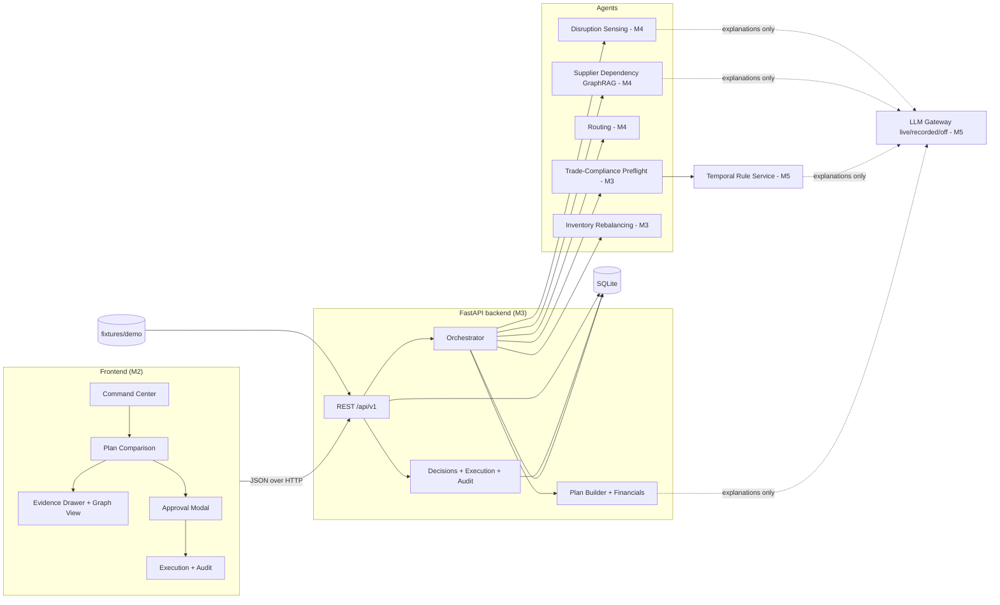
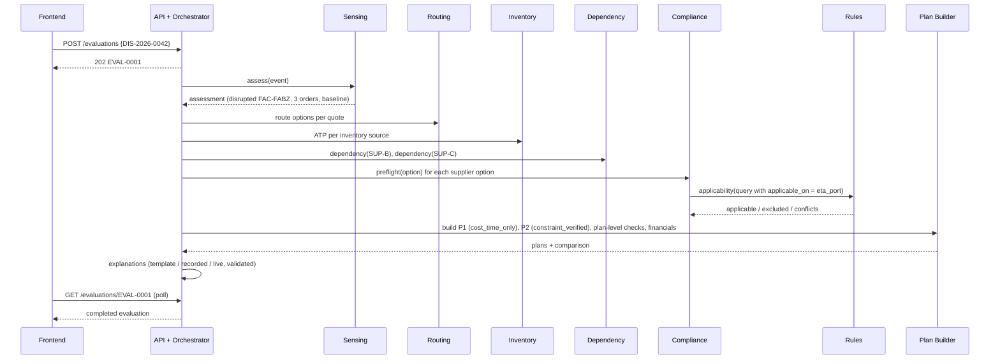
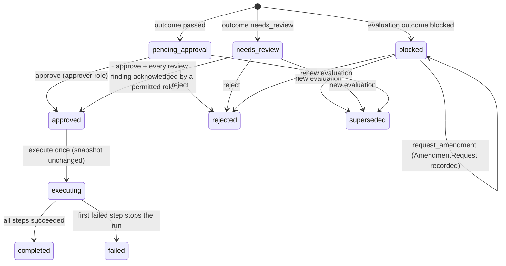

# AegisShield AI — Shared Source of Truth

| | |
|---|---|
| Document | `docs/00-source-of-truth.md` (canonical for every shared decision, contract summary, formula and date) |
| Version | 1.0.0 — 19 Oct 2026 |
| Final decision authority | Member 5, after consulting the owner of the affected module (section 15) |
| Maintainers | Member 5 (scope, decisions, sections 1–5, 12–16); Member 3 (sections 7–11 contract summaries, kept in sync with `contracts/`) |
| Machine-readable truth | `contracts/` and `fixtures/`. If this document and a contract file disagree, the contract file wins and this document is corrected in the same pull request. |
| Verification of numbers | Every figure in sections 10 and 12 is recomputed by `python3 tools/check_contracts.py` (last run: PASSED, 19 Oct 2026). |

**Human team vs software agents.** In this package *Member 1–5* always means a person. *Agent* always means one of the five software components in section 8. No person is "an agent".

---

## Contents
1. Product in one page
2. How to read evidence labels, and what we changed from the PDF
3. Event facts and tentative calendar
4. MVP scope, exclusions, stretch goals, success criteria
5. Requirements
6. Technology stack
7. Architecture, module boundaries and ownership
8. The five logical agents and orchestration
9. Contracts overview
10. Deterministic behaviour: dependency, temporal rules, LC, FTA, inventory, plans, money
11. Human approval, simulated execution and audit
12. The single demo scenario and demo script
13. Integration plan, milestones, critical path, daily plan
14. Tests, demo acceptance, risks, assumptions, open decisions
15. Repository conventions, contract versioning, change control, decision authority
16. Traceability
17. Glossary
18. Sources

---

## 1. Product in one page

**What we are building.** AegisShield AI is a supply-chain recovery *preflight*. When a disruption delays critical components, it proposes recovery plans, then checks each plan before anyone acts on it:

1. Does the "alternate" supplier secretly depend on the same disrupted upstream factory? (Supplier/BOM GraphRAG)
2. Which trade rules actually apply on the import date, in this jurisdiction, after supersession? (Temporal RAG)
3. Does the proposed route break the documentary credit (letter of credit) or the FTA direct-consignment condition? (Deterministic checks)
4. Can inventory cover the gap without breaching protected stock? (Deterministic allocation)
5. What does each plan really cost, what loss remains, and what is merely at risk? (Deterministic financials)

A human approves one plan, the system simulates execution, and every step lands in a hash-chained audit log.

**Target users** (proto-personas; Member 1 validates them, see `docs/01-research-and-deck.md`):

| User | Problem today |
|---|---|
| Supply planner (synthetic persona "Priya") | Has to recover three customer orders within hours; route and supplier tools optimise cost and time but cannot see sub-tier dependencies or documentary-credit terms. |
| Trade compliance officer ("Arjun") | Learns about a route change after it is booked; must then deal with a discrepant bill of lading or an FTA preference that may be denied. |
| Plant/operations head and customers | Bear late-delivery penalties and service failures (in our scenario: a rail supplier, a water utility and a cold-chain operator). |

**End-to-end example in plain words (the demo).** A wafer fab in Kulim (synthetic "Zenith Wafer Fab") shuts down. Our primary module supplier in Penang ships 7 days late, so three customer orders will be 6, 4 and 2 days late: ₹11,60,000 of penalties if we do nothing. A cost-and-time optimiser proposes plan **P1**: use plant and Pune stock, buy 400 modules from a cheap Thai supplier shipping via Colombo, and 200 from a Vietnamese supplier via Singapore. On paper P1 avoids ₹8,26,000. AegisShield finds that (a) the Thai supplier's dies come from the *same* disrupted fab through a Kedah die processor, (b) the Singapore transhipment breaks the Vietnamese supplier's letter of credit (43T "not allowed" and UCP 600 sub-article 20(c) excluded), and (c) Colombo is not an AIFTA party, so the preference needs evidence. P1 is **blocked**. Plan **P2** uses plant and Pune stock plus the Vietnamese supplier on a direct sailing: ₹6,18,000 net avoided loss, every check passed, 100 units two days late. Priya approves P2; execution is simulated; the audit chain verifies.

All companies, prices, rates, penalties, schedules and the letter of credit are **synthetic**.

---

## 2. How to read evidence labels, and what we changed from the PDF

### 2.1 Labels used in all six documents

| Label | Meaning |
|---|---|
| **[REQ]** | Requirement given directly in the team's instruction prompt (19 Oct 2026). Not negotiable without Member 5. |
| **[PDF p.N]** | Proposal from the attached planning conversation (`SAP Hackfest Bengaluru 2026 Overview.pdf`, 22 pages). Planning material, not an authority. |
| **[VERIFIED: source]** | Checked against an external source on 19 Oct 2026 (section 18). "official" = SAP or ICC page; "secondary" = reproduction or commentary. |
| **[ASSUMPTION A-nn]** | Our reversible decision where information is missing (section 14.4). |
| **[OPEN OD-nn]** | Unresolved; has an owner and a deadline (section 14.5). |
| **SYNTHETIC** | Fictional demo data. Never present it as real. |

### 2.2 Findings and conflict resolution (PDF vs this package)

| # | PDF said | Problem | Decision here |
|---|---|---|---|
| C1 | Final idea "AegisShield AI" [PDF p.18–22] | — | Kept. Five logical agents and HITL kept. Idea selection is closed [REQ]. |
| C2 | Work split: 1 pitch lead + tech lead + backend + "domain engine" + frontend [PDF p.13, p.21–22] | Conflicts with the team's real roles | Replaced by [REQ] roles: M1 research/deck, M2 UI/UX+frontend, M3 backend, M4 GraphRAG, M5 temporal RAG + UI review + final decisions (section 7.3). |
| C3 | "Letter of Credit Clause 43P (Transshipment Prohibited)" [PDF p.12, p.20] | In SWIFT MT700, **43P is Partial Shipments; 43T is Transhipment** [VERIFIED: iotafinance MT700 field list; ICC eUCP MT700 briefing] | All contracts use 43T for transhipment and 43P for partial shipments. |
| C4 | Transhipment "violates" the LC and "voids" the FTA [PDF p.12, p.19–20] | Too strong. UCP 600 sub-article 20(c) lets a bill of lading show transhipment even when the credit prohibits it, if goods are in a container and one B/L covers the carriage [VERIFIED secondary: ICC Forum; Univ. of Southampton lecture]. ICC's ISBP revision draft notes a prohibition usually needs 20(c) excluded to bite [VERIFIED: ISBP 821 draft — verify final text]. AIFTA direct consignment allows transit through non-parties under conditions [VERIFIED secondary: India's 2009 AIFTA origin rules, Rule 8]. | LC transhipment is **blocked only if** 43T = not allowed **and** 20(c) is excluded (or the container exception does not apply). Non-party transit gives FTA **needs_review**, never automatic loss. Party transit (e.g. Singapore) passes. |
| C5 | "Shipment dates vs arrival dates" mixed [PDF p.9 `latestShipmentDate` with "latest_arrival_date" p.13] | 44C is a **shipment** date; arrival is not an LC shipment condition | LC checks compare ETD with 44C and ETD + presentation period with 31D expiry. Arrival is never an LC pass/fail input (validation case VC-LC-04). |
| C6 | Inconsistent money: ₹42 L penalty [p.12], ₹34 L [p.20], ₹8 L freight [p.19], ₹12,000 freight [p.12], ₹29.5 L saving [p.20], ₹1.8 Cr orders [p.19] | Irreconcilable | One synthetic fixture (section 12). Every number in deck and UI comes from `fixtures/expected/`. |
| C7 | "In <100 ms", "never uses repealed rules", "impossible to dismiss", scores 9.7/10, "no major company works on this" [p.18–20, p.2] | Unmeasured or unverifiable. Other 2026 Hackfest teams publicly built multi-agent supply-chain systems with graph traversal and compliance agents [VERIFIED: public GitHub repositories, section 18] | Banned from deck and UI. Performance numbers are **targets** until measured (D8). We claim "rule applicability is decided by dates and authority, not similarity" and show tests, not "never". |
| C8 | Graph store Neo4j/Memgraph; LangGraph/CrewAI; Llama-3/Granite [p.21] | Operational load for 9 days | NetworkX in-process, plain Python orchestrator, provider-agnostic LLM gateway with recorded/off modes (section 6). |
| C9 | SAP IBP / TM / Ariba / GTS / Joule "integration" [p.13, p.19–20] | No access verified | Shown only as **proposed SAP mapping**. The finale requires a working prototype that uses SAP technologies [VERIFIED official, North and South-East regional pages; Bengaluru text not visible] → [OPEN OD-01]. |
| C10 | "Prototype must be built Oct 26–Nov 3" [p.1, p.9] | Bengaluru page snippet did not show this line; sibling regional pages show such windows | [ASSUMPTION A-01] tentative 9-day window; [OPEN OD-05] confirms whether pre-window work is allowed. |
| C11 | Beneficial ownership / shell entities in the graph [p.17–18] | Not needed for the final idea's checks | Excluded from MVP (stretch S-6). |
| C12 | Instructions embedded in the PDF ("give me…", "explain…") | Historical prompts | Treated as source material only. |

---

## 3. Event facts and tentative calendar

| Fact | Status | Source |
|---|---|---|
| Registration for SAP Hackfest Bengaluru 2026 and SAP Learning Hub, student edition: 24 Sep – **21 Oct 2026**. Learning Hub sign-up is mandatory for **every student individually**. | VERIFIED (official, search snippet; page blocks automated fetch) | SAP Hackfest Bengaluru page |
| Regional round 5–24 Oct 2026; regional round evaluates **ideas only**, based on SAP Learning Hub student-edition courses; no working prototype required. | VERIFIED (official) | same |
| Round 1 is Design Thinking and Business Model Canvas; code is not required. | VERIFIED (official) | same |
| Top 5 teams per regional college round shortlisted on **25 Oct 2026**. | VERIFIED (official) | same |
| Finale and winners: **4 Nov 2026**, New Horizon College of Engineering (NHCE), Bengaluru; finalists pay their own travel. | VERIFIED (official) | same |
| Faculty coordinators must confirm regional-round dates with SAP; unapproved rounds do not qualify. | VERIFIED (official) | same |
| Eligibility: AICTE-approved colleges / recognised universities in Bengaluru Urban and Bengaluru Rural districts. | VERIFIED (official) | same |
| Team size 4–5. | VERIFIED for the national/North page; assumed same for Bengaluru | Hackfest 2026 page |
| Finale: teams must design, build and demonstrate a working prototype that uses SAP technologies. | VERIFIED on North and South-East pages; Bengaluru text not visible → **OD-01** | regional pages |
| Theme 1 suggests agents: disruption sensing, scenario planning, logistics/rerouting, inventory rebalancing, compliance & audit; human approval for the highest-stakes decisions; demo may simulate a Red Sea closure or tariff spike. | VERIFIED (official) | Hackfest 2026 page |
| SAP frames problems through Domain, Tech and Business lenses. | VERIFIED (SAP Community event page) | SAP Community |
| Sir MVIT regional pitch on **24 Oct**; 10 min pitch + 5 min Q&A. | UNVERIFIED (from college guidelines not attached) [PDF p.9] → **OD-06** | — |
| Prototype build window 26 Oct – 3 Nov. | UNVERIFIED for Bengaluru [PDF p.1, p.9] → **A-01** | — |
| Prizes ₹75k / ₹50k / ₹25k. | UNVERIFIED [PDF p.1]; do not quote | — |

**Tentative calendar (IST).** Phase 0 = pitch preparation and contract freeze; Phase 1 = build.

| Date | Day | Phase | Gate |
|---|---|---|---|
| Mon 19 Oct | — | 0 | Package distributed |
| Tue 20 Oct | — | 0 | Kick-off; OD-05, OD-06 answered |
| **Wed 21 Oct** | — | 0 | **Registration deadline (verified)** |
| Thu 22 Oct | — | 0 | OD-01/02/03 decided; deck v1 |
| Sat 24 Oct | — | 0 | Regional pitch (tentative) |
| Sun 25 Oct | — | 0 | Shortlist (verified); contracts **v1.0.0 frozen** |
| Mon 26 Oct – Tue 3 Nov | D1–D9 | 1 | Build (A-01) |
| **Wed 4 Nov** | Finale | — | **Finale at NHCE (verified)** |

---

## 4. MVP scope, exclusions, stretch goals, success criteria

### 4.1 In scope (MVP, must work at the finale)
- One synthetic scenario (`SCN-DEMO-001`), loaded from `fixtures/demo/`, resettable in one call.
- Five logical agents (section 8) behind one deterministic orchestrator.
- Two plans per evaluation: **P1** cost-and-time only (what a naive optimiser does) and **P2** constraint-verified.
- Findings with outcomes `passed` / `needs_review` / `blocked`, each with ≥1 evidence item.
- Plan comparison with baseline loss, recovery cost, residual loss, net avoided loss and separately reported exposures.
- Graph view of the dependency evidence path; rule applicability view showing applied, superseded, draft and lower-authority rules.
- Approve / reject / request LC amendment; acknowledgement of review items by the right role.
- Simulated execution (6 step types), hash-chained audit log with verification.
- LLM modes `live`, `recorded`, `off` with identical outcomes in all three.

### 4.2 Explicitly excluded
Real SAP or ERP integration (only *proposed mappings*, unless OD-01 adds a real SAP technology); real customer data; real legal advice; FX and multi-currency; origin qualification (RVC/CTSH) — the supplier's certificate status is taken as given; surcharges and IGST; LC amendment timing; carbon; ownership/shell-company graphs; authentication; multi-tenant; mobile layouts beyond responsive desktop/projector.

### 4.3 Stretch goals (only after D7 feature freeze is green, in this order; Member 5 decides)
S-1 simulated LC amendment acceptance + re-evaluation (VC-AMEND-01); S-2 live LLM extraction of the supplier notice; S-3 rule timeline graphic; S-4 SAP HANA Cloud vector engine for rule passages; S-5 one real RSS feed classified by the sensing agent (never feeding decisions); S-6 ownership edges in the graph; S-7 third plan "P3 with acknowledged review items".

### 4.4 Measurable success criteria

| ID | Criterion | Measured by | Target date |
|---|---|---|---|
| SC-1 | Golden evaluation via API equals `fixtures/expected/evaluation_EVAL-0001.json` (volatile fields ignored) | `tests/e2e` (M3) | D5 |
| SC-2 | 39/39 oracle validation cases have automated equivalents passing in the owners' modules; 3 manual cases executed and recorded | CI + test log | D6 |
| SC-3 | 0 executions possible without approval; stale, duplicate and blocked approvals refused (VC-APR-01…08) | e2e | D6 |
| SC-4 | 100 % of findings in UI open an evidence item within 2 clicks | acceptance checklist DA-05..07 | D7 |
| SC-5 | Same plan hashes in `live`, `recorded` and `off` modes; demo runs with network unplugged | VC-LLM-01, offline drill | D8 |
| SC-6 | Presenter completes reset → audit verify in ≤ 3 min, 3 consecutive rehearsals without manual data edits | rehearsal log (M1) | D8 |
| SC-7 | Keyboard-only approval flow; status never by colour alone; text contrast WCAG 2.2 AA | M2 checklist, M5 review R3 | D7 |
| SC-8 | Every number in the deck equals a golden value | M1 deck checklist | D8 |
| SC-9 | Evaluation completes in ≤ 5 s on the demo laptop in `recorded` mode (**target, not yet measured**) | timing log | D8 |

---

## 5. Requirements

Priorities: **P0** = finale blocker, **P1** = should, **P2** = stretch. Owner = accountable person. Tests refer to `fixtures/validation/cases.json` (VC-*), golden files (G-*), or demo acceptance items (DA-*, section 14.2).

| ID | Requirement | Pri | Owner | Acceptance criteria |
|---|---|---|---|---|
| FR-01 | Load fixtures, expose scenario, reset demo state and id counters | P0 | M3 | `POST /api/v1/demo/reset` returns `AUD-000001`; next evaluation id is `EVAL-0001` (G-FLOW step 1, 3) |
| FR-02 | Show disruption, affected orders, days late, baseline loss | P0 | M2 | UI shows SO-1001/1002/1003 late 6/4/2 days and ₹11,60,000 (DA-02) |
| FR-03 | Disruption Sensing Agent maps notice to graph node and affected orders | P0 | M4 | Equals `expected/disruption_assessment.json`; unresolved alias → needs_review (VC-SENSE-01) |
| FR-04 | Routing Agent lists eligible route options per quote | P0 | M4 | 4 supplier options (quote × route) exactly as golden `options` (ETD ≥ ready date, same origin port) |
| FR-05 | Supplier Dependency Agent traverses ≤3 hops with evidence paths | P0 | M4 | VC-DEP-01, VC-DEP-02; golden `dependency_results.json` |
| FR-06 | Missing/unverified/truncated dependency data never passes | P0 | M4 | VC-DEP-03, 04, 06 |
| FR-07 | Cycle-safe traversal | P1 | M4 | VC-DEP-05 |
| FR-08 | Temporal rule applicability by jurisdiction, scope, publication, status, interval, supersession, authority | P0 | M5 | VC-RULE-01…07; golden `rule_applicability.json` |
| FR-09 | Unresolved equal-authority conflict → needs_review | P0 | M5 | VC-RULE-03 |
| FR-10 | LC preflight: 43T/20(c), 44C, 44E, 44F, 48+31D, amount, 43P, extraction consistency | P0 | M3 | VC-LC-01…07 |
| FR-11 | FTA preflight: direct consignment and certificate of origin, duty at risk | P0 | M3 | VC-FTA-01…03; VC-FIN-02 |
| FR-12 | Inventory Rebalancing Agent computes ATP and validates allocations | P0 | M3 | VC-INV-01…03 |
| FR-13 | Plan builder produces P1 (cost_time_only) and P2 (constraint_verified) | P0 | M3 | Lines equal golden; VC-LC-05 |
| FR-14 | Financials per section 10.7, exposures separate | P0 | M3 | VC-FIN-01, VC-FIN-03 |
| FR-15 | Plan comparison screen with recommendation rule | P0 | M2 | DA-04 |
| FR-16 | Evidence drawer for every finding; graph path highlight | P0 | M2 | DA-05..07 |
| FR-17 | Decisions with version+hash, roles, acknowledgements, idempotency | P0 | M3 | VC-APR-01…08; G-FLOW steps 5–10 |
| FR-18 | Approval UI with role switcher, acknowledgement checklist, blocked state | P0 | M2 | DA-08, DA-09 |
| FR-19 | Simulated execution, once, after approval, input snapshot unchanged | P0 | M3 | G-FLOW 11–13; VC-APR-04, 05 |
| FR-20 | Hash-chained append-only audit log + verify endpoint + viewer | P0 | M3 (API), M2 (UI) | G-FLOW 15–16; DA-11 |
| FR-21 | Agent progress timeline during evaluation | P1 | M2 | Steps render with status and mode |
| FR-22 | LLM gateway with live/recorded/off; UI badge | P0 | M5 | VC-LLM-01; DA-12 |
| FR-23 | Grounded explanations validated against allowed citations; template fallback | P1 | M5 (plans, rules), M4 (dependency) | VC-LLM-02 |
| FR-24 | LC raw-text extraction compared with gold; mismatch → needs_review | P1 | M5 | VC-LC-07 path end-to-end |
| FR-25 | Synthetic labelling in UI, API and deck | P0 | M2 (UI), M1 (deck) | DA-01, DA-14 |
| FR-26 | Request LC amendment records AmendmentRequest; plan stays blocked | P1 | M3 | VC-APR-08 |
| FR-27 | Simulated amendment acceptance + re-evaluation | P2 | M3 | VC-AMEND-01 |
| FR-28 | One real SAP technology used per OD-01 | P0 decision / P1 build | M3 (build), M5 (decision) | OD-01 record + working demo of the chosen piece |
| NFR-01 | Determinism: same inputs → same outcomes, amounts, ids and plan hashes | P0 | M3 | SC-1, SC-5 |
| NFR-02 | Offline demo | P0 | M3 | DA-12 offline drill |
| NFR-03 | Every API response validates against OpenAPI in test mode | P0 | M3 | response-validation middleware in tests |
| NFR-04 | Accessibility basics | P0 | M2 | SC-7 |
| NFR-05 | No secrets in repo; `.env` ignored | P0 | M3 | repo scan |
| NFR-06 | Performance targets (SC-9) measured and reported, not claimed earlier | P1 | M3 | D8 timing log |

---

## 6. Technology stack

No repository was supplied, so this is a green-field recommendation. Alternatives are named so Member 5 can overrule early.

| Layer | Choice | Why | Alternatives considered |
|---|---|---|---|
| Backend | Python 3.12, FastAPI, Pydantic v2, Uvicorn | Async jobs, typed models, OpenAPI tooling, team familiarity | Node/Express (two languages for RAG work) |
| Persistence | SQLite via SQLAlchemy 2.0 (one file, `data/aegis.db`) | Transactions and unique constraints for idempotency; zero ops; trivial reset | PostgreSQL (unneeded); SAP HANA Cloud (OD-01 option) |
| Graph | NetworkX `MultiDiGraph` built in-process from `supply_graph.json` | 10 nodes; deterministic; no service to fail | Neo4j/Memgraph (ops cost); SAP HANA Cloud knowledge graph (stretch, unverified effort) |
| Rule retrieval | Deterministic metadata filter decides; BM25 (`rank-bm25`) ranks passages for display only | Corpus is ~6 rules; selection must be explainable | Embeddings + Chroma; SAP HANA Cloud vector engine (S-4) |
| LLM | Provider-agnostic gateway: `live` (OpenAI-compatible HTTP or SAP Generative AI Hub if available), `recorded` (replay JSON by prompt hash), `off` (templates) | Venue network and quotas are unknown; outcomes never depend on the LLM | Hard dependency on one provider (rejected) |
| Orchestration | Plain Python pipeline with typed step functions, per-step timeout and step records | Fixed order, testable, cheapest reliable workflow | LangGraph / CrewAI (OD-02: wrap steps as nodes later if judges expect an "agent framework") |
| Frontend | React 18 + TypeScript + Vite, Tailwind CSS, shadcn/ui, Cytoscape.js, TanStack Query, types generated by `openapi-typescript` | Familiar stack; Cytoscape handles small graphs well; generated types keep UI and API aligned | Next.js (no SSR need); UI5 Web Components for React (SAP Fiori look; OD-03) |
| Tests | pytest + jsonschema + httpx/TestClient; Vitest; Playwright (one smoke path) | Covers contracts, modules, e2e | — |
| Contract tooling | `tools/check_contracts.py` (jsonschema, PyYAML, openapi-spec-validator) | Already passing; CI gate | — |
| Deployment | Local laptop (primary, offline-capable); SAP BTP Cloud Foundry trial for the backend if OD-01 chooses it (Python buildpack is documented by SAP) | Venue risk; finale expects SAP technologies (OD-01) | Public cloud host |

---

## 7. Architecture, module boundaries and ownership

### 7.1 Component view



### 7.2 Evaluation data flow



### 7.3 Modules, accountable owner and reviewer

Exactly one accountable owner per module. Reviewers review pull requests within one working session and do not own delivery.

| Module | Scope | Accountable | Reviewer | Code location (proposed) |
|---|---|---|---|---|
| MOD-01 Contracts & tooling | `contracts/`, `fixtures/expected/`, `tools/`, CHANGELOG, CI job | M3 | M5 | `contracts/`, `tools/` |
| MOD-02 API & persistence | FastAPI app, SQLite schema, fixture loader, reset, id counters, problem+json | M3 | M4 | `backend/app/api`, `backend/app/db` |
| MOD-03 Orchestrator | Evaluation job, step records, timeouts, supersession, failure propagation | M3 | M5 | `backend/app/orchestrator` |
| MOD-04 Disruption Sensing Agent | Notice extraction (gold/recorded/live), alias resolution, impact & baseline | M4 | M3 | `backend/app/agents/sensing` |
| MOD-05 Supplier Dependency Agent | Graph ingestion & validation, traversal, coverage, evidence paths, linearisation, GraphView | M4 | M5 | `backend/app/agents/dependency` |
| MOD-06 Routing Agent | Route eligibility per quote, transhipment ports and countries | M4 | M3 | `backend/app/agents/routing` |
| MOD-07 Temporal Rule Service | Rule store, applicability engine, BM25 passages, conflicts | M5 | M4 | `backend/app/rules` |
| MOD-08 Trade-Compliance Preflight Agent | LC checks, FTA checks, duty at risk | M3 | M5 | `backend/app/agents/compliance` |
| MOD-09 Inventory Rebalancing Agent | ATP, allocation feasibility | M3 | M4 | `backend/app/agents/inventory` |
| MOD-10 Plan Builder & Financials | Greedy strategies, plan-level checks, financials, comparison, plan hash | M3 | M5 | `backend/app/plans` |
| MOD-11 Decisions, Execution, Audit | State machine, idempotency, amendment requests, simulated execution, hash chain | M3 | M5 | `backend/app/decisions`, `backend/app/audit` |
| MOD-12 LLM Gateway & explanations | Modes, recorded store, prompt registry, citation validator, LC text extraction | M5 | M4 | `backend/app/llm` |
| MOD-13 Frontend application | Screens, state, API client, formatting | M2 | M5 | `frontend/src` |
| MOD-14 Graph & evidence components | Cytoscape view, evidence drawer, rule panel | M2 | M4 | `frontend/src/features/evidence` |
| MOD-15 Deployment & demo environment | Local runbook, offline bundle, optional SAP BTP CF deploy | M3 | M2 | `ops/` |
| MOD-16 Research, evidence register, deck, demo script | Round 1 and finale decks | M1 | M5 | `pitch/` |
| MOD-17 Decision log, scope and design review | `docs/05` decision log, review checkpoints | M5 | M1 | `docs/05-…` |
| MOD-18 Demo acceptance | Checklist DA-01…15; M1 executes as independent tester | M5 | M1 | `docs/00` §14.2, `pitch/rehearsal-log.md` |
| MOD-19 Backend e2e tests | Golden flow, response validation | M3 | M5 | `backend/tests/e2e` |
| MOD-20 UI tests & accessibility | Vitest, Playwright smoke, a11y checklist | M2 | M5 | `frontend/tests` |

### 7.4 Boundary rules
1. Only MOD-02 talks to the database. Agents are pure functions over typed inputs (section 9.4).
2. Only MOD-12 talks to an LLM provider. No module calls a model SDK directly.
3. Only MOD-08 decides LC/FTA outcomes; MOD-07 only says which rules apply.
4. Only MOD-10 computes money. The UI formats numbers; it never recomputes them.
5. Only MOD-11 changes plan status after evaluation.

---

## 8. The five logical agents and orchestration

"Agent" here means a bounded software component with a fixed contract. Deterministic code decides; the LLM may extract text into a schema or explain results, and its output is validated.

| Agent | Purpose | Owner | Inputs | Outputs | Tools | Deterministic responsibilities | LLM use (bounded) | Failure handling |
|---|---|---|---|---|---|---|---|---|
| Disruption Sensing (DSA) | Turn a notice into graph nodes, delayed shipments, affected orders, baseline loss, severity | M4 | `DisruptionEvent`, graph aliases, orders/POs/shipments, `severity_policy` | `DisruptionAssessment` | alias table, pegging | Alias resolution (exact, case-insensitive), revised dates, penalties, severity | Extract `GoldExtraction` fields from `raw_text` (live/recorded); must equal gold or → `issues: EXTRACTION_MISMATCH`, outcome needs_review | Unresolved alias → needs_review and empty `disrupted_node_ids` → every dependency check needs_review |
| Supplier Dependency (SDA, GraphRAG) | Prove or refute independence of each candidate supplier | M4 | `DependencyQuery`, `SupplyGraph`, BOM | `DependencyResult`, `LinearizedContext`, `GraphView` | NetworkX | Upstream traversal ≤ max_depth, BOM relevance, coverage, cycles, outcome rules (10.1) | Explain paths citing only `allowed_citation_ids` | Exception → step failed → all dependency findings needs_review (`check_unavailable`); never passed |
| Routing (RTA) | List feasible route options for each quote | M4 | quotes, `route_options` | eligible routes with transhipment countries | — | Eligibility: same origin port, ETD ≥ ready date | none | Missing route data → option omitted and logged |
| Trade-Compliance Preflight (TCA) | LC and FTA checks per option and per plan | M3 | option, LC, rule results, quotes | `Finding[]`, duty at risk | Temporal Rule Service | All LC and FTA rules (10.3, 10.4) | none (LC text extraction is MOD-12's, validated) | Rule service failure → `FTA.RULE_APPLICABILITY` needs_review |
| Inventory Rebalancing (IRA) | ATP and allocation feasibility | M3 | inventory positions, plan lines | ATP options, `INV.*` findings | — | ATP formula, availability date, allocation ≤ ATP | none | Negative/invalid stock → blocked finding |

**Orchestration (MOD-03).** One evaluation runs these steps in order, each with a timeout and a step record (`AgentStep`): 1 disruption_sensing (10 s) → 2 supplier_dependency (5 s) → 3 routing (5 s) → 4 inventory_rebalancing (5 s) → 5 trade_compliance (5 s) → 6 plan_assembly (5 s, includes financials) → 7 explanation (10 s). Rules:
- Deterministic steps: **0 retries** (a deterministic failure will not fix itself). LLM calls: **1 retry**, then fallback to template; step status `degraded`; attempts recorded. No hidden retries.
- A failed step 1, 6 makes the evaluation `failed`. A failed step 2–5 turns the affected findings into `needs_review` with `details.check_unavailable = true`; plans still build, and P2 excludes those options.
- Total budget 30 s (target). On timeout the step is `failed`, same propagation.
- Starting an evaluation supersedes undecided plans of earlier evaluations of the same disruption.
- **Human-in-the-loop checkpoint:** evaluation always ends with plans in `blocked`, `needs_review` or `pending_approval`. Nothing executes without a recorded human decision (section 11).

**Mapping to the event's suggested topology** (so judges hear their own vocabulary):

| Event term [VERIFIED official] | Our component |
|---|---|
| Disruption Sensing Agent | DSA |
| Scenario Planning Agent | SDA (risk lens) + Plan Builder (deterministic cost/time/risk comparison) |
| Rerouting & Logistics Agent | RTA |
| Inventory Rebalancing Agent | IRA |
| Compliance & Audit Agent | TCA (compliance) + MOD-11 audit log (every decision with rationale, timestamps, data sources) |

---

## 9. Contracts overview

Canonical files: `contracts/schemas/*.schema.json` (JSON Schema 2020-12, relative `$ref`s) and `contracts/openapi.yaml` (OpenAPI 3.1). Registry with owners and reviewers: `contracts/README.md`.

### 9.1 Conventions
- **IDs** are stable strings: `EVAL-0001`, `PLN-0001`, `DEC-0001`, `EXE-0001`, `AMD-0001`, `AUD-000001` (counters restart on reset); fixture ids such as `SUP-B`, `FAC-FABZ`, `E-005`, `RT-C-SIN`, `TR-0003`; content-derived ids `FND-<CHECK>-<subject>`, `EVD-…`, `PATH-SUP-B-1`, `EXP-DEP-L03`.
- **Money**: integer whole rupees (`*_inr`). Rates in basis points (`rate_bps`, 1500 = 15 %). Rounding half-up to the rupee per line, then sum. UI formats with Indian grouping (₹11,60,000).
- **Dates**: `YYYY-MM-DD` business dates in Asia/Kolkata terms; timestamps RFC 3339 with offset. Date intervals are inclusive of `effective_to`.
- **Nulls**: a nullable field is always present with `null`; absent fields are a contract error. Empty lists are `[]`, never `null`.
- **Versions**: every payload carries `schema_version` `1.x.y` (section 15.2).
- **Synthetic**: fixtures carry `synthetic: true`; API exposes `data_mode: "synthetic"`.

### 9.2 Entities (schema → file)

| Entity | Schema `$defs` | Fixture / producer |
|---|---|---|
| Scenario, Location, Agreement, Part (+BOM), Customer, Supplier, CustomerOrder (+penalty), PurchaseOrder (+pegging), Shipment, SupplierQuote, RouteOption (+legs), InventoryPosition, LetterOfCredit, Source, Policies | `master-data.schema.json` | `fixtures/demo/*.json` |
| DisruptionEvent, GoldExtraction, DisruptionAssessment | `disruption.schema.json` | `disruptions.json` → DSA |
| GraphNode, GraphEdge (SUPPLIES, provider→consumer), DependencyQuery, DependencyResult, DependencyPath, LinearizedContext, GraphView | `graph.schema.json` | `supply_graph.json` → SDA |
| TradeRule, RuleQuery, RuleApplicabilityResult | `trade-rules.schema.json` | `trade_rules.json` → MOD-07 |
| Evidence, Finding, Problem, Actor, Subject | `common.schema.json` | all |
| SourceOption, PlanLine, Exposure, PlanFinancials, RecoveryPlan, PlanComparison, AgentStep, Explanation, Evaluation | `plan.schema.json` | MOD-03/10 |
| DecisionRequest, Decision, Acknowledgement, AmendmentRequest, ExecutionRequest, Execution, ExecutionStep, AuditEvent, AuditVerifyResult | `decision.schema.json` | MOD-11 |
| Health, DemoResetResponse, ScenarioResponse, DisruptionList | `api.schema.json` | MOD-02 |

### 9.3 HTTP API (all under `/api/v1`, details in `openapi.yaml`)

| Method & path | Purpose | Success | Main errors |
|---|---|---|---|
| GET `/health` | status, llm_mode, snapshot | 200 | — |
| POST `/demo/reset` | restore fixtures, clear state | 200 | 403 DEMO_MODE_DISABLED |
| GET `/scenario` | orders, POs, shipments, suppliers, inventory, LCs, actors | 200 | — |
| GET `/disruptions`, `/disruptions/{id}` | events | 200 | 404 |
| POST `/evaluations` | start evaluation (async) | 202 | 400, 404, 409 EVALUATION_IN_PROGRESS, 422 |
| GET `/evaluations/{id}` | progress and results | 200 | 404 |
| GET `/evaluations/{id}/graph?focus_supplier_id=` | GraphView | 200 | 404, 409 EVALUATION_NOT_COMPLETE |
| GET `/plans/{id}` | current plan with status, decision_ids, execution_id | 200 | 404 |
| POST `/plans/{id}/decisions` | approve / reject / request_amendment | 201 (200 replay) | 400, 403, 404, 409 STALE/SUPERSEDED/EXISTS/KEY_REUSED, 422 BLOCKED/ACK/NO_AMENDABLE |
| POST `/plans/{id}/executions` | simulated execution | 202 | 409 NOT_APPROVED / ALREADY_EXECUTED / PLAN_VERSION_STALE |
| GET `/executions/{id}` | execution steps | 200 | 404 |
| GET `/amendment-requests/{id}` | amendment request | 200 | 404 |
| POST `/demo/amendment-requests/{id}/simulate-acceptance` | stretch S-1 | 200 | 403, 404 |
| GET `/audit-events`, `/audit-events/verify` | log page, chain verification | 200 | — |
| POST `/rules/applicability` | rule evidence panel and tests | 200 | 422 |

Headers on every mutating call: `X-Actor-Id` (simulated identity) and `Idempotency-Key`. Errors: `application/problem+json` with `code`.

### 9.4 Internal module interfaces (Python, typed with Pydantic models generated from the schemas)

```python
# MOD-04 (M4)
def assess_disruption(event: DisruptionEvent, ctx: ScenarioContext, mode: ExtractionMode) -> DisruptionAssessment: ...
# MOD-05 (M4)
def check_dependency(q: DependencyQuery, graph: SupplyGraph, parts: list[Part], policy: DependencyPolicy) -> DependencyResult: ...
def linearize(result: DependencyResult, graph: SupplyGraph) -> LinearizedContext: ...
def build_graph_view(results: list[DependencyResult], graph: SupplyGraph, focus_supplier_id: str, evaluation_id: str) -> GraphView: ...
# MOD-06 (M4)
def eligible_routes(quote: SupplierQuote, routes: list[RouteOption]) -> list[RouteOption]: ...
# MOD-07 (M5)
def rule_applicability(q: RuleQuery, rules: list[TradeRule], agreements: list[Agreement]) -> RuleApplicabilityResult: ...
def rank_passages(q: RuleQuery, result: RuleApplicabilityResult, k: int = 3) -> list[PassageHit]: ...   # display only
# MOD-08 (M3)
def lc_route_findings(lc: LetterOfCredit, route: RouteOption, locations: dict) -> tuple[list[Finding], list[Evidence]]: ...
def fta_findings(quote: SupplierQuote, route: RouteOption, rules: RuleApplicabilityResult, agreements: dict) -> tuple[list[Finding], list[Evidence]]: ...
def duty_at_risk(quote: SupplierQuote, route: RouteOption, qty: int, rules: RuleApplicabilityResult) -> int | None: ...
# MOD-09 (M3)
def inventory_options(positions: list[InventoryPosition], as_of: date) -> list[SourceOption]: ...
# MOD-10 (M3)
def build_plan(strategy: Strategy, assessment: DisruptionAssessment, options: list[SourceOption], findings: dict, ...) -> RecoveryPlan: ...
# MOD-12 (M5)
def explain(subject_id: str, context: LinearizedContext | PlanContext, prompt_id: str) -> Explanation: ...   # never raises; falls back to template
def extract_lc_fields(raw_text: str) -> dict: ...                                                        # validated against gold
```

`tools/aegis_oracle.py` contains a **reference** implementation of every function above. It is an executable specification for reading and for golden generation; production modules are written independently and must match the goldens.

### 9.5 Graph and evidence payloads
- Graph edges: `SUPPLIES`, direction **provider → consumer**; traversal for dependency follows incoming edges. GraphView adds `CANDIDATE_SUPPLY` edges (dashed) from candidate suppliers to the buyer plant.
- Evidence kinds: `graph_path`, `rule_passage`, `lc_field`, `fixture_record`, `source_document`, `calculation`. Every evidence item names `source_ids` that exist in the source registries; `check_contracts.py` enforces this.
- Every finding has ≥1 evidence id (enforced by schema `minItems: 1` and the checker).

---

## 10. Deterministic behaviour

### 10.1 Supplier dependency (MOD-05)
- Start at the candidate supplier's `supplying_facility_id`. Relevant parts = BOM closure of the supplied part (PM-750 → IGBT die, DBC substrate).
- Depth-first upstream over incoming `SUPPLIES` edges whose `part_id` is relevant, sorted by `edge_id`, up to `max_depth` hops (default 3). A node already on the current path is skipped and `cycle_detected = true`.
- A path ends at a node with no relevant incoming edge. If that node is not an origin for the part it supplies → gap `upstream_unknown`. At max depth with more edges → `truncated`.
- Coverage: every critical BOM child must have an incoming edge at the start facility, else gap `missing_critical_input`.
- Outcome, first match wins: no disrupted node known → `needs_review` (DISRUPTED_NODE_UNKNOWN); a path reaches a disrupted node → `blocked` if every edge on those paths is `verified`, else `needs_review`; any gap → `needs_review`; truncated → `needs_review`; else `passed`.
- Shared but undisrupted upstream nodes with the primary supplier are reported as `SHARED_NON_DISRUPTED_DEPENDENCY` notes (concentration risk), not as failures.
- **Missing data is never evidence of independence.**

### 10.2 Temporal rule applicability (MOD-07)
Query = jurisdiction, rule types, HS label, origin, transit countries, agreement, `applicable_on` (legal date; MVP: ETA at Indian port, A-05) and `known_as_of` (knowledge cutoff = scenario date). Steps:
1. Exclude by jurisdiction, HS scope, origin scope, `published_date > known_as_of` (not_yet_published), status draft/withdrawn, `applicable_on < effective_from` (not_yet_effective).
2. Exclude a remaining rule if another remaining rule lists it in `supersedes` (superseded); else exclude if `applicable_on > effective_to` (expired).
3. Per rule type, keep the highest authority level (`official_gazette > official_circular > internal_policy > secondary`). Equal-authority rules with different values → **unresolved conflict → needs_review**. Lower-authority rules are excluded (`lower_authority`); if their value differs, a conflict resolved by `authority_precedence` is recorded and shown.
4. A requested rule type with nothing applicable → `missing_rule_types` → needs_review. Never default to "passed".
5. BM25 ranks passages for display. **Similarity never decides applicability** (`retrieval_trace.ranker_used_for_selection = false`).

### 10.3 Letter-of-credit checks (MOD-08), per option and per plan
| Check | Rule | Outcome if failed |
|---|---|---|
| LC.TRANSHIPMENT | No transhipment → pass. 43T allowed or silent → pass. 43T not allowed and 47A excludes UCP 600 20(c) → **blocked**. 43T not allowed, 20(c) not excluded, bill of lading, containerised, single B/L → pass with note (20(c)(ii)). Otherwise blocked. | blocked + remedy `request_lc_amendment` |
| LC.LATEST_SHIPMENT_DATE | route ETD ≤ 44C. **Arrival is not checked.** | blocked |
| LC.PORT_OF_LOADING / DISCHARGE | origin port in 44E (port list or "any port in country"); destination = 44F | blocked |
| LC.PRESENTATION_PERIOD | ETD + 48 days ≤ 31D expiry | blocked |
| LC.AMOUNT (plan) | Σ qty × unit price under the LC ≤ available balance | blocked |
| LC.PARTIAL_SHIPMENTS (plan) | 43P allowed, or drawing equals full amount | blocked |
| LC.EXTRACTION_CONSISTENCY | if an LLM extraction exists, every extracted field equals the verified record | needs_review |
These are **simplified encodings** for a demo; a real examination follows UCP 600, ISBP and the credit's wording (A-13).

### 10.4 FTA checks (MOD-08)
- Applies when the supplier's country and the importing jurisdiction are parties to the agreement on the quote's certificate of origin.
- `FTA.DIRECT_CONSIGNMENT`: all transhipment countries are parties → pass; any non-party and `fta_transit_evidence_available` → pass; otherwise **needs_review** (preference depends on evidence that Rule-8-style conditions are met).
- `FTA.CERTIFICATE_OF_ORIGIN`: `available` → pass; `pending`/`unavailable` → needs_review.
- Unresolved rules → `FTA.RULE_APPLICABILITY` needs_review.
- **Duty at risk** (only for needs_review lines) = qty × (unit price + freight per unit) × (MFN bps − preferential bps) / 10 000, half-up per line. Basic customs duty only (A-06).

### 10.5 Inventory (MOD-09)
ATP = max(0, on_hand − reserved − protected_floor); available at plant on scenario date + transfer_days; cost = transfer cost per unit. A plan may never allocate more than ATP from a source (`INV.ALLOCATION_FEASIBLE`).

### 10.6 Plan building (MOD-10)
- **Options** = inventory sources + (quote × eligible route). Capacity is shared per quote (`capacity_group`). Unit incremental cost = (quote price − baseline PO price) + freight, or transfer cost.
- **Greedy allocation** (both strategies): orders by need-by date then id; for each unit block, choose among options with capacity: on-time options by (unit cost, ETA, id); if none on time, the earliest option that still beats the delayed primary arrival; otherwise leave units on the delayed PO (`BASELINE-PO`).
- **P1 `cost_time_only`** uses every option regardless of findings. **P2 `constraint_verified`** uses only options whose outcome is `passed` and caps LC-funded quantities at ⌊available balance / unit price⌋.
- Plan-level checks: LC amount, LC partial shipments, inventory allocation. Plan outcome = worst finding (sensing + options used + plan-level). Status: passed → `pending_approval`, needs_review → `needs_review`, blocked → `blocked`.
- The heuristic is not a global optimum; the fixture is built so that every recovery unit is cheaper than the penalty it avoids (stated, A-14).
- **Recommendation rule**: exclude blocked plans; prefer passed over needs_review; then highest net avoided loss; then lowest worst-case exposure.

### 10.7 Financial definitions (MOD-10)
| Term | Definition |
|---|---|
| Baseline loss | Penalties if nothing is done: Σ affected units × rate × min(days late, cap) using the delayed primary arrival |
| Recovery cost | Incremental cash of the plan: supplier price premium + freight + inventory transfer + LC amendment fee + certain incremental duty |
| Residual loss | Penalties still incurred under the plan |
| Net avoided loss | Baseline loss − recovery cost − residual loss |
| Exposure | Loss that *may* occur if a non-passed finding materialises. Reported separately; **never** added to recovery cost; mutually exclusive futures are not summed |
| Worst-case exposure | Σ over independent groups of the largest per-scenario total in the group |

"Penalty avoided" is never a cost line, and exposures are never netted into net avoided loss.

### 10.8 Worked figures for the demo (recomputed by the checker; INR)

| | Baseline (do nothing) | P1 cost & time only | P2 AegisShield verified |
|---|---|---|---|
| SO-1001 (400 u, need 3 Nov) | 400 × ₹250 × 6 d = 6,00,000 | on time | 100 u × ₹250 × 2 d = 50,000 residual |
| SO-1002 (300 u, need 5 Nov) | 300 × ₹300 × 4 d = 3,60,000 | on time | on time |
| SO-1003 (200 u, need 7 Nov) | 200 × ₹500 × 2 d = 2,00,000 | on time | on time |
| **Baseline loss** | **11,60,000** | 11,60,000 | 11,60,000 |
| Supplier price premium | — | B 400 × 300 + C 200 × 600 = 2,40,000 | C 600 × 600 = 3,60,000 |
| Freight | — | B 400 × 160 + C 200 × 120 = 88,000 | C 600 × 210 = 1,26,000 |
| Inventory transfer | — | Pune 150 × 40 = 6,000 | 6,000 |
| **Recovery cost** | 0 | **3,34,000** | **4,92,000** |
| **Residual loss** | 11,60,000 | **0** | **50,000** |
| **Net avoided loss** | 0 | **8,26,000 (on paper)** | **6,18,000** |
| Outcome | — | **BLOCKED** (2 blocked, 1 needs review) | **PASSED** |
| Exposures | — | B fails like A: 100 × 250 × 6 + 300 × 300 × 4 = **5,10,000**; or B arrives but preference denied: 400 × (6,300 + 160) × 15 % = **3,87,600** (same group, not added); LC amendment risk unquantified → worst case **5,10,000** | none |

P1 looks ₹2,08,000 better on paper and cannot be executed. If the repealed 10 % rate (TR-0002) had been used, duty at risk would have been understated at ₹2,58,400 (VC-FIN-02).

---

## 11. Human approval, simulated execution and audit

### 11.1 Plan states



### 11.2 Who may do what (from `policies.json`)

| Action | Allowed roles | Additional rules |
|---|---|---|
| Approve | supply_planner, trade_compliance_officer | Never for blocked plans. Every needs_review finding needs an acknowledgement by a role allowed for that finding's agent: compliance findings → trade_compliance_officer; dependency, routing, inventory, sensing → supply_planner |
| Reject | supply_planner, trade_compliance_officer | Justification ≥ 10 characters |
| Request LC amendment | trade_compliance_officer | Plan must contain a blocked `LC.*` finding; plan stays blocked; fee ₹8,000 applies only if the amended plan is later executed (stretch S-1) |
| Execute | any approver | Plan approved, matching decision id, input snapshot unchanged |
| Viewer | — | Read only |

### 11.3 Enforcement (server side; the UI only mirrors it)
- **No execution before approval** → 409 NOT_APPROVED.
- **No repeated execution** → 409 ALREADY_EXECUTED (same Idempotency-Key replays the original 202).
- **No duplicate decisions** → same key replays (200, `Idempotent-Replay: true`); new key → 409 DECISION_EXISTS; same key with a different body → 409 IDEMPOTENCY_KEY_REUSED.
- **No stale approval** → body must carry the current `plan_version` and `plan_hash` → else 409 PLAN_VERSION_STALE with `current`.
- **No approval of superseded plans** → 409 PLAN_SUPERSEDED.
- **No execution on changed inputs** → execution compares `input_snapshot_id` → 409 PLAN_VERSION_STALE.
- Refusals are audited (`DECISION_REFUSED`, `EXECUTION_REFUSED`).
- Concurrency: decisions and executions run inside one SQLite transaction with a unique index on (plan_id, plan_version) for decisions of type approve/reject and on (plan_id, plan_version) for executions.

### 11.4 Simulated execution
Steps are generated from plan lines in this order: REDUCE_PO (delayed PO reduced by the units bought elsewhere, allowed by its synthetic force-majeure clause) → CREATE_PO per quote → BOOK_FREIGHT per route → CREATE_STOCK_TRANSFER per inventory source with transfer days → RESERVE_STOCK per plant source and order → NOTIFY_CUSTOMER per order with late units (draft, not sent). Each step carries `simulated: true` and a `proposed_sap_mapping` string. The first failure stops the run; later steps are `skipped`; plan becomes `failed`; no automatic retry or compensation (VC-EXE-01). Golden steps for P2 are in `fixtures/expected/approval_flow.json` step 12.

### 11.5 Audit log
Append-only table; `event_hash = sha256(canonical JSON of the event without event_hash)`, `prev_hash` links to the previous event (genesis = 64 zeros). `GET /audit-events/verify` recomputes the chain. Reset starts a new chain. Payloads hold ids, statuses, hashes and amounts, never secrets or full documents.

---

## 12. The single demo scenario and demo script

### 12.1 Scenario `SCN-DEMO-001` (all SYNTHETIC; scenario clock 26 Oct 2026 09:00 IST)

| Item | Value |
|---|---|
| Buyer | Kaveri Motion Systems Pvt Ltd, Bengaluru plant; imports PM-750 IGBT power modules (HS label `HS-SYN-8504.90`, illustrative only) |
| Primary supplier | SUP-A Penang PowerTech (MY), PO-7001: 900 units at ₹6,000, shipment SHP-A-0901 Port Klang → Chennai, planned plant arrival 2 Nov |
| Disruption | DIS-2026-0042: Zenith Wafer Fab (Kulim) outage on 24 Oct; SHP-A-0901 departs 2 Nov instead of 26 Oct (+7 days); plant arrival 9 Nov |
| Orders | SO-1001 Nilgiri Rail 400 u, need 3 Nov, ₹250/u/day; SO-1002 Deccan Water Utilities 300 u, need 5 Nov, ₹300/u/day; SO-1003 Konkan Cold Chain 200 u, need 7 Nov, ₹500/u/day; cap 10 days; order values ₹84 L, ₹63 L, ₹42 L |
| Inventory | Bengaluru: on hand 250, floor 100 → ATP 150 now, ₹0; Pune: on hand 300, reserved 100, floor 50 → ATP 150 on 29 Oct, ₹40/u |
| Quote B | SUP-B Chao Phraya Power Devices (TH): ₹6,300, 400 u, ready 27 Oct at Laem Chabang, advance payment, CoO available |
| Quote C | SUP-C Saigon Precision Electronics (VN): ₹6,600, 600 u, ready 28 Oct at Ho Chi Minh City, under LC-SYN-0117, CoO available |
| Routes | RT-B-CMB via Colombo, plant 3 Nov, ₹160/u · RT-B-DIR direct, plant 8 Nov, ₹140/u · RT-C-SIN via Singapore, plant 4 Nov, ₹120/u · RT-C-DIR direct, ETD 29 Oct, plant 5 Nov, ₹210/u |
| Graph | B's dies: Chonburi ← Kedah Die Services ← **Zenith Kulim fab (disrupted)**; C's dies: Binh Duong ← Vina Die ← Kumgang Gumi fab; C and A share Selangor substrates (not disrupted) |
| LC-SYN-0117 | 43P allowed; 43T not allowed; 47A excludes UCP 600 20(c); 44E any port in Vietnam; 44F Chennai; 44C 5 Nov; 31D 26 Nov; 48: 21 days; amount ₹60 L; available ₹45 L |
| Rules | TR-0001 direct consignment (modeled on AIFTA Rule 8); TR-0002 MFN 10 % to 31 Oct (superseded); TR-0003 MFN 15 % from 1 Nov; TR-0004 draft 20 % (ignored); TR-0005 AIFTA preference 0 %; TR-0006 newsletter claims 15 % from 15 Oct (secondary, loses to official) |

### 12.2 Demo script (3 minutes of the finale demo; owner of wording M1, owner of clicks M2)

| Beat | Time | Screen | What the audience sees | Golden reference |
|---|---|---|---|---|
| 1 Disruption | 0:00–0:25 | Command Center | Notice from Penang; three orders late 6/4/2 days; ₹11.6 L baseline loss | `disruption_assessment.json` |
| 2 Attractive plan | 0:25–0:50 | Evaluation → Comparison | Agents run; P1 shows ₹8.26 L avoided, the cheapest | comparison PLN-0001 |
| 3 Hidden dependency | 0:50–1:20 | Evidence → Graph | B's dies come from the same Kulim fab via Kedah; path highlighted | `graph_view_SUP-B.json` |
| 4 Documentary constraint | 1:20–1:45 | Evidence → LC & rules | 43T not allowed + 20(c) excluded → blocked; Colombo transit → needs review, duty at risk at 15 % (TR-0003), 10 % rule shown as superseded | findings FND-LC-TRANSHIPMENT-RT-C-SIN, FND-FTA-DIRECT_CONSIGNMENT-RT-B-CMB |
| 5 Verified plan | 1:45–2:10 | Comparison | P2: plant + Pune stock, Vietnam direct; all checks passed; 100 units 2 days late | PLN-0002 |
| 6 Money side by side | 2:10–2:25 | Comparison | P1 ₹8.26 L on paper but blocked, exposure up to ₹5.1 L; P2 ₹6.18 L, no exposure | comparison |
| 7 Human approval → execution → audit | 2:25–3:00 | Approval, Execution, Audit | Approving P1 refused; Priya approves P2; 6 simulated steps; audit chain valid | `approval_flow.json` |

Fallback: if anything fails, press **Reset**, rerun (≈ 10 s), continue; if the backend is down, switch to the recorded screen video (M1 holds it, captured D8).

---

## 13. Integration plan, milestones, critical path, daily plan

### 13.1 Integration sequence
1. **Contract-first stubs (D1):** backend serves `fixtures/expected/*.json` from the real routes so the UI is never blocked.
2. **Modules in isolation (D2–D3):** each owner makes their validation cases and module goldens pass.
3. **Wiring (D4):** orchestrator calls real modules; golden e2e evaluation.
4. **Decisions & execution (D5–D6):** state machine, idempotency, execution, audit; UI flows.
5. **Explanations & fallbacks (D6):** recorded mode, validator, templates.
6. **Freeze (D7):** features frozen; only fixes.
7. **Rehearse (D8), buffer (D9).**

### 13.2 Milestones
| ID | Date | Exit criterion |
|---|---|---|
| G0 | Sun 25 Oct | Contracts v1.0.0 tagged; checker green; every member ran it |
| M1 | D1 Mon 26 Oct | Repo skeleton runs; `/health`, `/scenario`, `/demo/reset`; stub evaluation; UI shell renders stub comparison |
| M2 | D3 Wed 28 Oct | Module goldens pass in isolation (graph, rules, LC/FTA, inventory, plans/financials) |
| M3 | D5 Fri 30 Oct | Live evaluation via API equals golden; UI reads live data; breaking contract changes closed |
| M4 | D7 Sun 1 Nov | Approve → execute → audit live; all VC-APR pass; a11y pass; **feature freeze** |
| M5 | D8 Mon 2 Nov | 3 clean rehearsals; offline drill; deck numbers locked |
| G1 | D9 Tue 3 Nov 18:00 | `demo-freeze` tag; laptops packed |

### 13.3 Critical path
Contracts freeze → MOD-03/08/10 (M3) → golden e2e (M3, D5) → MOD-11 decisions/execution/audit (M3, D5–D6) → approval UI (M2, D5–D7) → rehearsals (all, D8). Member 3 sits on the critical path. Mitigations: reference oracle to port, stubs from D1, Member 4 takes over the execution-step generator (MOD-11 sub-task) if M3 has not started it by D5 noon (decided by M5 at standup).

### 13.4 Daily plan (summary; each role document has the detailed version)
| Day | M1 Research & deck | M2 UI/UX & frontend | M3 Backend | M4 GraphRAG | M5 Temporal RAG, review, decisions |
|---|---|---|---|---|---|
| Mon 19 | Confirm all 5 Learning Hub registrations; read package | Read 00, 02; run checker | Read 00, 03; run checker | Read 00, 04; run checker | Read all; prepare kickoff |
| Tue 20 | Kickoff; research plan; OD-05/06 answers | Kickoff; flows & wireframes v0 | Kickoff; FastAPI spike | Kickoff; NetworkX spike on fixture | Chair kickoff; decide OD-02/03 |
| Wed 21 | **Registration deadline**; deck v0; interviews | Wireframes v1 for deck | Stub routes spike | Linearisation spike | Rule engine spike; review deck v0 |
| Thu 22 | Deck v1 (architecture, BMC, empathy) | Mockups for deck | Architecture slide input | Graph slide input | **Decide OD-01**; review deck v1 |
| Fri 23 | Rehearse ×2; Q&A drill | Mock demo click-through | Q&A support | Q&A support | Rehearsal judge |
| Sat 24 | **Regional pitch (tentative)** | Pitch support | Pitch support | Pitch support | Pitch support |
| Sun 25 | Shortlist result; finale deck plan | Contract review sign-off | **Tag contracts v1.0.0** | Sign-off | Sign-off G0 |
| D1 Mon 26 | Evidence register v2; demo script v1 | App shell, API client, Command Center (stub) | Skeleton, loader, reset, stub routes | Graph loader+validation, traversal | Rule store + applicability (VC-RULE-01/02), LLM gateway `off` |
| D2 Tue 27 | Persona validation notes | Comparison screen (stub) | LC + FTA checks, inventory ATP | Outcomes, coverage, cycles (VC-DEP all) | All VC-RULE; conflicts; **Review R1 (45 min)** |
| D3 Wed 28 | Deck finale v1 | Evidence drawer, findings list | Plan builder + financials (VC-FIN, VC-LC-05) | Evidence paths, linearisation, GraphView, Routing | LC text extraction vs gold; BM25 passages |
| D4 Thu 29 | Judge Q&A bank v2 | Live API; Cytoscape graph | Orchestrator wiring; golden e2e | Sensing agent; integrate | Explanation templates + validator; **Review R2 (45 min)** |
| D5 Fri 30 | Script v2 against live app | Approval modal, role switcher | Decisions API + idempotency | Graph eval harness | Recorded LLM mode; contract change window closes |
| D6 Sat 31 | Deck numbers from goldens | Execution + audit screens | Execution simulator + audit chain | Dependency explanations | VC-LLM cases |
| D7 Sun 1 | **Acceptance run #1** | a11y pass; polish | All VC-APR; freeze | Bug fixes | **Review R3 (60 min)**; freeze call |
| D8 Mon 2 | Rehearsals ×3; video capture | Demo polish fixes | Timing log; offline drill; BTP (OD-01) | Fixes | **Review R4 (30 min)** |
| D9 Tue 3 | Final deck; acceptance run #2 | Fixes only | Fixes only; tag | Fixes only | Go/no-go; tag approval |

Cadence: stand-up 09:30 (15 min, blockers first); merge window 18:00–19:00; M3 runs checker and e2e nightly and posts results.

---

## 14. Tests, demo acceptance, risks, assumptions, open decisions

### 14.1 Test strategy
| Layer | What | Owner | Gate |
|---|---|---|---|
| Contract | `python3 tools/check_contracts.py` | M3 | Every PR, CI |
| Module | Owners convert VC-* for their module into unit tests and compare to module goldens | each owner | PR |
| API conformance | Test client validates every response against `openapi.yaml` | M3 | PR |
| Golden e2e | `approval_flow.json` steps 1–16 | M3 | nightly, D5+ |
| Frontend | Vitest (formatters, state), Playwright smoke: reset → evaluate → open B finding → approve P2 → execute → verify audit | M2 | D6+ |
| Manual | Demo acceptance DA-01…15 by M1 | M5 (accountable) | D7, D9 |
| Non-functional | Timing log (SC-9), offline drill, LLM-off run | M3, M5 | D8 |

### 14.2 Demo acceptance checklist (run by Member 1; signed by Member 5)
| ID | Check |
|---|---|
| DA-01 | Reset works; "SYNTHETIC DATA" banner visible on every screen |
| DA-02 | Command Center: 3 orders, 6/4/2 days late, ₹11,60,000 baseline |
| DA-03 | Evaluation shows 7 steps with status and mode; completes (record seconds) |
| DA-04 | Comparison: P1 ₹3,34,000 / ₹0 / ₹8,26,000 BLOCKED; P2 ₹4,92,000 / ₹50,000 / ₹6,18,000 PASSED; P2 recommended |
| DA-05 | FND-DEP-SUP-B opens the graph with Chonburi ← Kedah ← Zenith highlighted and a text version |
| DA-06 | LC finding shows 43T and 47A lines and the remedy "request amendment" |
| DA-07 | FTA finding (Colombo) shows needs review, ₹3,87,600 at 15 % (TR-0003), TR-0002 superseded, TR-0004 draft, TR-0006 lower authority |
| DA-08 | Approving P1 shows the server's PLAN_BLOCKED message; nothing changes |
| DA-09 | Priya approves P2; repeating shows "already decided"; Arjun cannot approve again |
| DA-10 | Execute → 6 simulated steps, all labelled simulated; second execute refused |
| DA-11 | Audit list shows refusals and decisions; Verify → valid |
| DA-12 | Network unplugged + LLM off: same numbers and outcomes; badge "LLM: off (templates)" |
| DA-13 | Whole approval flow by keyboard; focus visible; statuses have icon + text |
| DA-14 | Every number on slides equals the UI |
| DA-15 | Second run after reset gives identical plan hashes |

### 14.3 Risks and fallbacks
| ID | Risk | L | I | Mitigation | Fallback | Owner |
|---|---|---|---|---|---|---|
| R-01 | Finale requires SAP technology and we show none | M | H | OD-01 by 22 Oct; spike BTP CF deploy D2 | Show SAP mapping slide + ask coordinator early; minimum: BTP CF hosted backend | M5 / M3 |
| R-02 | LLM provider or venue network fails | H | M | `recorded` default; outcomes independent of LLM | `off` mode | M5 |
| R-03 | Member 3 overloaded (critical path) | M | H | Stubs D1; oracle port; daily burndown | M4 takes execution-step generator; cut S-goals | M5 |
| R-04 | Judges challenge legal accuracy | M | H | Evidence register; precise wording (C3–C5); synthetic labels | Say "simplified encoding; real examination follows UCP 600 / ISBP and the credit wording" | M1 |
| R-05 | "Where does tier-2 data come from?" | H | M | Provenance on every edge; needs_review for missing data | Answer: supplier declarations, audits, trade records; we refuse to infer independence | M1 / M4 |
| R-06 | Demo state corrupted mid-demo | M | M | Idempotent APIs; reset button | Recorded video | M2 |
| R-07 | Numbers drift between deck and app | M | H | Deck reads goldens; DA-14 | Freeze deck D8 | M1 |
| R-08 | Scope creep | H | M | Decision log; freeze D7 | M5 says no | M5 |
| R-09 | Pre-window coding or code reuse breaks rules | L | H | OD-05 by 21 Oct | Treat Phase 0 code as throwaway spikes | M1 / M5 |
| R-10 | Registration incomplete by 21 Oct | L | H | M1 checks each member on 19–20 Oct | — | M1 |
| R-11 | Weekend availability (31 Oct–1 Nov) | M | M | Confirm at kickoff | Shift R3 to D8 morning | M5 |
| R-12 | Similar projects by other teams | H | M | Differentiate on evidence discipline, LC/FTA precision, refusal to infer independence | No novelty claims | M1 |

### 14.4 Assumptions (reversible)
| ID | Assumption |
|---|---|
| A-01 | Build window 26 Oct–3 Nov; finale 4 Nov (only the finale date is verified) |
| A-02 | All five members available ~8 h/day including the weekend |
| A-03 | Demo runs on our laptop with a projector; venue internet not guaranteed |
| A-04 | Single currency INR; FX ignored |
| A-05 | Applicable tariff date = ETA at Indian port (India's actual rule ties duty to bill-of-entry / entry-inwards timing — Member 5 verifies before any pitch claim) |
| A-06 | Duty = basic customs duty on (price + freight); surcharges, insurance, IGST excluded |
| A-07 | Delayed PO quantity may be reduced without charge (synthetic force-majeure clause) |
| A-08 | Borrowed stock is replenished by the delayed delivery; carrying cost ignored |
| A-09 | Penalties linear per unit-day with a 10-day cap |
| A-10 | Identity is simulated (`X-Actor-Id`); no authentication |
| A-11 | LC amendment lead time not modelled; fee ₹8,000 |
| A-12 | Route schedules are static fixture data |
| A-13 | LC and FTA rules are simplified encodings, not legal advice |
| A-14 | Greedy planning is a heuristic; fixture constructed so it matches the cost-optimal choice |
| A-15 | Only one evaluation runs at a time per disruption |

### 14.5 Open decisions
| ID | Question | Owner (research) | Decides | Deadline | Default if undecided |
|---|---|---|---|---|---|
| OD-01 | Which SAP technology do we actually use? Options: (a) host backend on SAP BTP Cloud Foundry trial; (b) SAP HANA Cloud for rules/vector passages; (c) SAP Generative AI Hub for live LLM; (d) SAP Build Joule Studio for one agent; (e) UI5 Web Components | M1 (ask SAP/coordinator; check Learning Hub entitlements) | M5 | Thu 22 Oct | (a), plus SAP mapping slide |
| OD-02 | Wrap orchestrator in LangGraph for "agent framework" optics? | M3 | M5 | Thu 22 Oct | No; plain pipeline |
| OD-03 | UI kit: Tailwind/shadcn vs UI5 Web Components | M2 | M5 | Thu 22 Oct | Tailwind/shadcn with Fiori-inspired density |
| OD-04 | Live LLM provider and model | M5 | M5 | Sun 25 Oct | recorded mode only |
| OD-05 | Is work before 26 Oct allowed; may prior code be reused? | M1 | M5 | Wed 21 Oct | Phase 0 = contracts and throwaway spikes only |
| OD-06 | Confirm Sir MVIT regional date, format and SAP approval of the round | M1 | M5 | Tue 20 Oct | Prepare for 24 Oct, 10 + 5 min |
| OD-07 | Verify primary sources: AIFTA Rule 8 official text, party list, India duty-date rule, final ISBP 821 wording | M1 | M5 | Fri 23 Oct (pitch) | Use cautious wording only |
| OD-08 | Build stretch S-1 (amendment acceptance)? | M3 | M5 | D5 | No |

---

## 15. Repository conventions, contract versioning, change control, decision authority

### 15.1 Repository
```
aegisshield/
  README.md
  docs/00…05
  contracts/{README.md, CHANGELOG.md, openapi.yaml, schemas/*.schema.json}
  fixtures/{demo/, expected/, validation/cases.json}
  tools/{check_contracts.py, aegis_oracle.py}
  backend/   (M3; agents M3/M4; rules & llm M5)
  frontend/  (M2)
  pitch/     (M1: decks, evidence register export, rehearsal log, video)
  ops/       (M3: runbook, BTP manifest)
  .github/workflows/contracts.yml (M3)
  CODEOWNERS (mirrors section 7.3)
```
- Branches `m<member>/<topic>`; protected `main`; squash merge after the module reviewer approves and CI is green.
- Never force-push, rewrite shared history, or delete others' branches. Commit secrets nowhere; `.env.example` lists keys.
- Commit messages: `<module>: <imperative summary>` (e.g. `MOD-08: block transhipment when 20(c) excluded`).

### 15.2 Contract versioning
`schema_version` follows SemVer: **patch** = description/example fix; **minor** = additive optional field or enum value consumers can ignore; **major** = removal, rename, type or meaning change (avoid before the finale). Contracts are **v1.0.0 from 25 Oct**. After D5 only patch/minor; after D7 only fixes approved by Member 5.

### 15.3 Change control
1. Owner opens a PR changing schema + examples + fixtures + `contracts/CHANGELOG.md`, and regenerates goldens with `--write-golden` if behaviour changed (Member 3 runs it for others).
2. Checker must pass. Reviewer (contract registry) approves. Consumers listed in the registry are tagged.
3. Major or behaviour-changing edits also need Member 5's written OK in the decision log (`docs/05` §9).
4. This document is updated in the same PR when a shared rule changes.

### 15.4 Decision authority
Member 5 makes final calls on scope, design and implementation trade-offs **after consulting the accountable owner**; Member 1 is consulted on anything that changes the story or a claim. Decisions are logged within the same day with: context, options, decision, owner of follow-up. Turnaround target: 4 working hours; if no decision arrives, the accountable owner's documented proposal stands and is logged as "default".

---

## 16. Traceability

| Requirement | Module | Owner | Contract | Tests |
|---|---|---|---|---|
| FR-01 | MOD-02 | M3 | `api.schema.json#DemoResetResponse`, `openapi /demo/reset` | G-FLOW 1–3 |
| FR-02 | MOD-13 | M2 | `disruption.schema.json#DisruptionAssessment` | DA-02 |
| FR-03 | MOD-04 | M4 | `disruption.schema.json` | `expected/disruption_assessment.json`, VC-SENSE-01 |
| FR-04 | MOD-06 | M4 | `master-data#RouteOption`, `plan#SourceOption` | golden `options` |
| FR-05/06/07 | MOD-05 | M4 | `graph.schema.json#DependencyResult` | VC-DEP-01…06, `expected/dependency_results.json` |
| FR-08/09 | MOD-07 | M5 | `trade-rules.schema.json` | VC-RULE-01…07, `expected/rule_applicability.json` |
| FR-10 | MOD-08 | M3 | `common#Finding`, `master-data#LetterOfCredit` | VC-LC-01…07 |
| FR-11 | MOD-08 | M3 | `common#Finding`, `plan#Exposure` | VC-FTA-01…03, VC-FIN-02 |
| FR-12 | MOD-09 | M3 | `master-data#InventoryPosition` | VC-INV-01…03 |
| FR-13/14 | MOD-10 | M3 | `plan#RecoveryPlan`, `#PlanFinancials` | VC-FIN-01/03, VC-LC-05, golden plans |
| FR-15/16 | MOD-13/14 | M2 | `plan#Evaluation`, `graph#GraphView` | DA-04…07, Playwright smoke |
| FR-17/26 | MOD-11 | M3 | `decision#DecisionRequest`, `#Decision`, `#AmendmentRequest` | VC-APR-01…08, G-FLOW 5–10 |
| FR-18 | MOD-13 | M2 | `openapi decidePlan` | DA-08/09 |
| FR-19 | MOD-11 | M3 | `decision#Execution` | G-FLOW 11–13, VC-EXE-01 |
| FR-20 | MOD-11 / MOD-13 | M3 / M2 | `decision#AuditEvent`, `#AuditVerifyResult` | G-FLOW 15–16, DA-11 |
| FR-21 | MOD-13 | M2 | `plan#AgentStep` | DA-03 |
| FR-22/23/24 | MOD-12 | M5 | `plan#Explanation`, `master-data#LetterOfCredit.extracted` | VC-LLM-01/02, VC-LC-07 |
| FR-25 | MOD-13 / MOD-16 | M2 / M1 | `synthetic` flags, `Health.data_mode` | DA-01, DA-14 |
| FR-27 | MOD-10/11 | M3 | `openapi simulateAmendmentAcceptance` | VC-AMEND-01 |
| FR-28 | MOD-15 | M3 | OD-01 record | D8 demo |
| NFR-01 | MOD-10 | M3 | `RecoveryPlan.plan_hash` | DA-15, VC-LLM-01 |
| NFR-03 | MOD-02 | M3 | `openapi.yaml` | API conformance tests |

---

## 17. Glossary
- **AIFTA** — ASEAN–India Trade in Goods Agreement; parties get preferential duty on originating goods.
- **ATP (available to promise)** — stock that can be committed: on hand − reserved − protected floor.
- **BOM** — bill of materials; here PM-750 needs IGBT dies and a DBC substrate.
- **B/L** — bill of lading, the sea transport document.
- **Certificate of origin (CoO)** — document proving the goods qualify for the FTA rate.
- **Direct consignment** — FTA condition that goods travel from the exporting party to the importing party without entering commerce elsewhere; transit through non-parties allowed only under conditions.
- **Documentary credit / letter of credit (LC)** — a bank's undertaking to pay the seller against compliant documents; governed here by UCP 600.
- **Exposure** — a possible loss if a risky assumption fails; not a cost.
- **GraphRAG** — retrieving facts as paths in a graph and handing a linearised text version to an LLM for explanation.
- **HITL** — human in the loop: a person must decide before anything executes.
- **HS code** — customs classification; our label is synthetic.
- **ISBP** — ICC's International Standard Banking Practice for examining documents under UCP 600.
- **MFN rate** — standard (non-preferential) duty rate.
- **MT700** — SWIFT message used to issue a documentary credit; field tags such as 43T, 44C.
- **Temporal RAG** — retrieval that first filters by validity dates, jurisdiction and authority, then ranks text.
- **Tier-1/2/3** — supplier, its supplier, and the next level up. Tiers are relative to a path, so the same factory can be tier-2 via one supplier and tier-3 via another (Zenith fab in our demo).
- **Transhipment** — unloading from one vessel and reloading onto another at an intermediate port.
- **UCP 600** — ICC rules for documentary credits; Article 20 covers bills of lading and transhipment.

## 18. Sources
Event (official pages block automated fetching; facts taken from search-indexed text on 19 Oct 2026):
- [SAP Hackfest Bengaluru 2026](https://events.sap.com/in-hackfest-bangalore-2026/en_us/home.html)
- [SAP Hackfest 2026 (themes, agents, team size, North region)](https://events.sap.com/in-hackfest-2026/en_us/home.html)
- [Hackfest South & East Region 2026](https://events.sap.com/in-hackathon-south-east-india-2026/en_us/home.html)
- [SAP Community: Hackfest Hackathon North Region 2026](https://community.sap.com/t5/sap-university-alliances-program-events/hackfest-hackathon-north-region-2026/ev-p/14456114)

Trade finance and origin:
- [MT700 field list (iotafinance)](https://www.iotafinance.com/SWIFT-ISO15022-Type-de-message-MT700.html)
- [ICC: eUCP MT700 template briefing](https://library.iccwbo.org/content/tfb/DIGITAL_COM_BRIEFINGS/20240402_Commercialisation_Briefing_eUCP_MT700_templates_n_3.pdf)
- [ICC Forum discussion of UCP 600 Article 20(c)](https://library.iccwbo.org/iccForum/viewtopic.php?p=5627)
- [University of Southampton: Transport document and bank's security in L/C](https://eprints.soton.ac.uk/364607/1/Transport_20Document_20and_20Bank_27s_20Security.pdf)
- [ICC Sweden: ISBP 821 revision draft 2](https://www.icc.se/wp-content/uploads/2025/01/ISBP-821-Revision-Draft-2.doc)
- [India AIFTA origin rules 2009, Rule 8 (secondary reproduction)](https://www.taxmanagementindia.com/visitor/detail_act.asp?ID=11611)

SAP technology and context:
- [SAP Developers: Python app on SAP BTP Cloud Foundry](https://developers.sap.com/tutorials/btp-cf-buildpacks-python-create..html)
- [SAP Developers: SAP HANA Cloud trial](https://developers.sap.com/tutorials/hana-cloud-mission-trial-2..html)
- [SAP Learning Hub](https://www.sap.com/sk/training-certification/learning-hub.html)
- [SAP News (Ukraine), student access incl. SAP Build with Joule Studio, Sep 2026](https://news.sap.com/ukraine/2026/09/sap-%D0%B2%D1%96%D0%B4%D0%BA%D1%80%D0%B8%D0%B2%D0%B0%D1%94-%D1%83%D0%BA%D1%80%D0%B0%D1%97%D0%BD%D1%81%D1%8C%D0%BA%D0%B8%D0%BC-%D1%81%D1%82%D1%83%D0%B4%D0%B5%D0%BD%D1%82%D0%B0%D0%BC-%D1%82%D0%B0-%D0%B2/)
- [SAP News: autonomous supply chain and the role of deterministic systems of record (Jun 2026)](https://news.sap.com/2026/06/autonomous-supply-chain-why-agentic-ai-is-rewriting-the-operating-model/)
- Other public Hackfest 2026 repositories (evidence that "graph + agents" alone is not novel): [clutron01/SAP-Hackathon-2026](https://github.com/clutron01/SAP-Hackathon-2026), [ArindamJaiman/SAP-HACKFEST](https://github.com/ArindamJaiman/SAP-HACKFEST)
